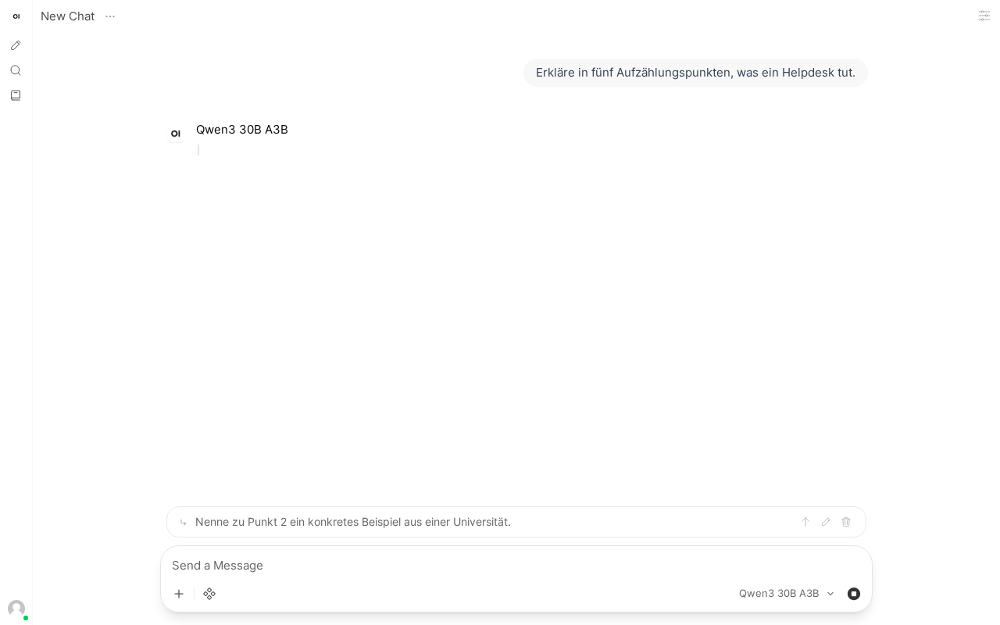

import PageSEO from '@site/src/components/PageSEO';

<PageSEO
  title="KI-Chat (Open WebUI)"
  description="Fragen stellen und mit Texten arbeiten im KI-Chat der Hochschule"
  keywords={["KI-Chat", "Open", "WebUI", "openEduSuite"]}
  suffix="openEduSuite"
  defaultKeywords={["Hochschule", "Open Source"]}
/>

import VideoFallback from '@site/src/components/VideoFallback';

# KI-Chat (Open WebUI)

Der KI-Chat ([Open WebUI](https://ai.openedusuite.org)) verbindet Sie
mit einem großen Sprachmodell: Fragen stellen, Texte schreiben oder
zusammenfassen lassen, Unterstützung bei der Gliederung Ihrer Arbeit.
Melden Sie sich mit Ihrem openEduSuite-Konto aus dem [Portal](/suite/portal) an.

<VideoFallback
  srcMp4="/docmakerai/clips/ai-chat.mp4"
  poster="/docmakerai/clips/ai-chat.png"
  alt="Kurzclip: eine Frage an den KI-Chat stellen und eine Antwort erhalten"
  width="640"
  height="400"
/>

## Eine Frage stellen

1. Öffnen Sie den KI-Chat und melden Sie sich bei Bedarf an
2. Schreiben Sie unten Ihre Frage in das Eingabefeld — die
   Vorschlagskarten können als Einstieg dienen
3. Senden Sie mit `Enter` — die Antwort erscheint, während sie
   geschrieben wird
4. Stellen Sie Rückfragen — der Chat behält den Zusammenhang des
   Gesprächs, wie der Clip oben zeigt

Über dem Eingabefeld sehen Sie, welches Modell antwortet — dort können
Sie ein anderes wählen, falls die Hochschule mehrere anbietet.

## Gut mit der KI arbeiten

- Geben Sie Kontext: wofür der Text ist, für wen, in welcher Sprache
- Bei langen Texten: einfügen und sagen, was geschehen soll
  (zusammenfassen, kürzen, prüfen)
- Prüfen Sie wichtige Aussagen — die KI kann sich bestimmt irren
- Fügen Sie keine vertraulichen oder persönlichen Daten ein, die Sie
  nicht offen teilen würden; fragen Sie im
  [Helpdesk](/suite/helpdesk-create-ticket), wenn Sie unsicher sind,
  was erlaubt ist

## Barrierefreiheit

| Aktion | Taste |
|--------|-------|
| Neuen Chat starten | `Strg+Umschalt+O` |
| Chats durchsuchen | `Strg+K` |
| Zum Eingabefeld bewegen | `Tab` |
| Nachricht senden | `Enter` |

- Der Chat ist eine gewöhnliche Webseite: `Tab` bringt Sie zum
  Eingabefeld, `Enter` sendet die fokussierte Nachricht.
- Verlieren Sie die Orientierung, drücken Sie `Strg+Pos1`, um zum
  Seitenanfang zurückzukehren.

- **Hochkontrast und Dunkelmodus:** Kontrast und dunkle Themes kommen vom
  Betriebssystem oder Browser — Windows `Win+Strg+C`, macOS „Kontrast erhöhen“
  oder eine Browser-Erweiterung wie Dark Reader. Bietet die App ein eigenes
  dunkles Theme, schalten Sie es in den Einstellungen; die oben beschriebene
  Bedienung gilt weiterhin.
