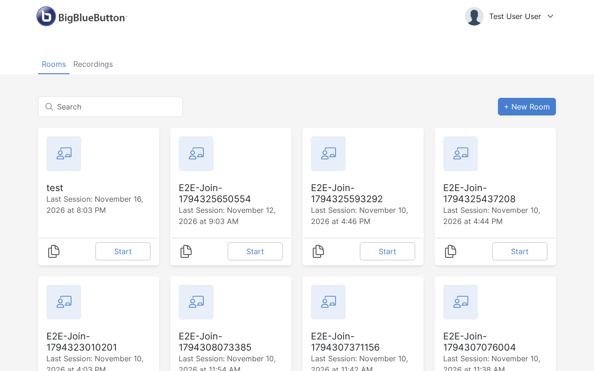

# Videokonferenzen (BigBlueButton)

Die [Konferenzen](https://bbb.openedusuite.org) der openEduSuite
laufen auf [BigBlueButton](https://bigbluebutton.org) mit Greenlight
als Eingang: Ihre persönlichen Konferenzräume, startbereit für
Lehrveranstaltungen, Seminare und Arbeitsbesprechungen — im Browser,
ohne Installation.

## Anmelden

Öffnen Sie die BigBlueButton-Kachel im [Portal](/suite/portal).
BigBlueButton begrüßt Sie auf Deutsch („Willkommen in
BigBlueButton"). Wählen Sie oben rechts **Anmelden** — die
openEduSuite-Anmeldung folgt, und Sie landen in Ihren Räumen.

## Ihre Räume

Die Seite **Rooms** (Räume) ist Ihre Basis: jeder Raum ist ein
ständiger Konferenzraum mit eigenem Link. **+ New Room** (Neuer Raum)
legt einen weiteren an — einen für die Vorlesung, einen für die
Sprechstunde, einen fürs Projekt.

- **Start** öffnet die Live-Sitzung: Mikrofon und Kamera werden beim
  Beitritt erfragt, und das Konferenzfenster bietet Bildschirmfreigabe,
  Chat und ein gemeinsames Whiteboard
- **Recordings** (Aufzeichnungen) bewahrt die mitgeschnittenen
  Sitzungen auf, bereit zum Teilen mit denen, die fehlten

Teilen Sie den Link eines Raums, können Menschen ohne Konto beitreten
— praktisch für Gäste von außerhalb der Hochschule.

## Barrierefreiheit

| Aktion | Taste |
|--------|-------|
| Durch Raumliste und Schaltflächen bewegen | `Tab` |
| Fokussierte Aktion öffnen | `Enter` |

- Greenlights Seiten sind gewöhnliche Web-Elemente: `Tab` bewegt Sie
  durch Räume und Aktionen, `Enter` öffnet die fokussierte.
- In der laufenden Konferenz ist die Tastaturbedienbarkeit begrenzt;
  verlieren Sie dort die Orientierung, verlässt `Escape`
  Vollbild-Ansichten, und außerhalb bringt `Strg+Pos1` Sie zum
  Seitenanfang zurück.
