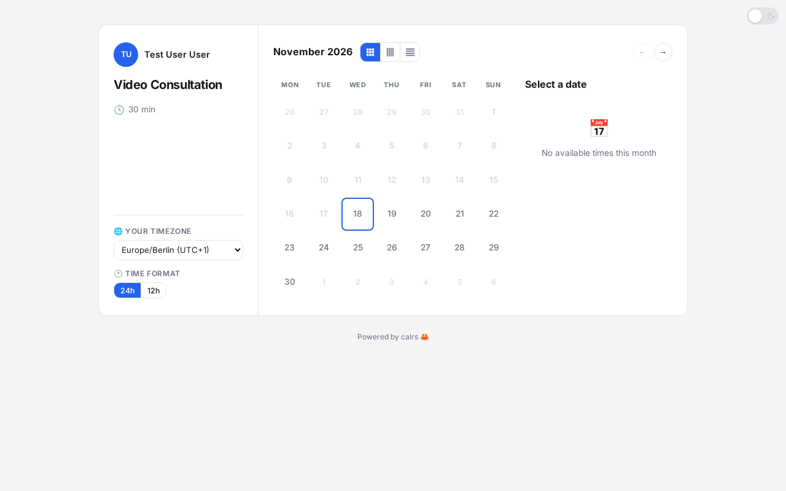

# Terminbuchung (calrs)

[calrs](https://calendar.openedusuite.org) ist der Buchungsdienst der
openEduSuite — „Powered by calrs 🦀", von [cal.rs](https://cal.rs).
Sie erreichen ihn über die Portalkachel **Terminbuchung (calrs)**.
Jedes Mitglied hat eine öffentliche Buchungsseite: Kolleginnen und
Gäste wählen dort einen freien Slot, ganz ohne Konto, und die
Buchung landet im gemeinsamen Buchungskalender, den SOGo spiegelt.



## Einen Termin buchen

Zum Buchen melden Sie sich nicht an. Öffnen Sie die Buchungsseite
der gastgebenden Person — die Adresse folgt dem Muster

```
https://calendar.openedusuite.org/u/<name>/vc
```

wobei `<name>` der Kontoname ist (Punkte werden zu Bindestrichen:
`andreas.simon@…` → `/u/andreas-simon/`). Zwei Buchungstypen stehen
für jedes Mitglied bereit:

- **Video Consultation** (`vc`) — 30 Minuten
- **Test-Termin** (`test`) — 15 Minuten, zum Ausprobieren

Tag wählen, freien Slot wählen, Name und E-Mail eintragen — fertig
ist die Buchung; die Seite bestätigt mit „You're booked".
Bestätigte Buchungen fließen in den gemeinsamen Buchungskalender;
in [SOGo](/sogo6/sogo-calendar-views) sehen Sie
sie über den abonnierten Buchungskalender eintreffen.

## Ihre eigene Buchungsseite

Melden Sie sich mit **Sign in with SSO** und Ihrem
openEduSuite-Konto an. Das Dashboard öffnet mit **Overview**,
**Event Types**, **Bookings** und **Teams**:


- **Event Types** — Ihre buchbaren Terminarten: Titel, Dauer und
  Beschreibung. Die beiden aus der Suite-Einrichtung gehören Ihnen —
  behalten oder bearbeiten Sie sie.
- **Bookings** — was andere bei Ihnen gebucht haben, Kommendes
  zuerst.
- **Teams** — buchbare Arten für mehrere Personen gemeinsam
  (Round-Robin), für Servicestellen und Sprechstunden.

Ihre eigene Seite liegt unter `/u/<ihr name>/vc` — setzen Sie den
Link in die E-Mail-Signatur oder ins [Wiki](/suite/xwiki), und
Leute buchen Sie ohne einen einzigen Terminfindungs-Thread.

## Buchungen und SOGo

calrs steuert den Buchungsablauf; der Kalender darunter spricht
CalDAV. Der gemeinsame Buchungskalender ist dieselbe Sammlung, die
SOGo spiegelt — ein gebuchter Slot blockiert die Zeit also auch in
[SOGo-Kalenderansicht](/sogo6/sogo-calendar-views), und Frei/Beschäftigt
bleibt in beide Richtungen ehrlich.

## Barrierefreiheit

| Aktion | Taste |
|--------|-------|
| Durch Tage, Slots und das Buchungsformular bewegen | `Tab` |
| Fokussiertes Element öffnen oder wählen | `Enter` |

- Die Buchungsseite ist eine schlichte Seite in Lesereihenfolge:
  Tageswahl, Slotliste, dann das Formular für Name und E-Mail —
  `Tab` führt Sie hindurch, `Enter` wählt.
- Das Dashboard nutzt gewöhnliche Links und Tabellen; `Escape`
  schließt Dialoge. `Strg+Pos1` bringt Sie zum Seitenanfang zurück.
