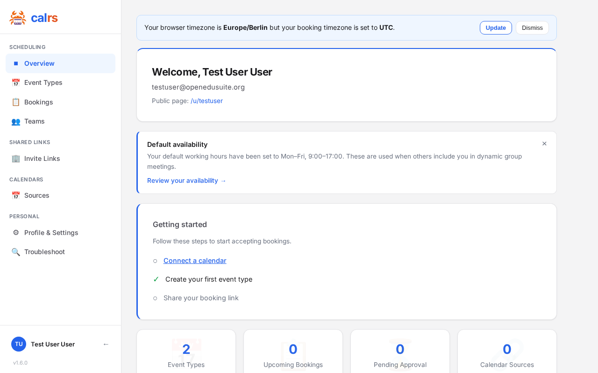

import PageSEO from '@site/src/components/PageSEO';

<PageSEO
  title="Terminbuchung (calrs)"
  description="Terminbuchung für alle — Slot auf der Buchungsseite wählen, ganz ohne Konto"
  keywords={["Terminbuchung", "calrs", "openEduSuite"]}
  suffix="openEduSuite"
  defaultKeywords={["Hochschule", "Open Source"]}
/>


# Terminbuchung (calrs)

[calrs](https://calendar.openedusuite.org) ist der Buchungsdienst der
openEduSuite — „Powered by calrs", sagt die Fußzeile jeder Seite —
von [cal.rs](https://cal.rs). Sie erreichen ihn über die Portalkachel
**Terminbuchung (calrs)**. Jedes Mitglied hat eine öffentliche
Buchungsseite: Kolleginnen und Gäste wählen dort einen freien Slot,
ganz ohne Konto.


## Einen Termin buchen

Zum Buchen melden Sie sich nicht an. Öffnen Sie die Buchungsseite
der gastgebenden Person — die Adresse folgt dem Muster

```
https://calendar.openedusuite.org/u/<name>/vc
```

wobei `<name>` der Kontoname ist (Punkte werden zu Bindestrichen:
`andreas.simon@…` → `/u/andreas-simon/`). Zwei Terminarten stehen
für jedes Mitglied bereit:

- **Video Consultation** (`vc`) — 30 Minuten
- **Test-Termin** (`test`) — 15 Minuten, zum Ausprobieren

Die Seite zeigt den Namen der gastgebenden Person, die Terminart
mit ihrer Dauer, eine Zeitzonenwahl und einen Monatskalender:
Tag wählen, freien Slot wählen, Name und E-Mail eintragen,
bestätigen. Freie Slots erscheinen erst, wenn die gastgebende
Person einen Kalender verbunden hat (siehe **Sources** unten).

## Ihre eigene Buchungsseite

Wählen Sie auf der Anmeldeseite **Sign in with SSO** und melden Sie
sich im [Portal](/suite/portal) mit Ihrem openEduSuite-Konto an. Das Dashboard öffnet sich:
Die Seitenleiste gruppiert **Overview**, **Event Types**,
**Bookings** und **Teams** unter Scheduling, gefolgt von
**Invite Links**, **Sources**, **Profile & Settings** und
**Troubleshoot**.



- **Overview** — die Adresse Ihrer öffentlichen Seite, eine
  Checkliste für den Einstieg (Kalender verbinden, erste Terminart
  anlegen, Buchungslink teilen) und Zähler für Terminarten,
  anstehende Buchungen, ausstehende Bestätigungen und
  Kalenderquellen.
- **Event Types** — Ihre buchbaren Terminarten, jede mit Dauer und
  öffentlichem Link aufgelistet, dazu **+ New** für eine weitere.
  Das Bearbeitungsformular umfasst Titel, Slug, Beschreibung, Ort,
  Dauer, Slot-Intervall und Verfügbarkeitszeiten je Wochentag.
- **Bookings** — was andere bei Ihnen gebucht haben, Kommendes
  zuerst.
- **Teams** — Terminarten, die mehrere Personen gemeinsam buchbar
  machen; Teams werden von Administratorinnen und Administratoren
  angelegt, die Sie als Mitglied aufnehmen.
- **Invite Links** — Einmal-Buchungslinks für interne Terminarten,
  für bestimmte Kontakte — niemand sonst kann buchen.
- **Sources** — die CalDAV-Anbindung: Wählen Sie einen Anbieter
  (SOGo, Nextcloud, Zimbra und weitere), und calrs prüft diesen
  Kalender, bevor ein Slot angeboten wird.
- **Troubleshoot** — eine Tagesansicht, die Stunde für Stunde
  zeigt, warum ein Slot frei oder blockiert ist: Kalendereintrag,
  Buchung, außerhalb der Zeiten, Puffer oder Vorlaufzeit.

Unter **Profile & Settings** stellen Sie Anzeigename, Kontonamen
(der Teil nach `/u/` in Ihrer Buchungs-URL), Titel und Kurztext
für die öffentliche Seite, Buchungs-E-Mail, Zeitzone und Ihre
Standard-Arbeitszeiten ein. Ihre eigene Seite liegt unter
`/u/<ihr name>/vc` — setzen Sie den Link in die E-Mail-Signatur
oder ins [Wiki](/suite/xwiki), und Leute buchen Sie ohne einen
einzigen Terminfindungs-Thread.

## Buchungen und SOGo

calrs steuert den Buchungsablauf; der Kalender darunter spricht
CalDAV. Die Anbieterliste unter **Sources** enthält auch SOGo
selbst: Verbinden Sie Ihren SOGo-Kalender, prüft calrs ihn, bevor
ein Slot angeboten wird — ein gebuchter Slot blockiert die Zeit
also auch in der [SOGo-Kalenderansicht](/sogo6/sogo-calendar-views),
und Frei/Beschäftigt bleibt in beide Richtungen ehrlich.

Bleibt Ihnen der Dienst verschlossen, erreicht das
[Helpdesk](/suite/helpdesk-create-ticket) seine Betreiber.

## Barrierefreiheit

| Aktion | Taste |
|--------|-------|
| Durch Tage, Slots und das Buchungsformular bewegen | `Tab` |
| Fokussiertes Element öffnen oder wählen | `Enter` |

- Die Buchungsseite ist eine schlichte Seite in Lesereihenfolge:
  Monatskalender, Slotliste, dann das Formular für Name und
  E-Mail — `Tab` führt Sie hindurch, `Enter` wählt.
- Das Dashboard nutzt gewöhnliche Links und Tabellen; `Escape`
  schließt Dialoge. `Strg+Pos1` bringt Sie zum Seitenanfang zurück.

- **Hochkontrast und Dunkelmodus:** Kontrast und dunkle Themes kommen vom
  Betriebssystem oder Browser — Windows `Win+Strg+C`, macOS „Kontrast erhöhen“
  oder eine Browser-Erweiterung wie Dark Reader. Bietet die App ein eigenes
  dunkles Theme, schalten Sie es in den Einstellungen; die oben beschriebene
  Bedienung gilt weiterhin.
