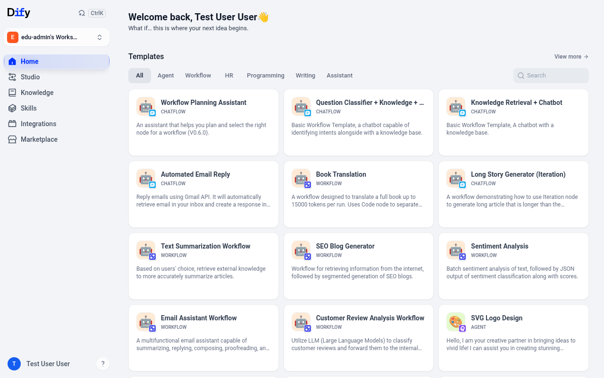

import VideoFallback from '@site/src/components/VideoFallback';

# Eigene KI-Assistenten bauen (Dify)

[Dify](https://dify.openedusuite.org) ist der Low-Code-Baukasten für
KI-Anwendungen: eigene Assistenten, Chatbots und kleine Workflows um
die Sprachmodelle der Hochschule bauen — ohne Programmierung. Während
der [KI-Chat](/suite/ai-chat) ein fertiges Gespräch ist, formen Sie in
Dify Ihr eigenes.

<VideoFallback
  srcMp4="/docmakerai/clips/dify-home.mp4"
  poster="/docmakerai/clips/dify-home.png"
  alt="Kurzclip: die Dify-Startseite mit Vorlagen und Navigation"
  width="640"
  height="400"
/>

## Die Übersicht

Nach der Anmeldung mit Ihrem openEduSuite-Konto sehen Sie **Home** mit
Begrüßung und **Templates** (Vorlagen) — fertige Ausgangspunkte für
Agenten, Workflows und Assistenten, nach Einsatzzweck sortiert (zum
Beispiel *Agent*, *Workflow*, *Writing*, *Assistant*).

Die Navigation führt zu den Bausteinen:

- **Studio** — Ihre Apps; jeder Assistent, den Sie bauen, lebt hier
- **Knowledge** (Wissen) — Dokumentsammlungen, aus denen Ihre
  Assistenten antworten können
- **Skills** (Fertigkeiten) — wiederverwendbare Fähigkeiten, die Ihre
  Apps aufrufen können
- **Integrations** — Verbindungen zu anderen Diensten
- **Marketplace** — Erweiterungen und Inhalte aus der Community

## Einen ersten Assistenten bauen

Starten Sie mit einer Vorlage, die zu Ihrem Ziel passt: Öffnen Sie sie
über **Home**, folgen Sie dem Einrichtungsdialog und passen Sie den
Prompt an — die Anweisungen, die dem Assistenten Rolle und Regeln
vorgeben. Ergänzen Sie Dokumente unter **Knowledge**, wenn der
Assistent aus Ihrem Material antworten soll, und testen Sie das
Ergebnis in der Vorschau, bevor Sie es weitergeben.

Arbeiten Sie im gemeinsamen Workspace, sieht dort jeder die Apps —
stimmen Sie sich vor dem Veröffentlichen ab und fragen Sie im
[Helpdesk](/suite/helpdesk-create-ticket), wenn Sie unsicher sind, was
dorthin gehört.

## Barrierefreiheit

| Aktion | Taste |
|--------|-------|
| Durch Navigation und Vorlagen bewegen | `Tab` |
| Fokussiertes Element öffnen | `Enter` |

- Die Seiten sind gewöhnliche Web-Elemente: `Tab` bewegt Sie durch
  Navigation, Vorlagen und Listen, `Enter` öffnet das fokussierte
  Element.
- Verlieren Sie die Orientierung, drücken Sie `Strg+Pos1`, um zum
  Seitenanfang zurückzukehren.
