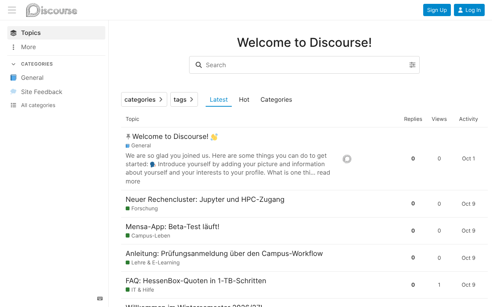

import PageSEO from '@site/src/components/PageSEO';

<PageSEO
  title="Forum (Discourse)"
  description="Der Treffpunkt der Suite — mit Ihrem Konto anmelden zum Lesen und Schreiben"
  keywords={["Forum", "Discourse", "openEduSuite"]}
  suffix="openEduSuite"
  defaultKeywords={["Hochschule", "Open Source"]}
/>

# Forum (Discourse)

[Discourse](https://discourse.openedusuite.org) ist das Forum der
openEduSuite — Fragen, Ankündigungen und Diskussionen in Threads.
Es liegt hinter dem Suite-Login: Die Kachel öffnet eine
Gate-Seite mit **Sign in with OpenID Connect**, die Sie mit Ihrem
openEduSuite-Konto anmeldet. Erst danach laden das Forum und
seine Inhalte.

- **Kategorien** bündeln die Threads nach Thema; die
  Kategorieliste zeigt jede Kategorie mit ihrer Themenzahl und
  der jüngsten Aktivität. Das Forum startet mit **General** und
  **Site Feedback** und enthält Themenbereiche wie **Forschung**,
  **Campus-Leben**, **Lehre & E-Learning**, **IT & Hilfe** und
  **Neuigkeiten**.
- **Themen (Topics)** sind die Threads selbst — neuester Beitrag
  zuerst, Antworten darunter eingebettet.
- Die Startseite listet **All latest topics** mit den sortierbaren
  Spalten Thema, Poster, Antworten, Aufrufe und Aktivität sowie
  den Ansichten **Latest**, **Hot** und **Categories**; das Menü
  **More** enthält Users, About, Guidelines, Groups und Badges.

## Schreiben

Der Suite-SSO (die Schaltfläche **Sign in with OpenID Connect**
am Gate) führt Sie ins Forum und lässt Sie alles lesen. Um selbst
zu schreiben, melden Sie sich zusätzlich im Forum an: Die
Schaltfläche **Log In** in der Kopfzeile öffnet einen Dialog für
Ihre E-Mail-Adresse oder Ihren Benutzernamen samt Passwort — oder
einen per E-Mail zugesandten Einmalcode bzw. einen Passkey —,
während **Sign Up** nach Ihrer E-Mail-Adresse fragt und dort
einen Bestätigungscode hinschickt. Nach der Anmeldung aus dem
[Portal](/suite/portal) öffnen Sie
ein Thema und antworten mit der Schaltfläche **Reply** unter dem
letzten Beitrag.

Bleibt Ihnen der Dienst verschlossen, erreicht das
[Helpdesk](/suite/helpdesk-create-ticket) seine Betreiber.

## Barrierefreiheit

| Aktion | Taste |
|--------|-------|
| Durch Kategorien, Themen und Schaltflächen bewegen | `Tab` |
| Fokussiertes Thema oder Schaltfläche öffnen | `Enter` |

- Das Forum ist eine gewöhnliche Website in Lesereihenfolge:
  Kategorieliste, Themenliste, dann die Schaltflächen — `Tab`
  führt hindurch, `Enter` öffnet.
- `Strg+Pos1` bringt Sie zum Seitenanfang zurück.

- **Hochkontrast und Dunkelmodus:** Kontrast und dunkle Themes kommen vom
  Betriebssystem oder Browser — Windows `Win+Strg+C`, macOS „Kontrast erhöhen“
  oder eine Browser-Erweiterung wie Dark Reader. Bietet die App ein eigenes
  dunkles Theme, schalten Sie es in den Einstellungen; die oben beschriebene
  Bedienung gilt weiterhin.
