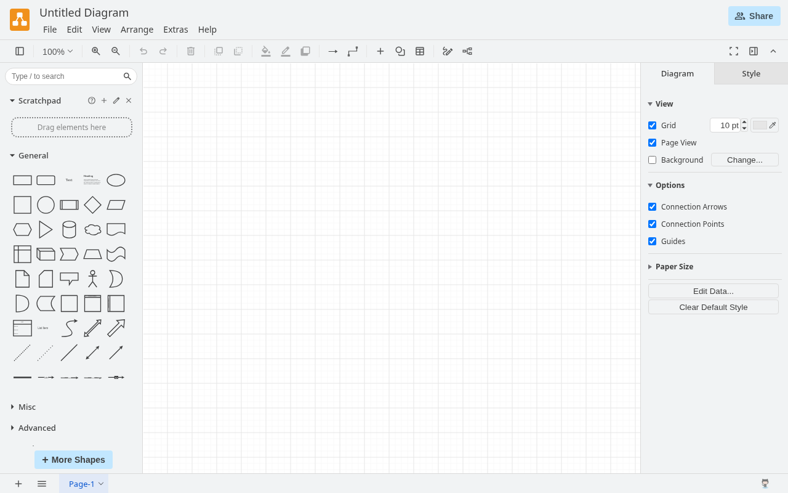

import PageSEO from '@site/src/components/PageSEO';

<PageSEO
  title="Diagramme (draw.io)"
  description="Diagramme und Abläufe im Browser zeichnen"
  keywords={["Diagramme", "draw.io", "openEduSuite"]}
  suffix="openEduSuite"
  defaultKeywords={["Hochschule", "Open Source"]}
/>

# Diagramme (draw.io)

[draw.io](https://drawio.openedusuite.org) ist das
Diagramm-Werkzeug der openEduSuite — Flussdiagramme,
Netzwerkpläne, Organigramme, UML. Die [Portal](/suite/portal)kachel
**Diagramme (draw.io)** und das Suite-Konto öffnen den Editor nach
einer einmaligen Anmeldung: ein unbenanntes Diagramm auf der
Zeichenfläche, bereit zum Zeichnen.

- **File | Edit | View | Arrange | Extras | Help | Share** — die
  Menüleiste. Jede Form liegt im Formen-Bereich links (General,
  Basic, Arrows, Flowchart, Entity Relation, UML und mehr;
  **More Shapes** lädt weitere Bibliotheken), die Zeichnung auf
  der Fläche. Leere Fläche zeigt den Hinweis „Drag elements
  here", die aktuelle Seite liegt im Reiter **Page-1** unten.
- Über **File → Save as** (das einfache **File → Save** darunter
  öffnet denselben Dialog) sichern Sie Ihre Arbeit als Datei:
  **XML File (.drawio)**, editierbares **PNG**, editierbares
  **SVG** oder **HTML** — auf dem **Device**, im **Browser** oder
  als **Download**. Legen Sie die Datei in Ihren
  [OpenCloud](/suite/files)-Ordner, um sie beim Rest Ihrer
  Suite-Arbeit zu haben.
- **Extras** bündelt die Werkzeugeinstellungen: **Theme**,
  **Language**, **Mathematical Typesetting**, die Diagrammsprache
  unter **Diagram Language**, den Diagramm-Editor unter
  **Edit Diagram** und mehr. **Help** hält **Keyboard Shortcuts**,
  ein **Quick Start Video** und **Support** bereit.
- **Share** öffnet einen Hinweis: Teilen ist für Google-Drive-
  und OneDrive-Dateien verfügbar — ein lokal gesichertes Diagramm
  bleibt, wo Sie es gesichert haben.

## draw.io, Excalidraw oder Grist

- **[Excalidraw](/suite/excalidraw)** — schnelle Skizzen mit
  handgezeichnetem Look; draw.io für präzise, formale Diagramme.
- **[Grist](/suite/grist)** — wenn das „Diagramm" eigentlich
  Daten sind: Beziehungen gehören in Tabellen.

Bleibt Ihnen der Dienst verschlossen, erreicht das
[Helpdesk](/suite/helpdesk-create-ticket) seine Betreiber.

## Barrierefreiheit

| Aktion | Taste |
|--------|-------|
| Durch Menüs und Leisten bewegen | `Tab` |
| Fokussiertes Menüelement öffnen | `Enter` |
| Offene Menüs schließen | `Escape` |

- Der Editor ist eine Canvas-Anwendung; Menüleiste und Leisten
  sind per `Tab` erreichbar, die Zeichenfläche selbst wird mit der
  Maus bearbeitet.
- `Strg+Pos1` bringt Sie zum Seitenanfang zurück.

- **Hochkontrast und Dunkelmodus:** Kontrast und dunkle Themes kommen vom
  Betriebssystem oder Browser — Windows `Win+Strg+C`, macOS „Kontrast erhöhen“
  oder eine Browser-Erweiterung wie Dark Reader. Bietet die App ein eigenes
  dunkles Theme, schalten Sie es in den Einstellungen; die oben beschriebene
  Bedienung gilt weiterhin.
