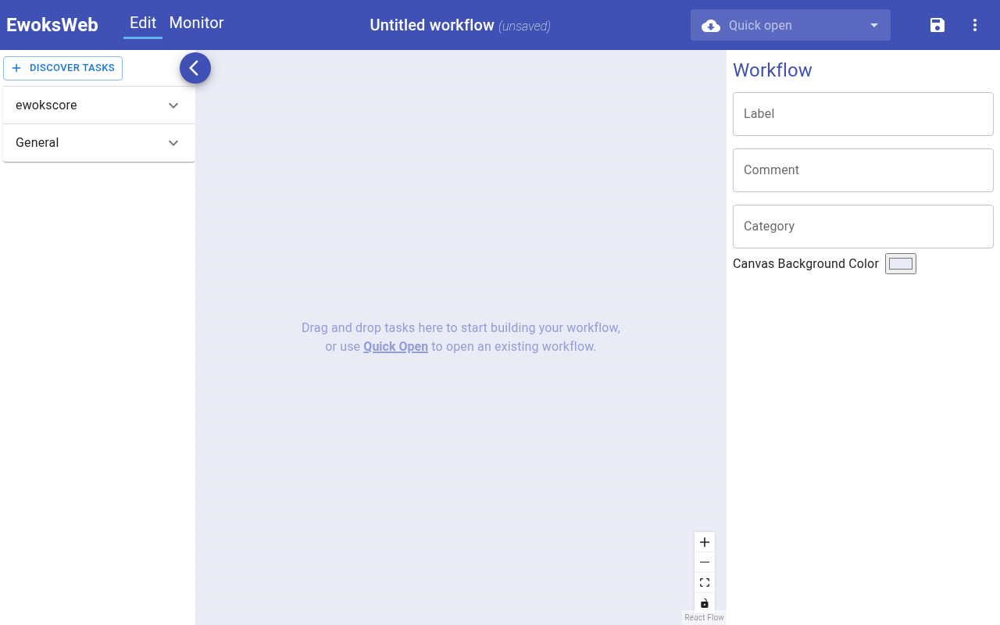

# Workflows (EWOKS)

[EWOKS](https://ewoks.openedusuite.org) ist der Workflow-Editor der
openEduSuite, aufbauend auf dem Workflow-System
[ewoks](https://ewoks.readthedocs.io) des ESRF. Die Anmeldung läuft
über die Portalkachel **Workflows (EWOKS)** und SSO — der Editor
öffnet direkt.

Die Seite bietet zwei Ansichten, oben umschaltbar:

- **Edit** — einen Workflow als Graphen zusammenbauen: Aufgaben
  (Tasks) sind Knoten, Verbindungen tragen die Daten von einer
  Aufgabe zur nächsten. Der Bereich **DISCOVER TASKS** listet
  verfügbare Task-Pakete (etwa `ewokscore`); ziehen Sie Aufgaben in
  die Fläche und verbinden Sie sie.
- **Monitor** — einen laufenden Workflow verfolgen: welcher Knoten
  gerade ausgeführt wird, welche fertig sind, wo die Ausführung
  stehen blieb.

## Wann EWOKS — und wann nicht

- **Ja** — wiederkehrende, mehrstufige Datenverarbeitung: „wenn
  neue Daten ankommen, führe diese Schritte in dieser Reihenfolge
  aus" — reproduzierbar und beobachtbar statt ein Haufen Skripte.
- **Nein** — einmalige Ad-hoc-Auswertung (dafür passt ein
  Arbeitsbereich in [OpenScience](/suite/openscience)) oder
  simple Automatisierungen zwischen Suite-Diensten — das ist
  Terrain von [n8n](/suite/n8n).

EWOKS-Auswertungen laufen oft in den Arbeitsbereichen von
[OpenScience](/suite/openscience); beide Kacheln nutzen dasselbe
SSO-Konto.

## Barrierefreiheit

| Aktion | Taste |
|--------|-------|
| Durch Editor-Elemente und Links bewegen | `Tab` |
| Fokussiertes Element öffnen | `Enter` |

- Der Editor ist eine Canvas-Anwendung; Tastaturpfade durch den
  Graphen sind begrenzt — Edit/Monitor-Umschalter und Task-Liste
  sind per `Tab` erreichbar.
- `Strg+Pos1` springt zum Seitenanfang zurück.
