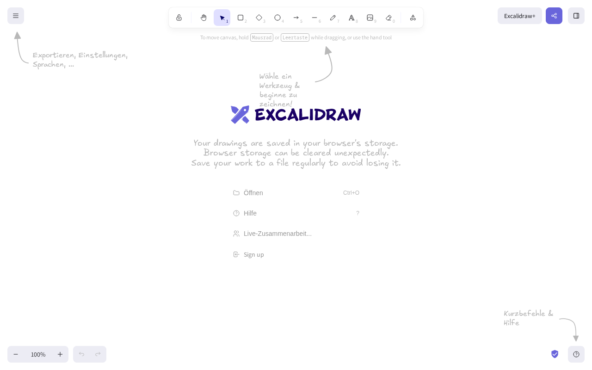

# Whiteboard (Excalidraw)

[Excalidraw](https://excalidraw.openedusuite.org) ist das
Whiteboard der openEduSuite — Ideen, Strukturen und Abläufe
skizzieren, im handgezeichneten Look, der zum Iterieren einlädt
statt zum Perfektionieren. Die Portalkachel
**Whiteboard (Excalidraw)** und das Suite-Konto öffnen das Board direkt.

- **Öffnen** (`Strg+O`) lädt eine frühere Zeichnung; die
  Werkzeugleiste hält Rechtecke, Pfeile, Text und den Stift.
- Das Board speichert im **Browser-Speicher** — die App sagt es
  selbst: Browserspeicher kann unerwartet geleert werden. Sichern
  Sie Ihre Arbeit regelmäßig als Datei und bewahren
  Sie sie in [OpenCloud](/suite/files) oder
  [Nextcloud](/suite/nextcloud) auf.
- **Hilfe** öffnet die Excalidraw-Dokumentation mit der
  vollständigen Tastenkürzelliste.

## Excalidraw oder draw.io

- **[draw.io](/suite/drawio)** — formale Diagramme: UML,
  Netzwerkpläne, Organigramme.
- **Excalidraw** — lautes Denken: Workshops, Entwürfe, schnelle
  Erklärungen.

## Barrierefreiheit

| Aktion | Taste |
|--------|-------|
| Durch Werkzeugleiste und Dialoge bewegen | `Tab` |
| Fokussiertes Element öffnen | `Enter` |

- Die Zeichenfläche selbst wird mit der Maus bearbeitet;
  Werkzeugleiste, Dialoge und Hilfe sind per `Tab` erreichbar.
- `Strg+Pos1` bringt Sie zum Seitenanfang zurück.
