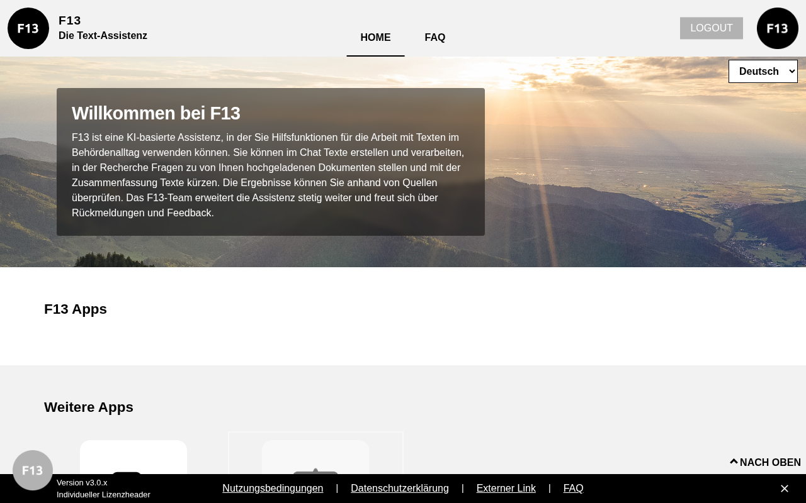

import PageSEO from '@site/src/components/PageSEO';

<PageSEO
  title="Text-Assistenz (F13)"
  description="KI für Behördentexte — entwerfen, recherchieren, zusammenfassen mit Quellenprüfung"
  keywords={["Text-Assistenz", "F13", "openEduSuite"]}
  suffix="openEduSuite"
  defaultKeywords={["Hochschule", "Open Source"]}
/>

# Text-Assistenz (F13)

[F13](https://f13.openedusuite.org), „die Text-Assistenz", ist
KI-Hilfe für die alltägliche Textarbeit: Schreiben von Briefen,
Fragen an eigene Dokumente und Kürzen langer Texte — mit Quellen,
die Sie prüfen können. Es läuft in der openEduSuite, unter eigenen
Nutzungsbedingungen.

## Anmelden — und die Einverständnis-Stufe

Melden Sie sich mit Ihrem openEduSuite-Konto aus dem [Portal](/suite/portal) an. Beim ersten
Eintreten bittet F13 um Ihr Einverständnis: Lesen Sie die
**Nutzungsbedingungen** und die **Datenschutzerklärung**, und wählen
Sie dann **Einverstanden**. **Ablehnen und Seite verlassen** führt
Sie wieder hinaus — die Wahl bleibt Ihre: Die Stufe erscheint
wieder, bis Sie zustimmen.

## Was F13 tut

Die Startseite nennt die Kern-Apps, und das Team ergänzt laufend:

- **Chat** — Texte erstellen und verarbeiten: Entwürfe, Antworten,
  Überarbeitungen
- **Recherche** — Dokumente hochladen und Fragen dazu stellen
- **Zusammenfassung** — lange Texte auf ihren Kern kürzen

Ergebnisse kommen mit Quellen, damit Sie nachprüfen können, was die
Assistenz Ihnen sagt — der ehrliche Weg, KI im Amtlichen zu nutzen.
**FAQ** beantwortet häufige Fragen; die Sprachwahl
(**Deutsch / English**) steht oben.

## F13 und Open WebUI

Beide chatten mit KI. F13 ist die getunte Spezialistin für die
behördliche Textarbeit mit eigenen Apps und Quellenprüfung;
Open WebUI ist die allgemeine Werkstatt, in der Sie jedes Modell für
jede Aufgabe wählen.

Bleibt Ihnen der Dienst verschlossen, erreicht das
[Helpdesk](/suite/helpdesk-create-ticket) seine Betreiber.

## Barrierefreiheit

| Aktion | Taste |
|--------|-------|
| Durch Navigation und Schaltflächen bewegen | `Tab` |
| Fokussierte App oder Link öffnen | `Enter` |

- F13s Seiten sind gewöhnliche Web-Elemente: `Tab` bewegt Sie durch
  Navigation, die Apps und die Einverständnis-Schaltflächen;
  `Enter` aktiviert die fokussierte.
- **NACH OBEN** ist ein seitenweiter Kurzbefehl zurück zum
  Seitenanfang; `Escape` schließt Überlagerungen.

- **Hochkontrast und Dunkelmodus:** Kontrast und dunkle Themes kommen vom
  Betriebssystem oder Browser — Windows `Win+Strg+C`, macOS „Kontrast erhöhen“
  oder eine Browser-Erweiterung wie Dark Reader. Bietet die App ein eigenes
  dunkles Theme, schalten Sie es in den Einstellungen; die oben beschriebene
  Bedienung gilt weiterhin.

- **Orientierung:** verlieren Sie Ihren Platz, drücken Sie `Strg+Pos1`, um zum
  Seitenanfang zurückzukehren und von dort weiterzunavigieren.
