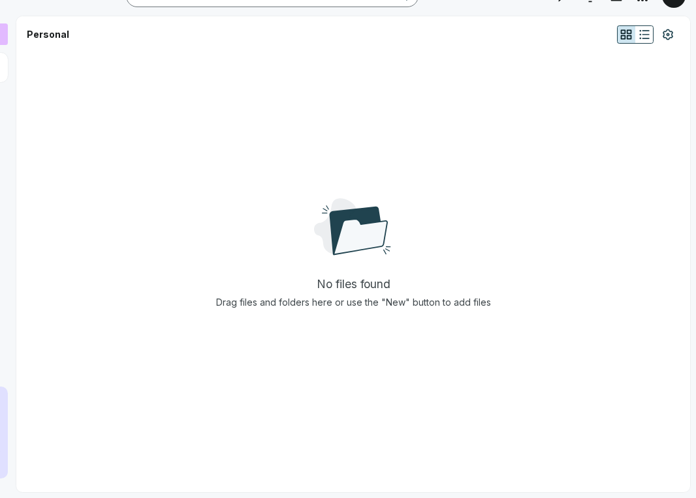
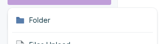
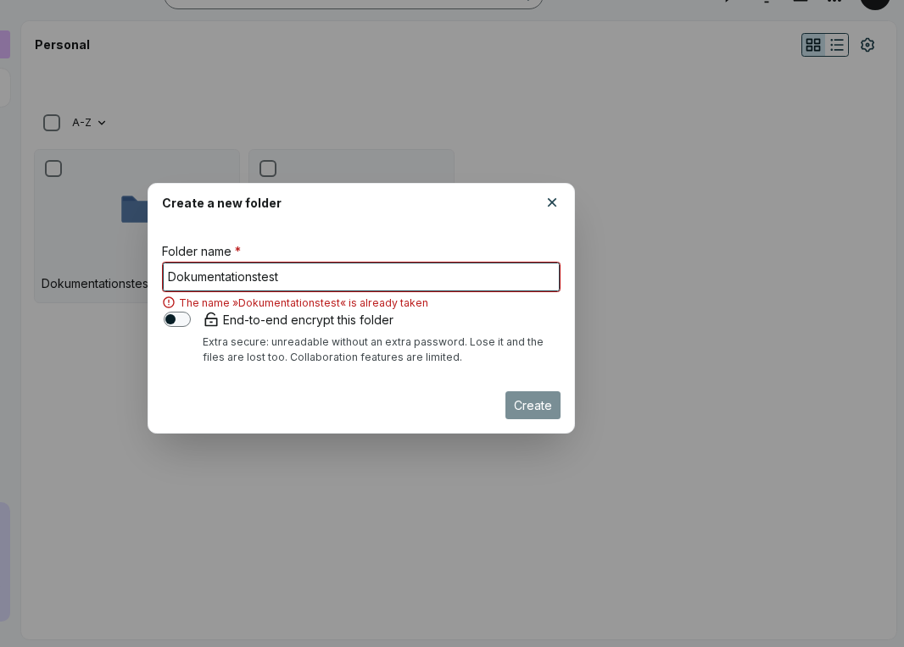
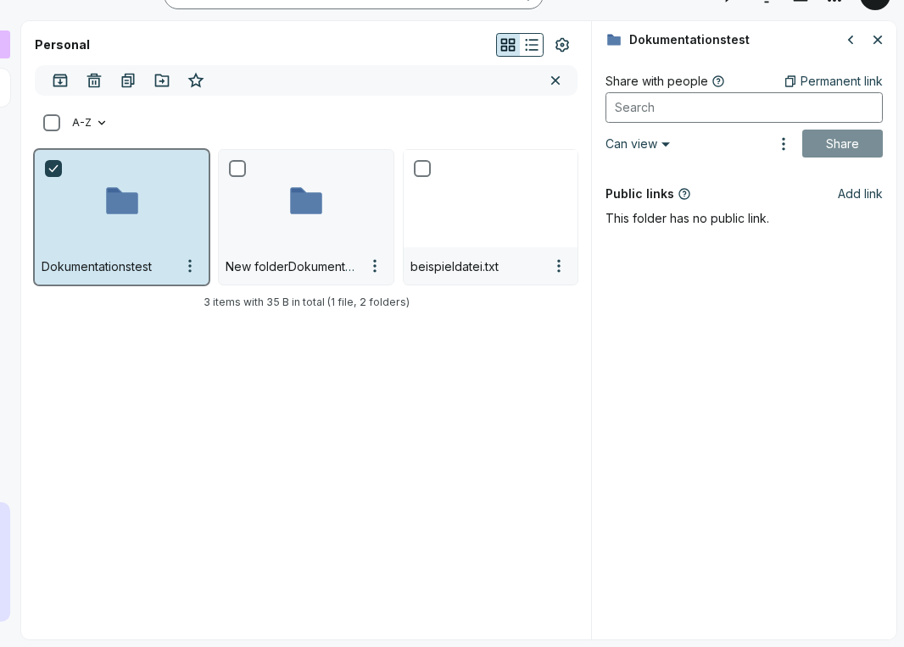
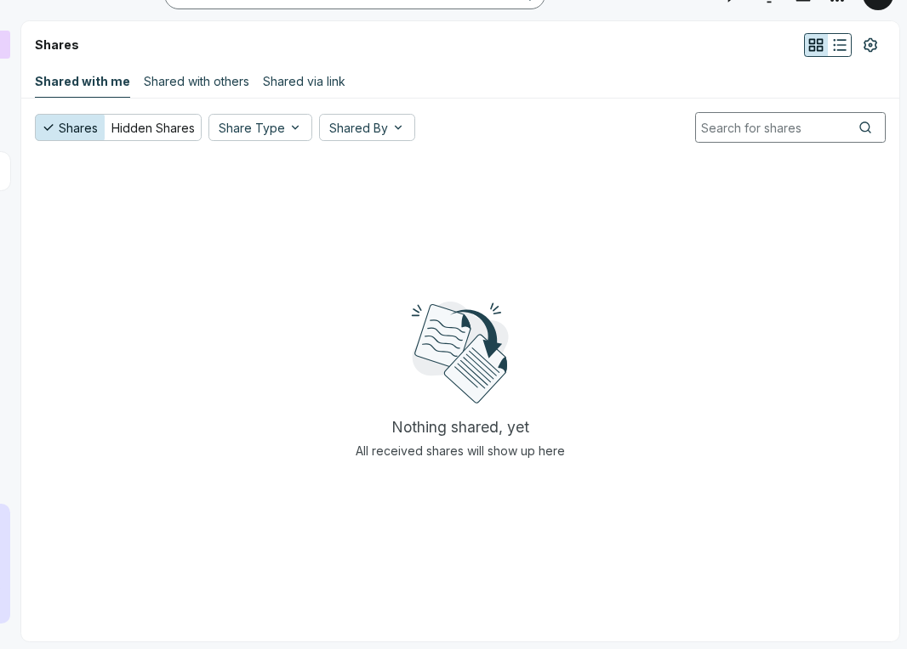

import VideoFallback from '@site/src/components/VideoFallback';

# Dateien mit OpenCloud

[OpenCloud](https://cloud.openedusuite.org) ist Ihr Dateispeicher in
der openEduSuite: Dokumente, Bilder und Ordner im persönlichen Bereich
ablegen, mit anderen teilen und von überall erreichen. Öffnen Sie es
über die Kachel **OpenCloud** im [Portal](/suite/portal) oder direkt —
die Anmeldung funktioniert mit Ihrem openEduSuite-Konto.

## Ihr persönlicher Bereich

Nach der Anmeldung landen Sie in Ihrem persönlichen Bereich: die Ansicht
**All files** (Alle Dateien) zeigt Ihre Dateien und Ordner.

Die Navigation bietet:

- **Personal** (Persönlich) — Ihre eigenen Dateien, mit **All files**,
  **Favorites** (Favoriten) und **Deleted files** (Gelöschte Dateien)
- **Shares** (Freigaben) — mit Ihnen geteilte und von Ihnen geteilte
  Dateien
- **Spaces** (Bereiche) — gemeinsame Flächen für Teams und Projekte

## Dateien hinzufügen

Wählen Sie **New** (Neu), um zu erstellen oder hochzuladen:

- **Folder** (Ordner) — ein neuer Ordner: der Dialog fragt nach dem
  **Folder name** (Ordnernamen), mit **Create** (Erstellen) landet der
  Ordner in **All files**
- **Files Upload** — eine oder mehrere Dateien von Ihrem Rechner
  hochladen
- **Folder Upload** — einen ganzen Ordner hochladen
- **Note**, **Markdown file**, **Shortcut** — direkt in der Cloud
  anlegen

**Files Upload** öffnet die Dateiauswahl Ihres Rechners: Wählen Sie
eine oder mehrere Dateien, sie landen in **All files**.

<VideoFallback
  srcMp4="/docmakerai/clips/cloud-create-folder.mp4"
  poster="/docmakerai/clips/cloud-create-folder.png"
  alt="Kurzclip: einen neuen Ordner anlegen — New-Menü, Ordnername, Erstellen"
  width="640"
  height="400"
/>

## Mit Dateien arbeiten

Wählen Sie eine Datei oder einen Ordner — mit Rechtsklick oder über
das **⋯**-Menü am Ende der Zeile — und die Aktionen erscheinen über
der Tabelle: **Download**, **Delete** (Löschen), **Copy to**
(Kopieren nach), **Move to** (Verschieben nach), **Add to favorites**
(Zu Favoriten). Das Zeilenmenü selbst bietet **Open** (Öffnen),
**Share** (Teilen), **Copy permanent link** (Permanenter Link) und
mehr.

### Teilen

Wählen Sie **Share**, öffnet sich das Teilen-Fenster neben der Datei:

- **Share with people** (Mit Personen teilen) — Menschen direkt
  einladen; mit **Can view** (Kann ansehen) können sie hineinschauen,
  weitere Rollen stehen bereit, sobald Ihre Hochschule sie freigibt
- **Permanent link** — ein stabiler Link genau zu dieser Datei zum
  Kopieren
- **Public links** (Öffentliche Links) — einen Link hinzufügen, den
  jeder damit Kenntliche nutzen kann (**Add link**); ohne Link sagt es
  das Fenster klar („This folder has no public link.")

## Freigaben

Unter **Shares** finden Sie alles Geteilte:

- **Shared with me** — Dateien und Ordner, die Kolleginnen und Kollegen
  mit Ihnen geteilt haben
- **Shared with others** — was Sie geteilt haben
- **Shared via link** — Ihre Freigabelinks

Gelöschte Dateien landen zuerst in **Deleted files** — von dort lassen
sie sich wiederherstellen oder endgültig entfernen.

## Barrierefreiheit

| Aktion | Taste |
|--------|-------|
| Durch die Dateiliste und Schaltflächen bewegen | `Tab` |
| Fokussierte Datei oder Menüeintrag öffnen | `Enter` |
| New-Menü öffnen | `Enter` auf der Schaltfläche New |

- Die Dateiansicht ist eine gewöhnliche Web-Liste: `Tab` bewegt Sie
  durch Dateien und Schaltflächen, `Enter` öffnet das fokussierte
  Element.
- Verlieren Sie die Orientierung, drücken Sie `Strg+Pos1`, um zum
  Seitenanfang zurückzukehren.
