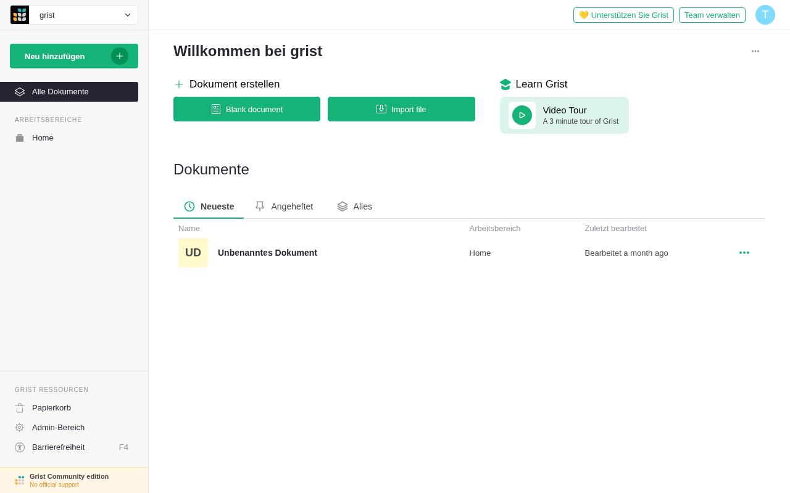

# Formulare und Tabellen (Grist)

Die [Datenerfassung](https://grist.openedusuite.org) der
openEduSuite läuft auf [Grist](https://getgrist.com) —
Tabellenkalkulationen, die zu Datenbanken heranwachsen, ohne eine
Zeile Code. Formulare füllen Tabellen, Tabellen werden Dokumente,
und alles bleibt in Ihrer Hand: „souveräne Erfassung", wie es auf
der Startseite heißt.

## Anmelden

Grist meldet Sie mit Ihrem openEduSuite-Konto an. Ihre Startseite
listet **Alle Dokumente**, organisiert in Arbeitsbereichen — **Home**
zum Anfang —, mit **Papierkorb** für Entferntes und einem
**Admin-Bereich** für die Team-Verwaltung.

## Ein Dokument beginnen

**Neu hinzufügen** legt das Nächste an: ein Dokument, leer oder aus
einer Vorlage. Im Dokument arbeitet Grist zuerst wie eine
Tabellenkalkulation — Spalten, Zellen, Formeln —, aber jede Seite
kann zur Kartenansicht, zum Eingabe-Formular oder zum Diagramm
werden. Brauchen Sie dieselben Daten als Formular für andere, ist
das eine Dokument-Einstellung, kein zweites Werkzeug.

Grist verlinkt seine eigenen Ressourcen in der Seitenleiste —
darunter eine eigene Seite **Barrierefreiheit**.

## Wann Grist, wann nicht

- **Listen, Anmeldungen, kleine Inventare** — Grist, von Anfang bis
  Ende: Formular rein, Tabelle raus
- **Strukturierte Arbeit mit Fristen und Zuständigkeiten** —
  [OpenProject](/suite/openproject)
- **Einmaliges gemeinsames Schreiben** — [Typst](/suite/typst) oder
  das [Wiki](/suite/xwiki)

## Barrierefreiheit

| Aktion | Taste |
|--------|-------|
| Durch Arbeitsbereiche und Dokumente bewegen | `Tab` |
| Fokussiertes Dokument öffnen | `Enter` |

- Die Startseite ist ein gewöhnliches Seitenleisten-und-Listen-
  Layout: `Tab` bewegt Sie durch Arbeitsbereiche und Dokumente,
  `Enter` öffnet das fokussierte.
- Grist bringt eine eigene Barrierefreiheitserklärung mit — finden
  Sie sie unter **Barrierefreiheit** in der Seitenleiste. In
  Tabellen verlässt `Escape` die aktive Zelle; `Strg+Pos1` bringt
  Sie zum Seitenanfang zurück.
