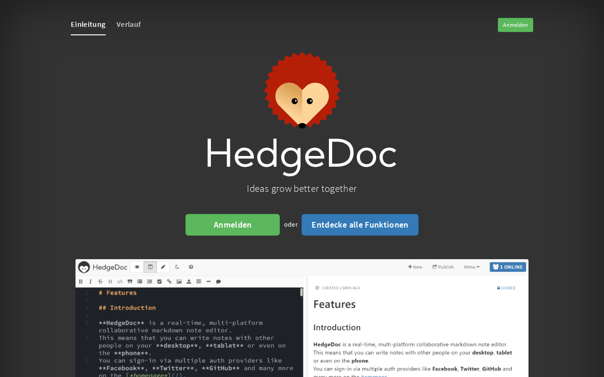

# Notizen (HedgeDoc)

[HedgeDoc](https://hedgedoc.openedusuite.org) ist der Dienst der
openEduSuite für gemeinsame Markdown-Notizen — mehrere Personen
schreiben gleichzeitig in einem Dokument, live. Der Einstieg läuft
über die Portalkachel **Notizen (HedgeDoc)**: Das Suite-Konto trägt
Sie durch die Anmelde-Schleuse auf die HedgeDoc-Startseite.

- **Lesen** funktioniert sofort: Die Startseite listet die
  Einleitung und zuletzt bearbeitete Notizen.
- **Schreiben** verlangt einen Schritt mehr: Das eigene
  **Anmelden** der App verknüpft Ihre Bearbeitungen mit einem
  Autorennamen innerhalb von HedgeDoc.
- Markdown ist das Format: Überschriften, Listen, Code — und mit
  `MathJax`-Unterstützung sowie einem Präsentationsmodus auch
  Formeln und Folien.

## HedgeDoc und seine Nachbarn

- [Grist](/suite/grist) — strukturierte Tabellen und Formulare
  statt freier Text.
- [XWiki](/suite/xwiki) — bleibendes Wissen statt lebender
  Dokumente.
- [Typst](/suite/typst) — Paper mit professionellem Satz.

## Barrierefreiheit

| Aktion | Taste |
|--------|-------|
| Durch Links und Menüs bewegen | `Tab` |
| Fokussiertem Link folgen | `Enter` |

- Die Startseite ist eine gewöhnliche Seite in Lesereihenfolge:
  Navigation, Einleitungskarte, Feature-Karten — `Tab` führt
  hindurch, `Enter` öffnet.
- `Strg+Pos1` bringt Sie zum Seitenanfang zurück.
