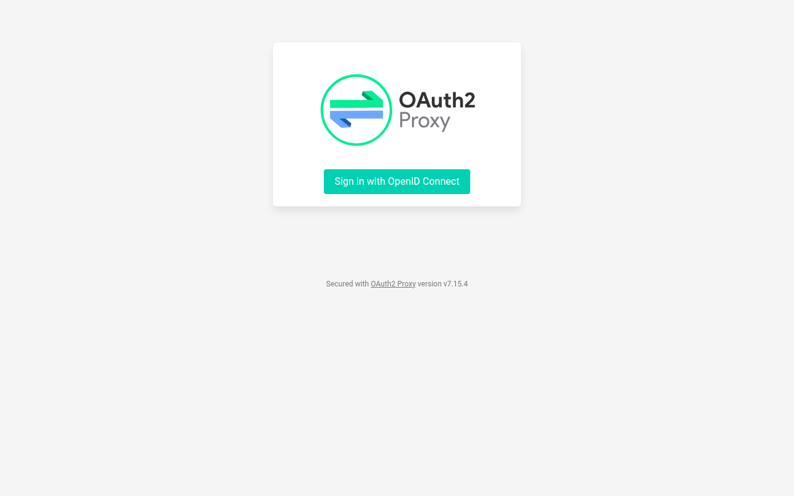
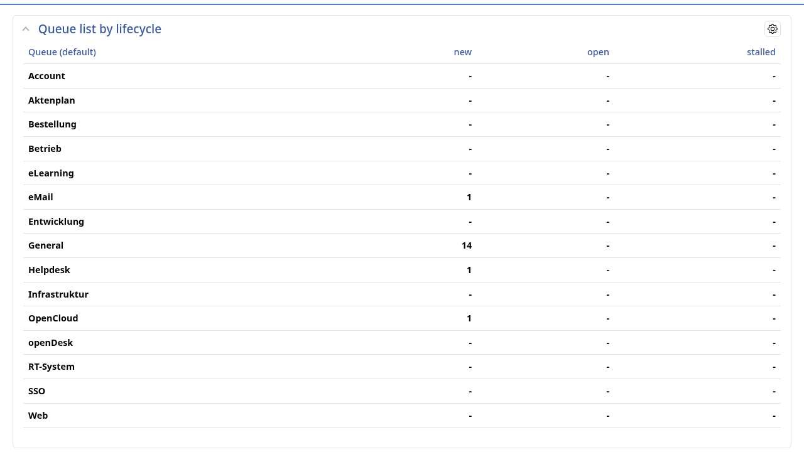
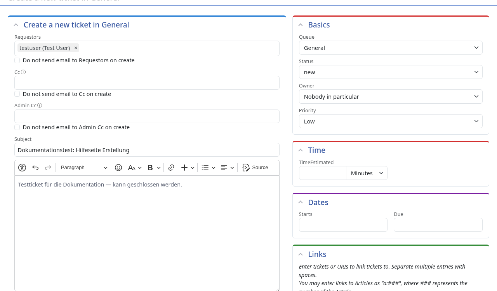

import VideoFallback from '@site/src/components/VideoFallback';

# Helpdesk: Ein Ticket erstellen

Das Helpdesk ist die Anlaufstelle für Hilfe: gestörter Zugriff, Fragen zu
einem Dienst, Wünsche für Ihre Arbeitsgruppe. Es läuft auf dem
[Request Tracker (RT)](https://rt.openedusuite.org) — öffnen Sie ihn und
melden Sie sich bei Bedarf mit Ihrem openEduSuite-Konto an.

## Beim Helpdesk anmelden

Das Helpdesk gehört zum Single Sign-On der openEduSuite: Sind Sie
woanders bereits angemeldet, kommen Sie in der Regel direkt durch.
Erscheint eine **Sign In**-Seite, wählen Sie
**Sign in with OpenID Connect** — nach der einmaligen Anmeldung sind Sie
zurück im Helpdesk. Wie die Anmeldung funktioniert, siehe
[Anmelden](/suite/sso-login).

<VideoFallback
  srcMp4="/docmakerai/clips/rt-login.mp4"
  poster="/docmakerai/clips/rt-login.png"
  alt="Kurzclip: die Anmeldeseite des Helpdesk und der Single Sign-On"
  width="640"
  height="400"
/>

## Das Dashboard

Nach der Anmeldung sehen Sie Ihr Dashboard: einen schnellen Weg, Tickets
zu erstellen, und eine Liste Ihrer offenen Tickets.

<VideoFallback
  srcMp4="/docmakerai/clips/rt-dashboard.mp4"
  poster="/docmakerai/clips/rt-dashboard.png"
  alt="Kurzclip: das Helpdesk-Dashboard mit Schnellerfassung und offenen Tickets"
  width="640"
  height="400"
/>

## Ein Ticket erstellen

Öffnen Sie **Create Ticket** (Ticket erstellen) und füllen Sie aus:

- **Queue** — worum es geht; wählen Sie die passendste Warteschlange
  (zum Beispiel *General* oder *Helpdesk*)
- **Requestors** (Antragsteller) — für wen das Ticket ist, in der Regel
  Sie selbst — tippen Sie Ihren Namen oder Ihre E-Mail-Adresse und
  wählen Sie den Vorschlag aus
- **Subject** (Betreff) — eine kurze Zusammenfassung Ihres Anliegens
- Das große Textfeld — beschreiben Sie Ihr Anliegen: Was haben Sie
  getan, was haben Sie erwartet, und was ist stattdessen passiert
- Optional: **Cc** für Personen, die mitverfolgen sollen, sowie weitere
  Angaben wie Priorität oder Fälligkeitsdatum

Wählen Sie **Create** (Erstellen), um das Ticket abzuschicken. Das
Helpdesk-Team übernimmt es — Antworten erhalten Sie per E-Mail und
können den Status im Helpdesk verfolgen.

<VideoFallback
  srcMp4="/docmakerai/clips/rt-create.mp4"
  poster="/docmakerai/clips/rt-create.png"
  alt="Kurzclip: das Ausfüllen des Create-Ticket-Formulars im Helpdesk"
  width="640"
  height="400"
/>

## Tipps für gute Tickets

- Ein Thema pro Ticket — zwei Probleme sind zwei Tickets
- Schreiben Sie dazu, was Sie bereits versucht haben
- Bei Fehlermeldungen: übernehmen Sie den genauen Wortlaut ins Ticket

## Barrierefreiheit

| Aktion | Taste |
|--------|-------|
| Durch die Formularfelder bewegen | `Tab` |
| Einen Vorschlag im Antragstellerfeld übernehmen | `Enter` |
| Formular absenden | `Enter` auf der Schaltfläche Create |

- Das Ticket-Formular ist ein Standardformular: `Tab` bewegt Sie der
  Reihenfolge nach durch die Felder, `Enter` führt die fokussierte
  Schaltfläche aus. Im Antragstellerfeld übernimmt `Enter` den
  ausgewählten Vorschlag.
- Das Nachrichtenfeld ist ein Rich-Text-Editor; `Tab` führt hinein und
  wieder hinaus. Verlieren Sie die Orientierung, drücken Sie
  `Strg+Pos1`, um zum Seitenanfang zurückzukehren.
