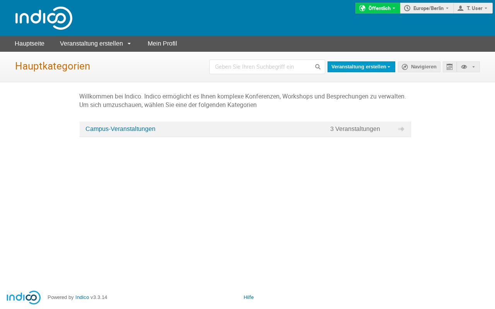

# Veranstaltungen (Indico)

Der [Veranstaltungskalender](https://indico.openedusuite.org) der
openEduSuite läuft auf [Indico](https://getindico.io) — der an der
CERN geborenen Veranstaltungsplattform. Hier wird das Campus-Leben
angekündigt: Vorlesungen, Konferenzen und Besprechungen mit Terminen,
Räumen und Materialien an einem Ort.

## Anmelden

Indico begrüßt Sie auf Deutsch. Sein Anmelde-Dialog bietet zwei
Wege: ein lokales Indico-Konto oder — der richtige für Sie —
**openEduSuite SSO** unter „oder verbinden mit": ein Klick durch die
Hochschulanmeldung und Sie sind drin, mit Ihrem Namen in der
Kopfzeile.

## Startseite und Kategorien

Die Startseite listet die **Hauptkategorien** — heute eine einzige
öffentliche, **Campus-Veranstaltungen**, die ihre Veranstaltungen
hält („3 Veranstaltungen"). Öffnen Sie die Kategorie, um zu stöbern,
was kommt; öffnen Sie eine Veranstaltung für Zeiten, Ort und
angehängte Materialien. Die Kalender-Ansicht der Werkzeugleiste
wechselt zwischen Liste und Zeitplan.

## Eine Veranstaltung anlegen

**Veranstaltung erstellen** startet den Assistenten: Kategorie
wählen, Titel und Zeit setzen, Raum hinzufügen — und die
Veranstaltung ist bei allen angekündigt, die die Kategorie verfolgen.
Eine Anmeldung, falls die Veranstaltung eine verlangt, ist für
Teilnehmende ein Klick.

Die Suche (**Durchsuche Indico**) reicht über alles Öffentliche.

## Barrierefreiheit

| Aktion | Taste |
|--------|-------|
| Durch Kategorien, Veranstaltungen und Dialoge bewegen | `Tab` |
| Fokussierte Kategorie oder Veranstaltung öffnen | `Enter` |
| Dialoge und Ausklappmenüs schließen | `Escape` |

- Indicos Seiten sind gewöhnliche Web-Elemente: `Tab` bewegt Sie
  durch die Kategorien-Liste und die Veranstaltungsseiten, `Enter`
  öffnet die fokussierte, `Escape` schließt Dialoge.
- Verlieren Sie die Orientierung, bringt Sie `Strg+Pos1` zum
  Seitenanfang zurück.
