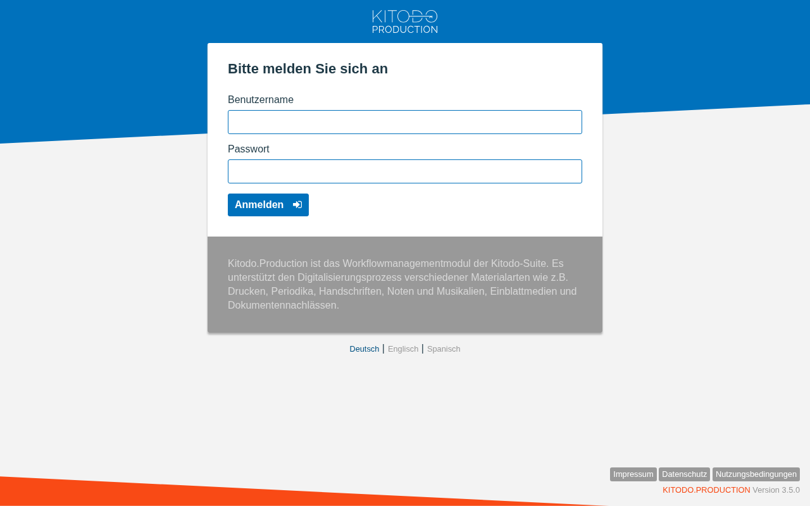

# Bibliothek (Kitodo)

Kitodo.Production ist die Kachel der openEduSuite für
digitalisierte Sammlungen — Scans und Metadaten aus Bibliothek und
Archiv, samt dem Digitalisierungs-Workflow dahinter. Die
Portalkachel öffnet `https://kitodo.openedusuite.org/kitodo/` —
mit dem Suite-Konto passieren Sie die Anmelde-Schleuse direkt.

- Die Suite-Anmeldung (SSO) öffnet die Tür zum Dienst.
- **Kitodo verlangt zusätzlich eine eigene Anmeldung**:
  *Bitte melden Sie sich an* — Benutzername und Passwort Ihres
  Kitodo-Kontos, das die Verwaltung vergibt. Das Suite-Konto
  allein ist kein Kitodo-Konto.

Die Anmeldeseite erscheint standardmäßig auf Deutsch; der
Sprachumschalter über dem Formular bietet **Deutsch**, **Englisch**,
**Spanisch**. Das Anmeldeformular trägt die Felder **Benutzername**
und **Passwort** sowie den Button **Anmelden**. In der englischen
Oberfläche lauten dieselben Felder **Username** (Benutzername) und
**Password** (Passwort), der Button **Sign in** (Anmelden).

## Für Lesende, für Beschäftigte

- **Lesende** erreichen digitalisiertes Material, sobald
  Sammlungen veröffentlicht sind; die Katalogansicht gehört zur
  Kitodo-Suite (`Kitodo.Presentation`).
- **Digitalisierungs-Teams** arbeiten im hier gezeigten
  Workflow-Modul: Prozesse, Aufgaben und Scans von der Vorlage
  bis zur fertigen digitalen Kopie.

Wenn Sie Zugang brauchen oder eine Sammlung dunkel bleibt, verbindet
der [Helpdesk](/suite/helpdesk-create-ticket) Sie mit dem
Bibliotheks-Team.

## Barrierefreiheit

| Aktion | Taste |
|--------|-------|
| Durch Formularfelder und Links bewegen | `Tab` |
| Fokussiertes Formular absenden | `Enter` |

- Die Anmeldeseite ist ein gewöhnliches Formular: Felder für
  Benutzername und Passwort, dann der Anmelde-Button — `Tab`
  führt der Reihe nach.
- `Strg+Pos1` bringt Sie zum Seitenanfang zurück.
