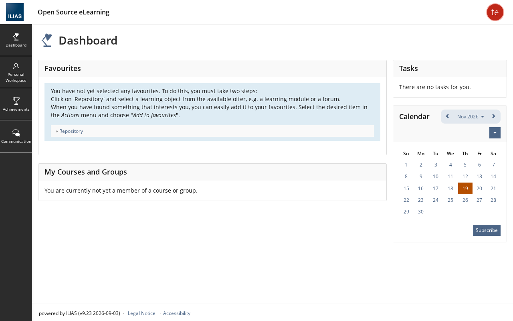

# Lernplattform (ILIAS)

Die openEduSuite betreibt eine eigene Lernplattform:
[ILIAS](https://lms.openedusuite.org). Kurse, Lernmaterialien und
Tests der Suite leben hier. Die Portalkachel
**Lernplattform (ILIAS)** und das Suite-Konto öffnen das
**Dashboard** direkt.

- **Dashboard** begrüßt Sie nach der Anmeldung: Ihre Kurse und
  der persönliche Schreibtisch.
- **Personal Workspace** hält Ihre eigenen Dateien und
  Lesezeichen; **Achievements** zeigt Zertifikate und
  abgeschlossene Kurse.
- **Communication** bündelt Mail- und Forumsfunktionen Ihrer
  Kurse.

Hinweis: Die Kachel **ILIAS** unter *UNIVERSITÄT* zeigt auf das
uni-weite ILIAS der Philipps-Universität (extern) — die
Suite-Instanz hier ist die eigene der openEduSuite, mit Ihrem
Suite-Konto.

## Barrierefreiheit

| Aktion | Taste |
|--------|-------|
| Durch Menüs und Inhalte bewegen | `Tab` |
| Fokussiertes Element öffnen | `Enter` |

- ILIAS ist eine klassische Webanwendung in Lesereihenfolge:
  Hauptmenü, Inhaltsbereich — `Tab` führt hindurch.
- `Strg+Pos1` bringt Sie zum Seitenanfang zurück.
