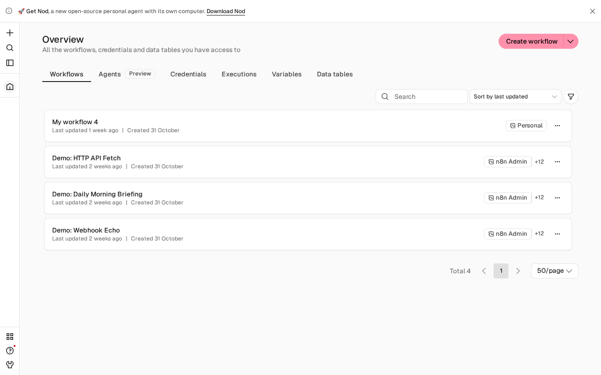
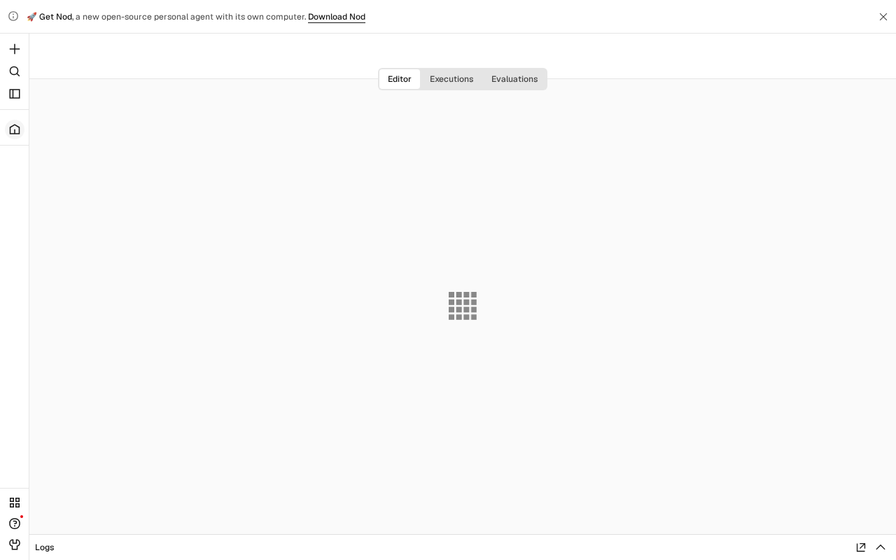

# Automatisierung mit n8n

[n8n](https://n8n.openedusuite.org) verbindet die Dienste der
openEduSuite: Geschieht etwas an einem Ort, kann n8n an einem anderen
reagieren — eine Nachricht senden, eine Datei schreiben, ein Ticket
anlegen, Daten abrufen. Diese Automatisierungen stellen Sie visuell
aus Bausteinen zusammen.

## Die Übersicht

Nach der Anmeldung aus dem [Portal](/suite/portal) sehen Sie Ihre **Workflows**: die Automatisierungen
Ihres Kontos, mit fertigen Demo-Workflows zum Lernen. Die Seitenleiste
führt zu den wichtigen Orten:

- **Overview** — Ihre Workflows, Ausführungen und Zugangsdaten auf
  einen Blick
- **Create workflow** — eine neue Automatisierung beginnen
- **Credentials** (Zugangsdaten) — die Konten und Schlüssel, die Ihre
  Workflows nutzen
- **Executions** (Ausführungen) — was lief, wann und mit welchem
  Ergebnis
- **Data tables** (Datentabellen) und **Variables** (Variablen) —
  Speicher und Werte für Ihre Automatisierungen

## Ein Blick hinein: der Editor

Öffnen Sie einen Demo-Workflow, um zu sehen, wie eine Automatisierung
aufgebaut ist: der Editor zeigt den Ablauf als verbundene Knoten auf
einer Fläche — jeder Knoten ist ein Schritt, die Linien zeigen, wohin
die Daten fließen. Registerkarten über der Fläche führen zu
**Executions** (Ausführungen: was lief, mit welchem Ergebnis) und
weiteren Ansichten des Workflows.

## Eine erste Automatisierung bauen

1. Wählen Sie **Create workflow** — der Editor öffnet sich mit einem
   Startpunkt
2. Wählen Sie einen **Trigger**: was die Automatisierung startet — zum
   Beispiel ein Zeitplan, ein Webhook oder ein Ereignis in einem Dienst
3. Fügen Sie Schritte hinzu: jeder Schritt tut genau eines — abrufen,
   umformen, senden
4. Testen Sie die Schritte beim Bauen und aktivieren Sie den Workflow
   danach

Gute erste Automatisierungen sind klein: ein Trigger, ein bis zwei
Schritte. Die Demo-Workflows zeigen vollständige Beispiele, die Sie
kopieren und anpassen können. Wenn sich etwas weigert zu funktionieren,
ist der [Helpdesk](/suite/helpdesk-create-ticket) der richtige Ort zum
Fragen.

## Barrierefreiheit

| Aktion | Taste |
|--------|-------|
| Durch Listen und Dialoge bewegen | `Tab` |
| Fokussiertes Element öffnen | `Enter` |

- Übersicht und Dialoge sind gewöhnliche Web-Elemente: `Tab` bewegt Sie
  hindurch, `Enter` öffnet das fokussierte Element.
- Verlieren Sie die Orientierung, drücken Sie `Strg+Pos1`, um zum
  Seitenanfang zurückzukehren.

- **Hochkontrast und Dunkelmodus:** Kontrast und dunkle Themes kommen vom
  Betriebssystem oder Browser — Windows `Win+Strg+C`, macOS „Kontrast erhöhen“
  oder eine Browser-Erweiterung wie Dark Reader. Bietet die App ein eigenes
  dunkles Theme, schalten Sie es in den Einstellungen; die oben beschriebene
  Bedienung gilt weiterhin.
