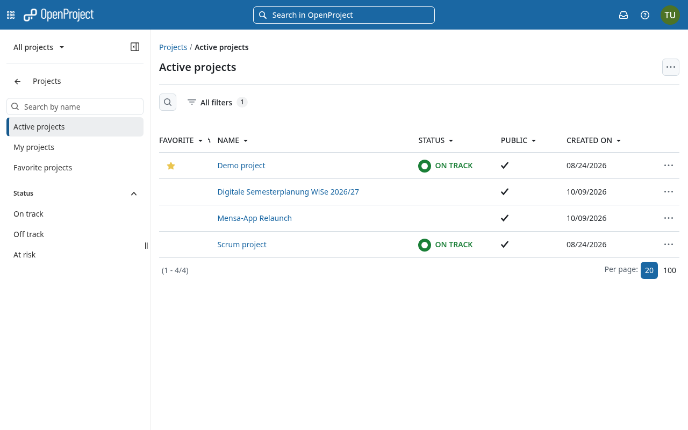
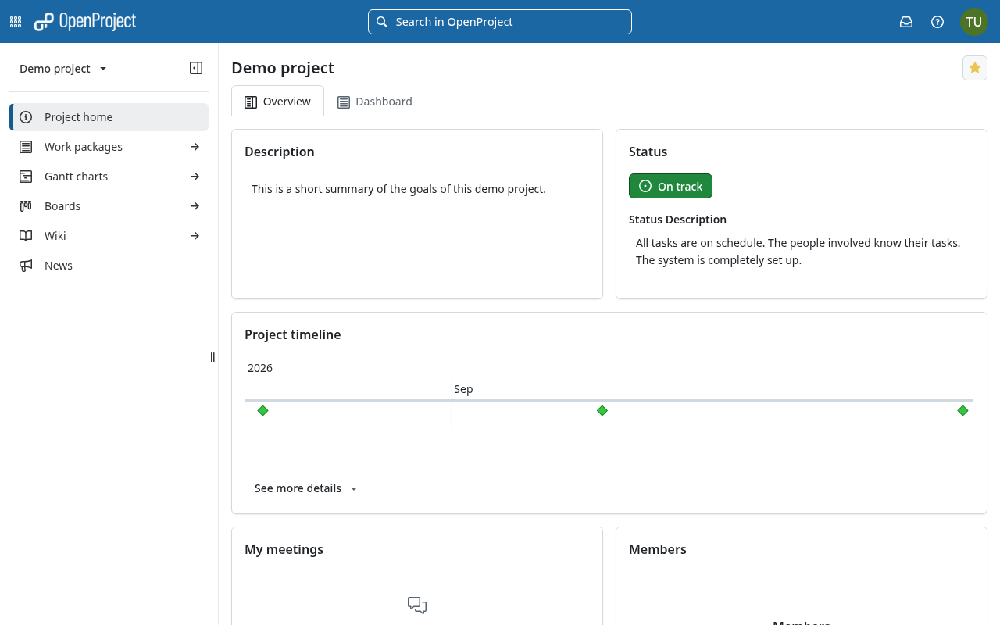

# Projekte und Aufgaben (OpenProject)

[OpenProject](https://openproject.openedusuite.org) ist der
Arbeitsplatz für organisierte Zusammenarbeit: Projekte mit ihrem
Status, Arbeitspaketen und Zeitplänen. Während der [Chat](/suite/chat)
fürs Reden und das [Wiki](/suite/xwiki) fürs Wissen da ist, lebt in
OpenProject der *Plan* — wer macht was, bis wann, und wie weit es ist.

## Die Übersicht

Aus dem [Portal](/suite/portal): nach der Anmeldung mit Ihrem openEduSuite-Konto führt die Navigation
zu allem: **Home** (Start), **All projects** (Alle Projekte),
**My page** (Meine Seite) und die Arbeitsbereiche — **Projects**
(Projekte), **Work packages** (Arbeitspakete), **Gantt charts**
(Gantt-Diagramme), **Boards** (Tafeln), **News** (Nachrichten) und
**Wiki**.

**All projects** zeigt die Tabelle mit Favoriten, Namen und einem
Status je Projekt — *On track* (auf Kurs), *Off track* (vom Kurs
abgekommen) oder *At risk* (gefährdet) — so sehen Sie auf einen
Blick, wo es steht.

## Im Projekt

Öffnen Sie ein Projekt, begrüßt Sie dessen Übersicht: die
**Description** (Beschreibung) mit den Zielen, der aktuelle **Status**
mit einer einordnenden Notiz und die **Zeitachse des Projekts** —
Meilensteine auf einer Zeitlinie (zum Beispiel *Start of project*,
*Conference*, *End of project*), sodass sich der Bogen ohne ein
einziges Arbeitspaket erkennen lässt.

Neben der Übersicht sammelt der Reiter **Dashboard** die Zahlen des
Projekts; **News** trägt Ankündigungen der Projektbeteiligten.

## Mit Arbeitspaketen arbeiten

Ein Arbeitspaket ist ein Baustein des Projekts — eine Aufgabe, ein
Meilenstein, eine Phase. Finden Sie sie unter **Work packages** (oder
in der Liste des Projekts): jedes hat einen Typ, einen Status, eine
verantwortliche Person und Termine. Boards zeigen dieselbe Arbeit als
Spalten zum Durchziehen — von *offen* bis *erledigt* — für Teams, die
Fortschritt lieber sehen als Listen.

Neu im Projekt? Beginnen Sie bei der Übersicht, lesen Sie dann die
Arbeitspakete mit Ihrem Namen — die sind Ihre. Fragen zu einer Aufgabe
gehören in ihre Kommentare oder in den [Chat](/suite/chat).

Bleibt Ihnen der Dienst verschlossen, erreicht das
[Helpdesk](/suite/helpdesk-create-ticket) seine Betreiber.

## Barrierefreiheit

| Aktion | Taste |
|--------|-------|
| Durch Navigation, Tabellen und Projekte bewegen | `Tab` |
| Fokussierten Link oder Projekt öffnen | `Enter` |

- Die Seiten sind gewöhnliche Web-Elemente: `Tab` bewegt Sie durch die
  Navigation, die Projekte-Tabelle und die Arbeitspakete, `Enter`
  öffnet den fokussierten Eintrag.
- Tabellen melden ihre Spalten und Zeilen auf die übliche Weise;
  verlieren Sie die Orientierung, bringt Sie `Strg+Pos1` zum
  Seitenanfang zurück.

- **Hochkontrast und Dunkelmodus:** Kontrast und dunkle Themes kommen vom
  Betriebssystem oder Browser — Windows `Win+Strg+C`, macOS „Kontrast erhöhen“
  oder eine Browser-Erweiterung wie Dark Reader. Bietet die App ein eigenes
  dunkles Theme, schalten Sie es in den Einstellungen; die oben beschriebene
  Bedienung gilt weiterhin.
