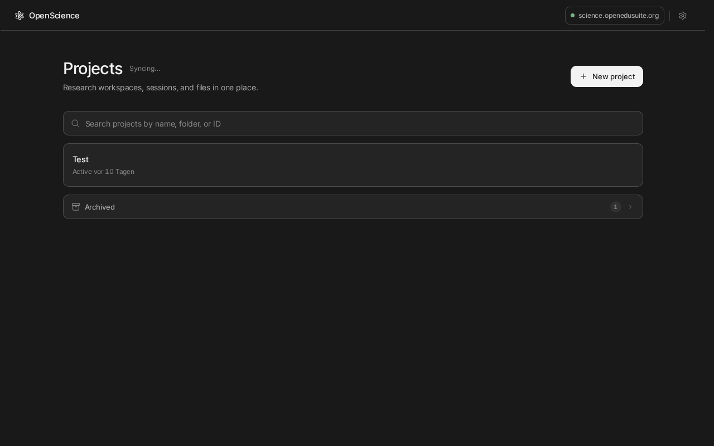

# OpenScience

[OpenScience](https://science.openedusuite.org) ist die KI-
Forschungswerkbank der Suite — die [Portal](/suite/portal)kachel beschreibt sie als
Agents, Tools und Daten-Workflows direkt im Browser. Sie erreichen
sie über die Portalkachel **OpenScience** und melden sich per SSO
an; die Projektübersicht öffnet sich sofort.

## Die Projektübersicht

Die Seite öffnet mit einer Liste namens **Projects** — „Research
workspaces, sessions, and files in one place".

- Jede Projektkarte zeigt ihren Namen, ihre Session-Anzahl und
  ihren Status mit der letzten Aktivität als relative Zeitangabe
  („Active", mit deutschem Browser „vor 10 Tagen").
- Jede Karte bietet **Pin** und **Archive** an. Der Filter
  **Archived** trägt eine Zahl und listet archivierte Projekte,
  jedes mit einer Schaltfläche **Restore**.
- **New project** öffnet den Dialog **Create project**: benennen
  Sie den Arbeitsbereich, verbinden Sie optional Quellordner —
  jetzt oder später —, und wählen Sie **Create** oder **Cancel**.

## Innerhalb eines Projekts

Beim Öffnen eines Projekts gelangen Sie in seinen Arbeitsbereich.
Die Seitenleiste enthält:

- **New** — startet eine neue Session; die Befehlspalette nennt es
  „Start a new research conversation".
- **Search** — die Befehlspalette. Sie durchsucht Sessions,
  Transkript-Nachrichten, Workspace-Dateien, Artefakte und
  Projekt-Aktionen und versammelt die Aktionen der App in einer
  Liste (von **New session** bis **Open settings** und
  **Open documentation**).
- **Customize** — die Einstellungen (siehe unten).
- Die Arbeitsbereich-Aktionen **Files**, **Terminal**, **Compute**
  und **Autoresearch**.
- **Sessions** — die Session-Liste des Projekts, mit einer
  Schaltfläche **New session**.

Was die Arbeitsbereich-Aktionen zeigen:

- **Files** — die Dateien des Projekts, mit einem Menü **More**
  („Add folder…", „Manage workspace folders…"). Ein leerer Ordner
  meldet „This folder is empty".
- **Terminal** — Befehle innerhalb des Projekts; ohne Verbindung
  zum lokalen OpenScience-Server meldet er „Local terminal
  unavailable".
- **Compute** — der Rechner hinter dem Projekt („This computer"):
  aktive und laufende Ausführungen, Arbeitsspeicher und CPU-Kerne.
- **Autoresearch** — Studien, die eine Metrik schrittweise
  verbessern, jede mit ihrem Score, ihren Durchläufen und ihrer
  Warteschlange. Ein leeres Projekt meldet „No studies yet" und
  rät, in einer Session nach einer Studie zu fragen: die zu
  verbessernde Metrik, das Budget und das auszuführende Skript.

## Einstellungen und Sprache

**Customize** öffnet den Dialog **Settings** mit Abschnitten für
Account, General, Workspaces, Models, Research, Skills, Tools,
Connectors, Credentials und System (Compute, Berechtigungen,
Netzwerk, Sandbox, Storage). Unter **General** stehen das Design
(System, Light, Dark) und die Anzeigesprache: OpenScience folgt der
Sprache Ihres Browsers — mit deutschem Browser erscheint ein großer
Teil der Oberfläche auf Deutsch („Erscheinungsbild", „Hell" und
„Dunkel", „Terminal umschalten"), der Rest bleibt Englisch. Der
Eintrag **Open documentation** in der Befehlspalette führt zum
README des Projekts auf GitHub.

## Abgrenzung

- **[EWOKS](/suite/ewoks)** — wiederholbare, mehrstufige
  Datenverarbeitung als Workflow; die Autoresearch-Studien von
  OpenScience verbessern dagegen eine einzelne Metrik, Durchlauf
  für Durchlauf.
- **[Nextcloud](/suite/nextcloud)** und
  **[OpenCloud](/suite/files)** — reine Dateiablage ohne
  Rechen-Sessions.
- Das Projekt ist die Einheit: Seine Sessions, Dateien und
  Artefakte sind alle über seine Befehlspalette erreichbar.

## Barrierefreiheit

| Aktion | Taste |
|--------|-------|
| Durch Projekte, Schaltflächen und Menüs bewegen | `Tab` |
| Fokussiertes Element öffnen | `Enter` |

- Die Projektübersicht ist eine gewöhnliche Liste mit
  Schaltflächen — `Tab` führt der Reihe nach durch.
- Die Befehlspalette ist tastaturfirstig: Ihre Fußzeile zeigt die
  Tasten (Pfeiltasten zum Navigieren, `Enter` öffnet, `Esc`
  schließt).
- Die Palette nennt Strg+` (die Backtick-Taste) als Kürzel zum Ein-
  und Ausschalten des Projekt-Terminals.
- `Strg+Pos1` bringt Sie zum Seitenanfang zurück.
