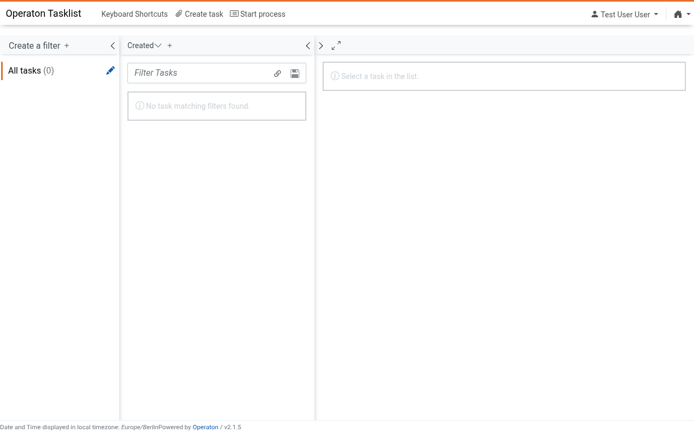
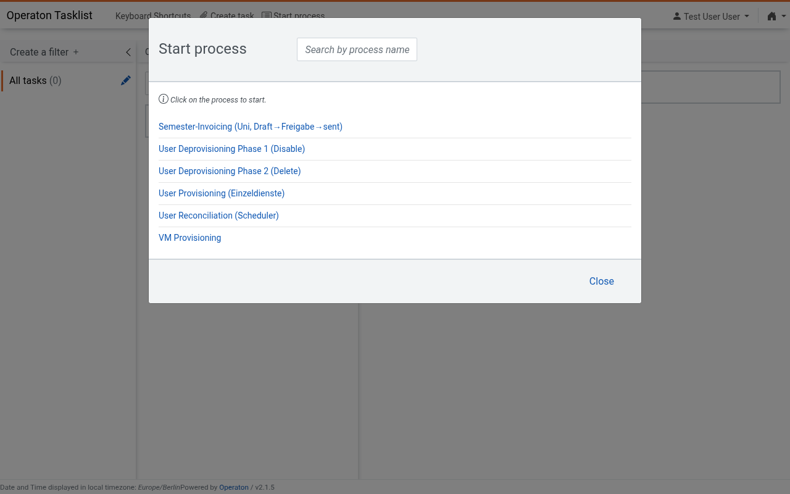

import PageSEO from '@site/src/components/PageSEO';

<PageSEO
  title="Prozesse und Aufgaben (Operaton)"
  description="Zugewiesene Aufgaben bearbeiten und Prozesse starten in der Workflow-Engine Operaton"
  keywords={["Prozesse", "und", "Aufgaben", "Operaton", "openEduSuite"]}
  suffix="openEduSuite"
  defaultKeywords={["Hochschule", "Open Source"]}
/>

# Prozesse und Aufgaben (Operaton)

[Operaton](https://operaton.openedusuite.org) ist die Workflow-Engine
der openEduSuite: Verwaltungs- und Kollaborationsprozesse laufen hier
digital ab — Freigaben, Anträge, Checklisten. Ihnen begegnen Sie, wenn
ein Prozess Ihnen eine Aufgabe zuweist.

## Ihre Aufgaben

Öffnen Sie nach der Anmeldung aus dem [Portal](/suite/portal) die
**Tasklist**. Sie zeigt die Ihnen
zugewiesenen Aufgaben, zum Beispiel unter **All tasks**. Öffnen Sie
eine Aufgabe, um ihr Formular zu sehen: Details, auszufüllende Felder
und eine Schaltfläche zum Abschließen des Schritts — manchmal eine
Auswahl zwischen mehreren Wegen. Was genau Sie sehen, hängt vom
Prozess ab.

Einige Listen behalten einen Filter, sodass Sie nur das für Sie
Relevante sehen; die Zahl neben einem Listeneintrag zeigt, wie viele
Aufgaben sie gerade enthält. Warten keine Aufgaben, sagt die
Liste es klar („No task matching filters found.") — dann gibt es
schlicht nichts für Sie zu tun.

## Einen Prozess starten

Viele Prozesse lassen sich auch von Ihnen direkt starten: Wählen Sie
**Start process** (Prozess starten) — es öffnet sich ein Bereich mit
den Prozessen, die Ihre Hochschule eingerichtet hat („Click on the
process to start"). Wählen Sie den Prozess, füllen Sie das folgende
Formular aus und senden Sie es ab. Der Prozess durchläuft dann die in
der Hochschule festgelegten Schritte — als Aufgabe begegnet er Ihnen
wieder, wann immer Ihr Teil dran ist.

Ein Prozess kann reale Dinge in Bewegung setzen — Benutzerkonten,
virtuelle Maschinen, Rechnungen. Starten Sie nur, wofür Sie zuständig
sind.

Bleibt Ihnen der Dienst verschlossen, erreicht das
[Helpdesk](/suite/helpdesk-create-ticket) seine Betreiber.

## Barrierefreiheit

| Aktion | Taste |
|--------|-------|
| Durch Aufgabenliste und Formulare bewegen | `Tab` |
| Fokussierte Aufgabe oder Schaltfläche öffnen | `Enter` |

- Aufgabenliste und Formulare sind gewöhnliche Web-Elemente: `Tab`
  bewegt Sie der Reihenfolge nach durch Listeneinträge und
  Formularfelder, `Enter` öffnet die fokussierte Aufgabe oder löst die
  fokussierte Schaltfläche aus.
- Verlieren Sie die Orientierung, drücken Sie `Strg+Pos1`, um zum
  Seitenanfang zurückzukehren.

- **Hochkontrast und Dunkelmodus:** Kontrast und dunkle Themes kommen vom
  Betriebssystem oder Browser — Windows `Win+Strg+C`, macOS „Kontrast erhöhen“
  oder eine Browser-Erweiterung wie Dark Reader. Bietet die App ein eigenes
  dunkles Theme, schalten Sie es in den Einstellungen; die oben beschriebene
  Bedienung gilt weiterhin.
