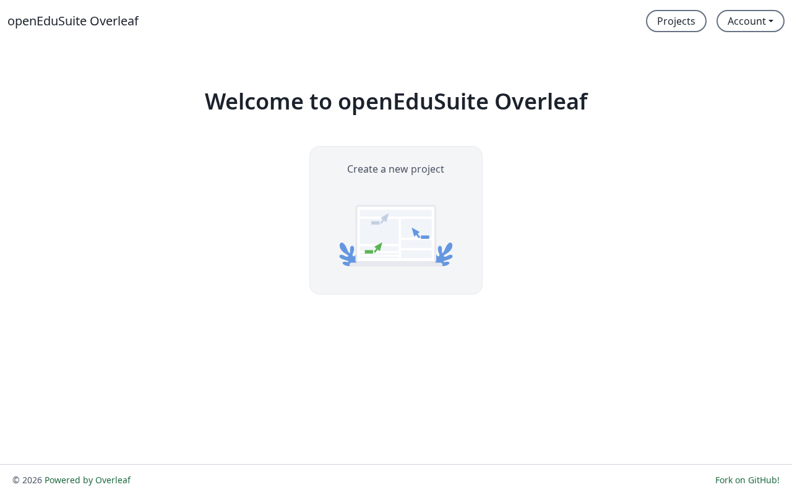

# LaTeX (Overleaf)

[Overleaf](https://overleaf.openedusuite.org) ist die
LaTeX-Werkbank der openEduSuite — Paper, Abschlussarbeiten und
Berichte in LaTeX schreiben, live kompiliert während Sie tippen,
gemeinsam in einem Projekt. Die Portalkachel
**LaTeX (Overleaf)** und das Suite-Konto öffnet **Projects** direkt.

- **Projects** listet Ihre Projekte; **New Project** startet aus
  einer Vorlage oder von Null.
- Im Editor stehen Quelle und kompiliertes PDF nebeneinander;
  jedes Speichern kompiliert neu — Fehler zeigen sich dort, wo
  sie sind, nicht drei Absätze später.
- Die Suite-Instanz meldet sich als *openEduSuite Overleaf*; Ihr
  Konto ist das Suite-Konto (SSO).

## Overleaf oder Typst

- **[Typst](/suite/typst)** — moderne Auszeichnungssprache,
  Sofort-Vorschau, leichterer Einstieg; erste Wahl für die
  meisten.
- **Overleaf** — LaTeX: Journals, Zitationsstile und Vorlagen,
  die längst als `.tex` existieren. Erste Wahl, wenn das Ziel
  LaTeX spricht.

## Barrierefreiheit

| Aktion | Taste |
|--------|-------|
| Durch Projektliste und Menüs bewegen | `Tab` |
| Fokussiertes Projekt öffnen | `Enter` |

- Die Projektliste ist eine gewöhnliche Liste mit Menüs — `Tab`
  führt hindurch, `Enter` öffnet.
- Overleaf pflegt die eigene, umfassende Kürzelliste unter
  **Help**; `Strg+Pos1` bringt Sie zum Seitenanfang zurück.
