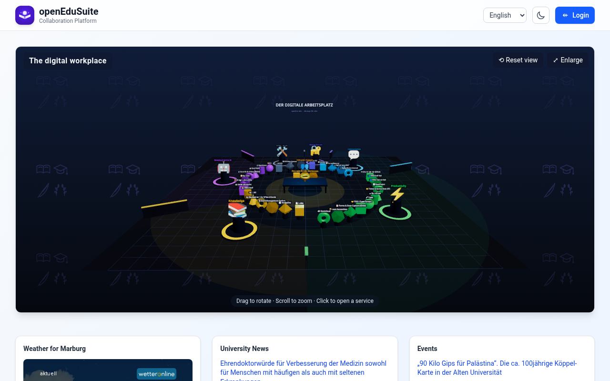
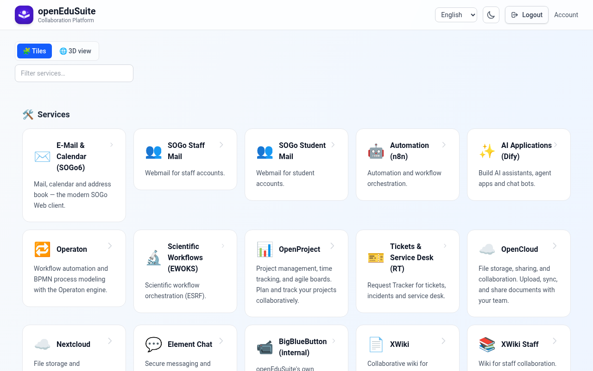

# Das Portal

Das [Portal](https://home.openedusuite.org) ist der Einstieg in die
openEduSuite: Ihr digitaler Arbeitsplatz. Schon vor der Anmeldung
zeigt es Nachrichten, Wetter und Veranstaltungen der Universität.

## Anmelden

Wählen Sie im Portal **Anmelden** und melden Sie sich mit Ihrem
openEduSuite-Konto an — mit demselben Login, der überall in der Suite
gilt. Details siehe [Anmelden](/suite/sso-login).

Nach der Anmeldung zeigt das Portal Ihren persönlichen digitalen
Arbeitsplatz:

- **App-Kacheln** — ein Klick zu E-Mail und Kalender (SOGo), zum
  [Helpdesk](/suite/helpdesk-create-ticket) (Tickets & Service Desk),
  zu Ihren [Dateien](/suite/files) (OpenCloud) und vielen weiteren
  Diensten
- **Nachrichten und Veranstaltungen der Universität** — aktuelle
  Meldungen und Termine
- **Ihr Konto** — über **Konto** erreichen Sie die Kontoverwaltung
  (Profil, Passwort, Zwei-Faktor-Authentifizierung), über
  **Abmelden** verlassen Sie das Portal

Nicht jede Kachel ist für alle gedacht — was Sie sehen, hängt von
Ihrer Rolle ab. Fehlt ein Dienst, den Sie brauchen, fragen Sie im
[Helpdesk](/suite/helpdesk-create-ticket).

## Barrierefreiheit

| Aktion | Taste |
|--------|-------|
| Durch Links und Kacheln bewegen | `Tab` |
| Fokussierten Link oder App öffnen | `Enter` |

- Das Portal besteht aus gewöhnlichen Links und Kacheln: `Tab` bewegt
  Sie in Leserichtung hindurch, `Enter` öffnet das fokussierte Element.
  Screenreader-Nutzer erreichen die App-Liste unter der Überschrift
  des Arbeitsplatz-Bereichs.
- Verlieren Sie die Orientierung, drücken Sie `Strg+Pos1`, um zum
  Seitenanfang zurückzukehren.
