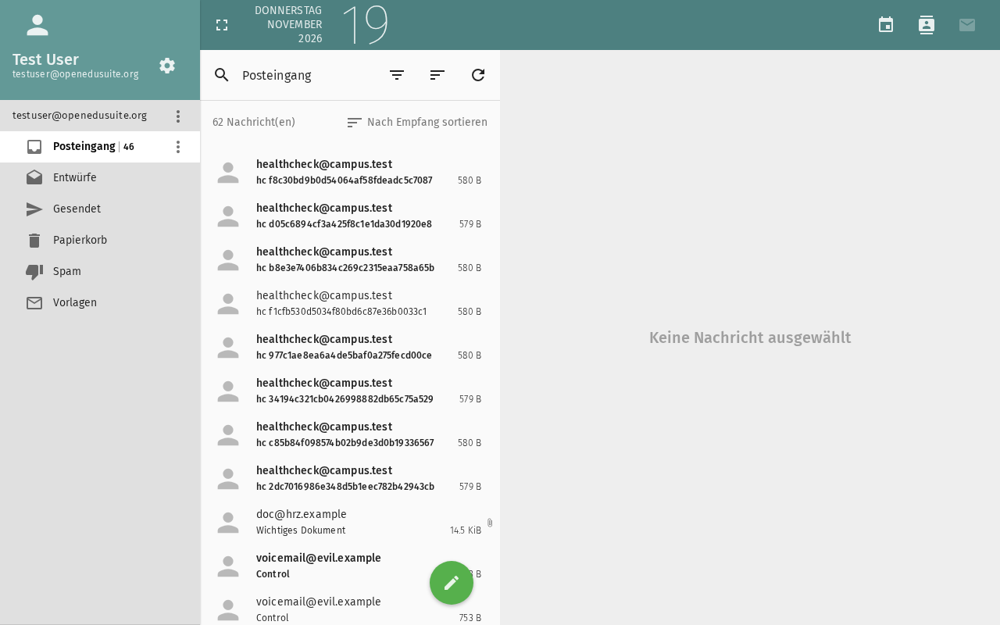

# Mail klassisch: SOGo (Personal & Studierende)

Neben der [Suite-Mail SOGo6](/sogo6/sogo-login) betreibt die
openEduSuite zwei **klassische SOGo**-Instanzen, erreichbar über
die [Portal](/suite/portal)kacheln **SOGo Beschäftigten-Post** und
**SOGo Studierenden-Post**. Die Anmeldung läuft über SSO — Ihr
Konto, kein zweites Passwort — und das Postfach öffnet im
**Posteingang**.

- **SOGo Beschäftigten-Post** — die Instanz für Beschäftigte,
  Webmail für Beschäftigten-Konten.
- **SOGo Studierenden-Post** — die Instanz für Studierende,
  Webmail für Studierenden-Konten.

Beide öffnen direkt die SOGo-5-Oberfläche: Mail, Kalender und
Adressbuch im bewährten Layout. Die vollständigen Anleitungen
liegen unter **SOGo 5** in dieser Dokumentation — jeder dort
gezeigte Schritt gilt für beide Instanzen:

- [Mail lesen](/sogo5/sogo-mail-read) und
  [Mail schreiben](/sogo5/sogo-mail-compose)
- [Kalenderansichten](/sogo5/sogo-calendar-views) und
  [Termine anlegen](/sogo5/sogo-calendar-create-event)
- [Adressbuch](/sogo5/sogo-contacts-add)
- [Abmelden](/sogo5/sogo-logout)

## Welches SOGo Sie haben

| Instanz | Oberfläche | Anleitungen |
|---------|-----------|-------------|
| SOGo6 (Suite-Kachel **E-Mail & Kalender (SOGo6)**) | Die neue Oberfläche | `/sogo6/…`-Seiten |
| SOGo Beschäftigten-Post / SOGo Studierenden-Post | Klassische Oberfläche | `/sogo5/…`-Seiten |

Zeigen Postfach und Suite-Mail dieselben Nachrichten, ist Ihr
Konto über beide Wege erreichbar — die Anleitungen behandeln jede
Oberfläche in ihrem eigenen Abschnitt.

Bleibt Ihnen der Dienst verschlossen, erreicht das
[Helpdesk](/suite/helpdesk-create-ticket) seine Betreiber.

## Barrierefreiheit

| Aktion | Taste |
|--------|-------|
| Durch Mailliste und Werkzeugleiste bewegen | `Tab` |
| Fokussiertes Element öffnen | `Enter` |

- Klassisches SOGo ist eine Webanwendung mit Menüs und Listen in
  Lesereihenfolge; `Tab` führt durch Mailliste, Ordner und
  Werkzeugleiste.
- `Strg+Pos1` bringt Sie zum Seitenanfang zurück.

- **Hochkontrast und Dunkelmodus:** Kontrast und dunkle Themes kommen vom
  Betriebssystem oder Browser — Windows `Win+Strg+C`, macOS „Kontrast erhöhen“
  oder eine Browser-Erweiterung wie Dark Reader. Bietet die App ein eigenes
  dunkles Theme, schalten Sie es in den Einstellungen; die oben beschriebene
  Bedienung gilt weiterhin.
