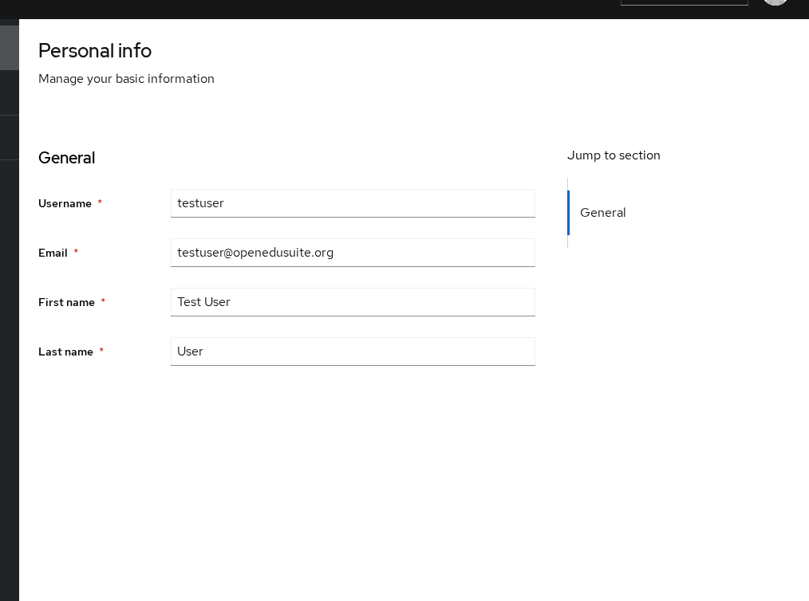
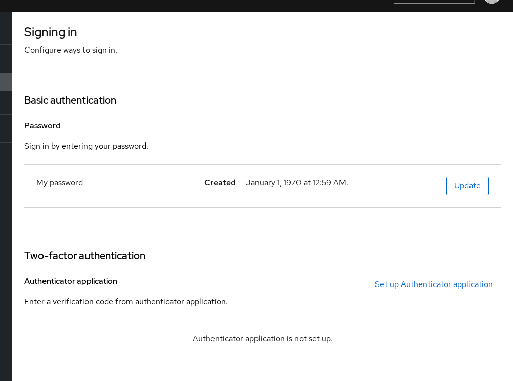
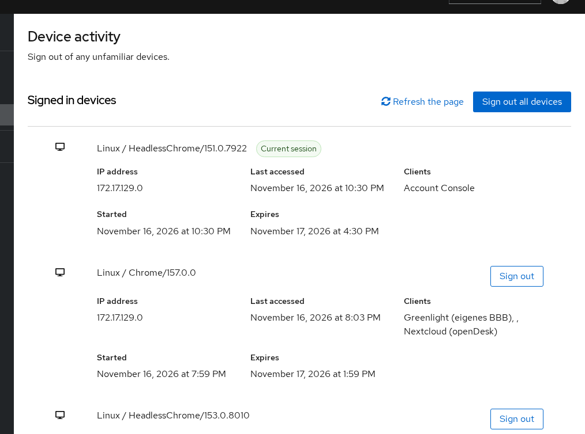

import PageSEO from '@site/src/components/PageSEO';

<PageSEO
  title="Ihr Konto"
  description="Profil, Passwort, Zwei-Faktor-Authentifizierung und aktive Sitzungen in der openEduSuite-Kontoverwaltung"
  keywords={["Ihr", "Konto", "openEduSuite"]}
  suffix="openEduSuite"
  defaultKeywords={["Hochschule", "Open Source"]}
/>

# Ihr Konto

Die Kontoverwaltung regelt alles rund um Ihren openEduSuite-Login: Ihr
Profil, Ihr Passwort, die Zwei-Faktor-Authentifizierung und die Geräte,
auf denen Sie angemeldet sind.

Öffnen Sie sie aus einer beliebigen angemeldeten Anwendung heraus, oder
rufen Sie Ihre Kontoseite direkt auf und melden Sie sich bei Bedarf an.

## Persönliche Informationen

Zeigt Ihre Kontodaten:

- **Username** (Benutzername) und **Email** (E-Mail)
- **First name** (Vorname) und **Last name** (Nachname)

Benutzername und Name verwaltet Ihre Hochschule; wenden Sie sich an den
Helpdesk, wenn dort etwas nicht stimmt.

## Anmeldung

Zwei Bereiche steuern Ihre Anmeldung:

- **Basic authentication**: wählen Sie **Update**, um Ihr Passwort zu
  ändern
- **Two-factor authentication**: wählen Sie
  **Set up Authenticator application**, um einen zweiten Faktor
  einzurichten

Die Zwei-Faktor-Authentifizierung verbindet Ihren Login mit einer
Authenticator-App auf Ihrem Telefon: Nach der Passworteingabe tippen Sie
zusätzlich einen Code aus der App ein. Wir empfehlen die Einrichtung —
sie schützt Ihr Konto, selbst wenn jemand Ihr Passwort erfährt.

## Geräteaktivität

Listet die Geräte und Browser auf, auf denen Sie angemeldet sind. Für
jeden Eintrag können Sie **Sign out** wählen, um genau diese Sitzung zu
beenden, oder **Sign out all devices**, um alle Sitzungen auf einmal zu
beenden.

Nutzen Sie sie, wenn Sie an einem gemeinsam genutzten Rechner fertig
sind, oder wenn Sie auf Nummer sicher gehen wollen, nachdem Sie ein
Gerät benutzt haben, das Sie nicht kontrollieren.

## Barrierefreiheit

| Aktion | Taste |
|--------|-------|
| Durch Formularfelder und Schaltflächen bewegen | `Tab` |
| Schaltfläche ausführen oder Änderung speichern | `Enter` |

- Die Kontoseiten sind gewöhnliche Formulare und Listen: `Tab` bewegt Sie
  der Reihe nach hindurch, `Enter` führt die fokussierte Schaltfläche
  aus. Screenreader sagen beim Bewegen die Feldbezeichnungen und
  Überschriften an („Personal info", „Signing in").
- Wenn Sie die Orientierung verlieren, drücken Sie `Strg+Pos1`, um zum
  Seitenanfang zurückzukehren, und fahren Sie von dort mit `Tab` fort.

- **Hochkontrast und Dunkelmodus:** Kontrast und dunkle Themes kommen vom
  Betriebssystem oder Browser — Windows `Win+Strg+C`, macOS „Kontrast erhöhen“
  oder eine Browser-Erweiterung wie Dark Reader. Bietet die App ein eigenes
  dunkles Theme, schalten Sie es in den Einstellungen; die oben beschriebene
  Bedienung gilt weiterhin.
