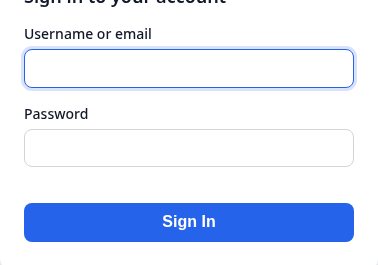

import PageSEO from '@site/src/components/PageSEO';

<PageSEO
  title="Anmelden: Ein Login für alle Anwendungen"
  description="Wie das Single Sign-On der openEduSuite funktioniert und was der Anmeldebildschirm abfragt"
  keywords={["Anmelden:", "Ein", "Login", "für", "alle", "Anwendungen", "openEduSuite"]}
  suffix="openEduSuite"
  defaultKeywords={["Hochschule", "Open Source"]}
/>

import VideoFallback from '@site/src/components/VideoFallback';

# Anmelden: Ein Login für alle Anwendungen

Die openEduSuite-Anwendungen — E-Mail, Dateien, Wiki, Helpdesk und weitere
— teilen sich einen Login. Sie melden sich einmal mit Ihrem
Hochschulkonto an, und danach erkennt Sie jede Anwendung.

## Wie die Anmeldung funktioniert

1. Öffnen Sie eine openEduSuite-Anwendung oder das Portal Ihrer Hochschule
2. Sie werden zum **openEduSuite-Anmeldebildschirm** weitergeleitet
3. Geben Sie **Username or email** (Benutzername oder E-Mail) und Ihr
   **Password** (Passwort) ein
4. Wählen Sie **Sign In** (Anmelden)
5. Sie kehren zur Anwendung zurück — angemeldet

<VideoFallback
  srcMp4="/docmakerai/clips/sso-login.mp4"
  poster="/docmakerai/clips/sso-login.png"
  alt="Kurzclip: der openEduSuite-Anmeldebildschirm"
  width="640"
  height="400"
/>

Für jede Anwendung erscheint derselbe Anmeldebildschirm. Die Anmeldung bei
einer weiteren Anwendung erfolgt in der Regel automatisch, ohne erneute
Abfrage.

## Ihr Konto verwalten

Nach der Anmeldung können Sie Ihre Kontodaten prüfen und ändern — Name,
Passwort, Zwei-Faktor-Authentifizierung und aktive Sitzungen — in der
Kontoverwaltung. Siehe [Ihr Konto](/suite/sso-account).

## Abmelden

- In den meisten Anwendungen melden Sie sich über das Benutzermenü der
  Anwendung ab
- Um Ihre Sitzung überall zu beenden, nutzen Sie
  [Sign out all devices](/suite/sso-account) in der
  Kontoverwaltung

## Barrierefreiheit

| Aktion | Taste |
|--------|-------|
| Zwischen Feldern wechseln | `Tab` |
| Anmelden | `Enter` |

- Das Anmeldeformular ist ein Standardformular: `Tab` springt von Feld zu
  Feld, `Enter` sendet es ab. Screenreader sagen die Feldbezeichnungen
  an („Username or email", „Password"), sobald Sie sich in den Feldern
  befinden.
- Wenn Sie nicht wissen, wo Sie sich auf der Seite befinden, drücken Sie
  `Strg+Pos1`, um zum Seitenanfang zu springen, und erreichen Sie das
  Formular dann mit `Tab`.

- **Hochkontrast und Dunkelmodus:** Kontrast und dunkle Themes kommen vom
  Betriebssystem oder Browser — Windows `Win+Strg+C`, macOS „Kontrast erhöhen“
  oder eine Browser-Erweiterung wie Dark Reader. Bietet die App ein eigenes
  dunkles Theme, schalten Sie es in den Einstellungen; die oben beschriebene
  Bedienung gilt weiterhin.
