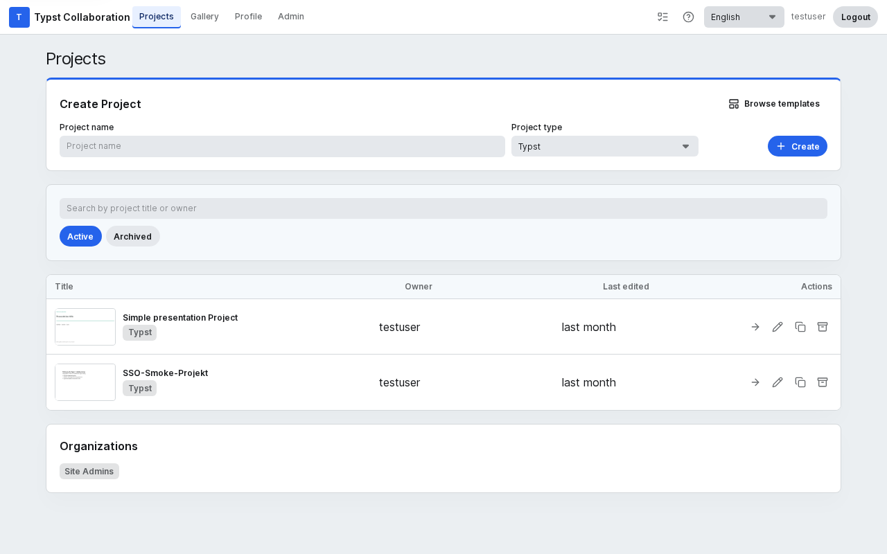

# Papier schreiben (Typst)

Das [Schreibstudio](https://toss.openedusuite.org) der openEduSuite
baut auf [Typst](https://typst.app) — der modernen Satz-Engine, die
aus schlichtem Text geglättete PDFs macht, ohne die steilen Kanten
von LaTeX. Im Browser schreiben Sie, die Vorschau baut sich live mit,
und der PDF-Export ist ein Klick.

## Anmelden

Melden Sie sich mit Ihrem openEduSuite-Konto an — Single Sign-On
bringt Sie direkt auf Ihre Seite **Projects** (Projekte). Sie listet
Ihre Arbeiten mit Eigentümer und letzter Bearbeitung, jede mit den
Aktionen **Open** (öffnen), **Rename** (umbenennen), **Copy**
(kopieren) und **Archive** (archivieren), und schaltet zwischen
**Active** (aktiv) und **Archived** (archiviert) um. Die Navigation
bietet daneben **Gallery** (Galerie), **Profile** und **Tasks**
(Aufgaben) sowie **Help** (Hilfe) — ein Hilfezentrum mit
Anleitungen zu Einstieg, Bearbeitung und Vorschau, Paketen und
LaTeX-Projekten.

## Ein Papier beginnen

**Create Project** (Projekt anlegen) öffnet das kleine Formular:
Geben Sie Ihrem Papier einen **Project name** (Projektnamen),
wählen Sie **Typst** als Projekttyp (LaTeX steht daneben) — und
**Create** (anlegen) öffnet den Editor. **Browse templates**
(Vorlagen durchstöbern) führt in die Galerie gepflegter
Ausgangspunkte. Der Editor trägt die Reiter **View**, **Files**,
**Preview**, **Settings** und **Revisions**; Quelltext auf der
einen, die gerenderte Vorschau auf der anderen Seite. Typst-Markup
ist leichter als LaTeX: `=` Überschriften, `-` Listen, `$…$`
Formeln. Ist das Papier reif, exportiert es die Schaltfläche
**Download PDF** im Vorschaubereich.

## Warum Typst

- **Schnelles Feedback** — die Vorschau folgt Ihrem Tippen, nicht
  einem Compiler
- **Sanfte Syntax** — lesbarer Quelltext, der trotzdem Tabellen,
  Abbildungen, Formeln und Literaturverzeichnisse setzt
- **Im Browser** — nichts zu installieren; Ihre Projekte warten im
  Studio, wo immer Sie sich anmelden

Für längere Dokumente, die einem Chat oder dem [Wiki](/suite/xwiki)
entwachsen, ist das Studio der Ort — und fertige PDFs passen direkt
in Ihre [Cloud-Dateien](/suite/files).

## Barrierefreiheit

| Aktion | Taste |
|--------|-------|
| Durch Projekte und Formulare bewegen | `Tab` |
| Fokussiertes Formularfeld bestätigen | `Enter` |

- Die Seiten sind gewöhnliche Web-Elemente: `Tab` bewegt Sie durch
  die Projektliste und das Anlege-Formular, `Enter` bestätigt.
- Im Editor schließt `Escape` Überlagerungen und Dialoge; verlieren
  Sie die Orientierung, bringt Sie `Strg+Pos1` zum Seitenanfang
  zurück.
