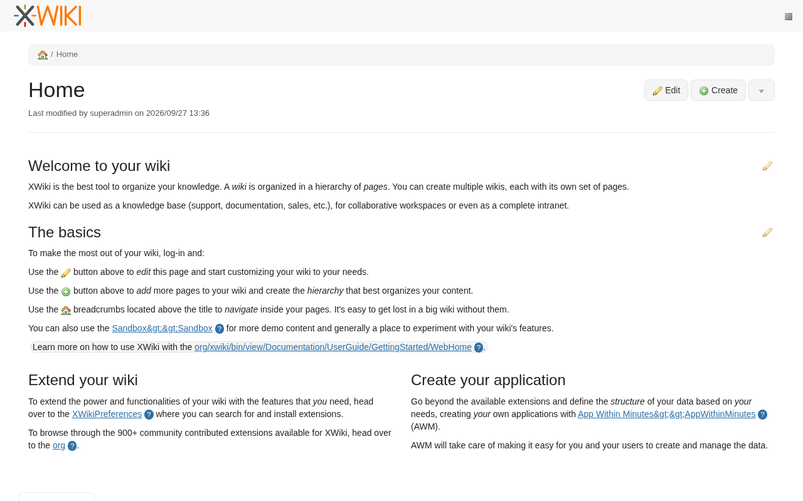

# Wiki (XWiki)

Das openEduSuite-[Wiki](https://xwiki.openedusuite.org) ist die
gemeinsame Wissensbasis: Dokumentation, Anleitungen und
Lehrmaterial, das zusammengehört — von allen geschrieben, für alle.
Es läuft auf [XWiki](https://www.xwiki.org), einer der
längstlebigen offenen Wiki-Engines.

## Lesen und anmelden

Das Wiki ist offen lesbar — zum Stöbern braucht es kein Konto. Zum
Bearbeiten wählen Sie im [Portal](/suite/portal) **Log-in** (Anmelden): Sie werden zur
openEduSuite-Anmeldung geleitet und mit Ihrem Namen zurück ins Wiki
geführt — unter Ihrem Namen stehen dann auch Ihre Änderungen.

## Die Hauptseite

Die Hauptseite des Wikis ist seine Eingangstür: Begrüßungstext, die
ersten Abschnitte („The basics", der **Sandbox**-Bereich — eine Seite,
auf der Ausprobieren ausdrücklich erlaubt ist) und Hinweise, das Wiki
zu erweitern. Angemeldet warten die Aktionen **Edit** (Bearbeiten)
und **Create** (Anlegen).

## Gemeinsam schreiben

Ein Wiki wächst in kleinen Schritten: **Edit** klicken, verbessern,
was da ist, mit einer Notiz speichern, was sich geändert hat.
**Create** legt eine neue Seite an. Üben Sie zuerst im **Sandbox** —
dort stört niemanden ein Experiment, und alte Versionen jeder Seite
bleiben erhalten, wirklich verloren geht also nichts.

Für Team-Material, das sich oft ändert, schlägt das Wiki Dateianhänge
— und es verbindet sich natürlich mit Ihren [Projekten](/suite/openproject)
und Gesprächen im [Chat](/suite/chat).

## Das Staff-Wiki

Neben dem Haupt-Wiki läuft eine zweite Instanz für Material der
Beschäftigten: [xwiki-staff.openedusuite.org](https://xwiki-staff.openedusuite.org).
Sie funktioniert genauso: offen lesbar, und **Log-in** führt Sie mit dem
Suite-Konto in die openEduSuite-Anmeldung.

Welches Sie brauchen, steht auf der Hauptseite jeder Instanz — das
Staff-Wiki hält interne Dokumentation, das Haupt-Wiki alles, das für
alle gedacht ist.

## Barrierefreiheit

| Aktion | Taste |
|--------|-------|
| Durch Navigation und Seiteninhalt bewegen | `Tab` |
| Fokussierten Link öffnen | `Enter` |
| Die Dialogmenüs des Editors verlassen | `Escape` |

- Das Wiki ist eine gewöhnliche Web-Anwendung: `Tab` bewegt Sie durch
  Navigation, Inhalt und die Bearbeitungs-Aktionen, `Enter` folgt dem
  fokussierten Link.
- Verlieren Sie die Orientierung, bringt Sie `Strg+Pos1` zum
  Seitenanfang zurück.
