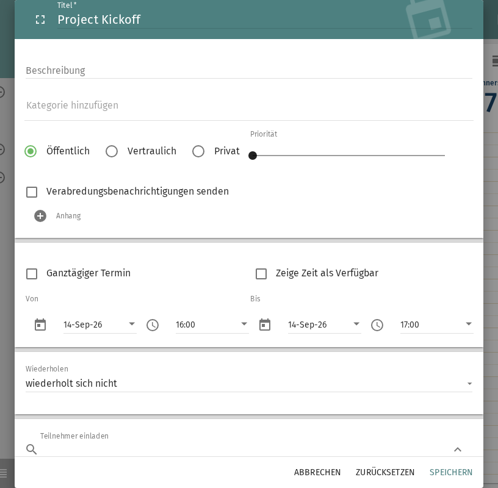
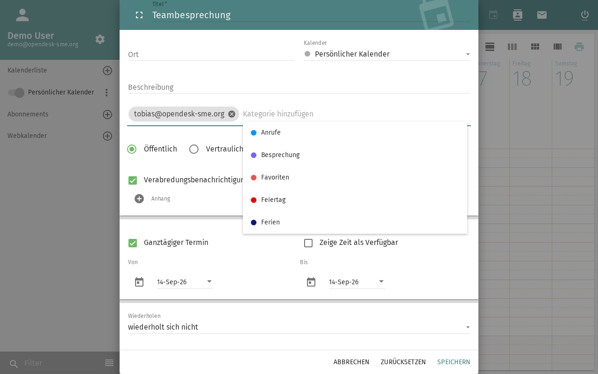

# Frei/Gebucht-Abfrage

Prüfen Sie die Verfügbarkeit Ihrer Kollegen, bevor Sie eine Besprechung
planen — direkt aus dem Dialog zur Ereigniserstellung.

## Warum die Kalenderfreigabe gegenseitig sein muss

Frei/Gebucht-Daten sind nicht öffentlich. Das Raster kann nur Verfügbarkeiten
zeigen, die jede Person aktiv freigegeben hat — deshalb muss die Freigabe in
beide Richtungen laufen:

- **Sie sehen Kollegen nur, wenn diese für Sie freigegeben haben.** Ohne
  erteilte Freigabe bleibt die Zeile auf „Keine Daten“ — die Verfügbarkeit
  bleibt unsichtbar.
- **Kollegen sehen Sie nur, wenn Sie freigegeben haben.** Dieselbe Prüfung
  läuft umgekehrt ab, wenn jemand anderes die Besprechung plant.
- **Einseitige Freigabe bricht den Workflow.** Gibt nur eine Seite frei,
  schlägt jede Abfrage in der anderen Richtung fehl — und die E-Mail-Frage
  „Sind Sie um … frei?“ ist genau da wieder da, wo die Frei/Gebucht-Abfrage
  sie eigentlich überflüssig machen sollte.

Bevor Sie sich auf das Raster verlassen, stellen Sie die Freigabe einmalig
gegenseitig sicher:

1. [Geben Sie Ihren eigenen Kalender frei](./sogo-calendar-share) —
   mindestens die Frei/Gebucht-Berechtigung für Ihr Team
2. Bitten Sie die Teilnehmer, es Ihnen gleichzutun

„Keine Daten“ ist daher kein Fehler: Das Berechtigungssystem funktioniert
genau wie vorgesehen.

## Voraussetzungen

- Ein SOGo 5-Konto mit gültigen Anmeldedaten
- Sie sind bei SOGo 5 angemeldet
- Gegenseitige Kalenderfreigabe: Der Kollege hat seine Frei/Gebucht-
  Informationen für Sie freigegeben, und Sie Ihre für ihn (siehe
  [Warum die Kalenderfreigabe gegenseitig sein muss](#warum-die-kalenderfreigabe-gegenseitig-sein-muss))

## Schritt-für-Schritt-Anleitung

### Schritt 1: Mit der Erstellung eines Ereignisses beginnen

1. Öffnen Sie das Modul **Kalender**
2. Klicken Sie auf **+**, um ein neues Ereignis zu erstellen, oder klicken Sie auf ein vorhandenes Ereignis, um es zu bearbeiten

### Schritt 2: Teilnehmer hinzufügen

1. Klicken Sie im Ereignisdialog auf den Bereich **Teilnehmer**
2. Beginnen Sie mit der Eingabe des Namens oder der E-Mail-Adresse eines Kollegen
3. Wählen Sie die Person aus der automatischen Vervollständigungsliste aus
4. Wiederholen Sie den Vorgang für jede Person, die Sie prüfen möchten

Sobald Personen eingetragen sind, öffnet sich das Frei/Gebucht-Raster automatisch —
es gibt keine separate Frei/Gebucht-Schaltfläche.

### Schritt 3: Das Raster lesen

Das Raster zeigt Zeitbereiche für jede Person. Verlassen Sie sich nicht auf
Farbnamen — die genauen Farben hängen vom SOGo-Skin und Design ab; lesen Sie
stattdessen die Statusbezeichnungen:

| Status | Bedeutung |
|-------|----------|
| **Beschäftigt** | Der Kollege hat ein Ereignis |
| **Vorläufig** | Nimmt vielleicht teil |
| **Verfügbar** | Zu dieser Zeit frei |
| Kein Eintrag / keine Daten | Kalender nicht für Sie freigegeben oder außerhalb der Arbeitszeit |

### Schritt 4: Einen gemeinsamen Zeitraum finden

Suchen Sie nach einem Zeitraum, in dem alle Teilnehmer als verfügbar angezeigt werden.
SOGo 5 schlägt möglicherweise automatisch den nächsten verfügbaren Termin vor.

### Schritt 5: Zeit bestätigen

Klicken Sie auf den gewünschten Zeitbereich im Raster.
Die Start-/Endzeit des Ereignisses wird entsprechend aktualisiert.

## Was andere sehen

Was eine Kollegin oder ein Kollege sehen kann, hängt von zwei Dingen ab:
von den Rechten, die die Person auf Ihrem Kalender hat, und davon, wie
das einzelne Ereignis eingestuft ist.

**1. Die Rechte auf dem Kalender.** Wenn ein Kalender freigegeben wird,
wird pro Person eine dieser Berechtigungen erteilt:

| Recht | Was es erlaubt |
|:------|:---------------|
| Ereignisse ohne Details sehen | Nur belegte und freie Zeiten — keine Titel, keine Details |
| Ereignisse mit Details sehen | Titel, Zeiten und Beschreibungen |
| Antworten | Auf Einladungen reagieren |
| Bearbeiten | Ereignisse anlegen, ändern und löschen |

Die Frei/Gebucht-Anzeige in dieser Anleitung ist die Ansicht „ohne
Details“.

**2. Die Einstufung des Ereignisses.** Jedes Ereignis trägt eine
Sichtbarkeit — je Ereignis im Ereignisdialog einstellbar: *Öffentlich*,
*Privat* oder *Vertraulich*.

Was eine Person für ein bestimmtes Ereignis sieht, hängt von beidem ab:
ihrem Recht am Kalender und der Einstufung des Ereignisses. Mit „ohne
Details“ sieht sie nur belegte Blöcke — unabhängig von der Einstufung.

## Fehlerbehebung

### Kollege wird nicht angezeigt

- Überprüfen Sie, ob der Kollege ein SOGo 5-Konto hat
- Möglicherweise hat er die Frei/Gebucht-Freigabe nicht aktiviert
- Er befindet sich möglicherweise in einem anderen Adressbuch — versuchen Sie, die vollständige E-Mail-Adresse einzugeben

### Alle Zeiten zeigen "Keine Daten"

- Es fehlt eine Freigabe, keine Störung — siehe
  [Warum die Kalenderfreigabe gegenseitig sein muss](#warum-die-kalenderfreigabe-gegenseitig-sein-muss)
- Der Kollege hat seinen Kalender nicht für Sie freigegeben
- Bitten Sie die Person oder Ihren Administrator, Ihnen den Frei/Gebucht-Zugriff zu gewähren

## Fazit

Die Frei/Gebucht-Abfrage hilft Ihnen, Besprechungstermine zu finden, ohne die
lästige E-Mail-Frage "Sind Sie um ... frei?". Sie funktioniert für
alle in Ihrer Organisation, die ihre Kalenderverfügbarkeit freigeben.
Die einmalige Voraussetzung ist die gegenseitige Freigabe: Das Raster zeigt
nur Kalender, deren Besitzer Zugriff gewährt haben — in beide Richtungen.
## Barrierefreiheit

### Tastaturnavigation

Diese Anwendung unterstützt die Tastaturnavigation. Keine Maus erforderlich.

| Aktion | Tastenkombination | Hinweise |
|--------|-------------------|----------|
| Module navigieren | `Tab` / `Umschalt+Tab` | Wechselt zwischen Bereichen |
| Auswählen/Aktivieren | `Eingabetaste` oder `Leertaste` | Link oder Schaltfläche aktivieren |
| Abbrechen/Schließen | `Escape` | Aktuelle Aktion abbrechen |
| Listen navigieren | `Pfeiltasten` | Durch Einträge bewegen |

**Reihenfolge der Screenreader-Navigation:**
1. Modul-Navigation → `Tab` zum Betreten
2. Modulinhalte → `Pfeiltasten` zum Navigieren
3. Aktionsschaltflächen → `Leertaste` oder `Eingabetaste` zum Aktivieren
4. Formulare → `Tab` zwischen Feldern, Pfeiltasten für Dropdowns

### Screenreader-Workflow

**Verfügbarkeitsprüfung: Die Verfügbarkeit von Kollegen für ein Meeting prüfen**

**Schritt 1: Kalender-Modul öffnen**
- `Tab` (ggf. mehrfach) zur Schaltfläche **Kalender**, dann `Eingabetaste`
- Sie hören: „Kalender, Modul-Überschrift“

**Schritt 2: Neues Ereignis anlegen**
- `Tab` zur Schaltfläche **+** (Ereignis erstellen) und `Eingabetaste` drücken
- Sie hören: „Neues Ereignis, Dialog“
- Der Ereignis-Dialog öffnet sich mit Feldern für Titel, Datum, Uhrzeit und Teilnehmer

**Schritt 3: Teilnehmerbereich öffnen**
- Mit `Tab` (ggf. mehrfach) durch die Ereignisfelder (Titel, Datum, Uhrzeit) navigieren
- Anhalten, wenn Sie den Bereich **Teilnehmer** erreichen
- Sie hören: „Teilnehmer, Abschnitt“

**Schritt 4: Verfügbarkeitsansicht öffnen**
- `Tab` zur Schaltfläche **Frei/Gebucht** bzw. **Verfügbarkeit**
- `Eingabetaste` zum Öffnen des Verfügbarkeitsrasters
- Sie hören: „Frei/Gebucht-Raster, Ihr Kalender wird angezeigt“

**Schritt 5: Kollegen hinzufügen**
- `Tab` zum Feld **Person hinzufügen**
- Name oder E-Mail-Adresse des Kollegen eingeben
- Sie hören: „Bearbeiten, Autovervollständigung, Vorschläge verfügbar“
- Mit `Pfeil nach unten` durch die vorgeschlagenen Namen navigieren
- `Eingabetaste` zum Auswählen des richtigen Kollegen
- Sie hören: „Person zum Raster hinzugefügt“

**Schritt 6: Raster navigieren und lesen**
- Mit `Tab` zwischen den Zeilen der Kollegen im Raster wechseln
- Mit `Pfeil nach links`/`Pfeil nach rechts` über die Zeitslots bewegen
- Sie hören jeden Slot: „10:00 Uhr, verfügbar“ oder „11:00 Uhr, gebucht“
- Status werden als Text übermittelt („Verfügbar“, „Gebucht“, „Mit Vorbehalt“) — Sie müssen sich nie auf Farben verlassen
- Für jeden hinzugefügten Kollegen wiederholen

**Schritt 7: Gemeinsamen freien Slot auswählen**
- Zu einem Zeitslot navigieren, in dem alle Kollegen als verfügbar angezeigt werden
- `Eingabetaste` zum Auswählen der Zeit
- Sie hören: „Zeit ausgewählt: 14:00 Uhr bis 15:00 Uhr“
- Beginn und Ende des Ereignisses werden automatisch aktualisiert

**Schritt 8: Ereignis speichern**
- Mit `Tab` zur Schaltfläche **Speichern** navigieren
- `Eingabetaste` zum Bestätigen und Anlegen des Ereignisses
- Sie hören: „Ereignis gespeichert“ oder eine ähnliche Bestätigung
- Das Ereignis erscheint mit der gewählten Zeit in Ihrem Kalender

**Häufige Screenreader-Ansagen:**

| Ansage | Bedeutung | Aktion |
|--------|-----------|--------|
| „Neues Ereignis, Dialog“ | Das Formular zum Anlegen ist offen | Ereignisdetails ausfüllen |
| „Frei/Gebucht-Raster, Ihr Kalender wird angezeigt“ | Die Verfügbarkeitsansicht ist aktiv | Kollegen hinzufügen |
| „Bearbeiten, Autovervollständigung, Vorschläge verfügbar“ | Das Personensuchfeld ist aktiv | Namen des Kollegen eingeben und aus der Liste wählen |
| „Person zum Raster hinzugefügt“ | Der Terminplan des Kollegen ist geladen | Weitere Personen hinzufügen oder einen Slot suchen |
| „10:00 Uhr, verfügbar“ | Der Zeitslot ist frei | Diesen Slot für das Meeting auswählen |
| „14:00 Uhr, gebucht“ | Der Zeitslot ist belegt | Einen anderen Zeitslot wählen |
| „Keine Daten“ (Zeile ohne Einträge) | Frei/Gebucht nicht freigegeben | Kollegen bitten, die Freigabe zu aktivieren, oder Administration kontaktieren |
| „Ereignis gespeichert“ | Das Meeting ist angelegt | Das Ereignis ist in Ihrem Kalender |

### Beschreibungen der visuellen Inhalte

**freebusy.png:** Animierte Demonstration der Prüfung der Verfügbarkeit von Kollegen über das Frei/Gebucht-Raster in SOGo 5.

### Hochkontrastmodus

SOGo unterstützt den Hochkontrast- und Dunkelmodus. Aktivierung über Benutzereinstellungen oder systemweite Barrierefreiheitseinstellungen:
- **Windows:** `Win+Strg+C` schaltet den Hochkontrast um
- **macOS:** Systemeinstellungen → Bedienungshilfen → Anzeige → Kontrast erhöhen
- **Browser-Erweiterungen:** Dark Reader, High Contrast (Chrome)

- **Orientierung:** verlieren Sie Ihren Platz, drücken Sie `Strg+Pos1`, um zum
  Seitenanfang zurückzukehren und von dort weiterzunavigieren.
