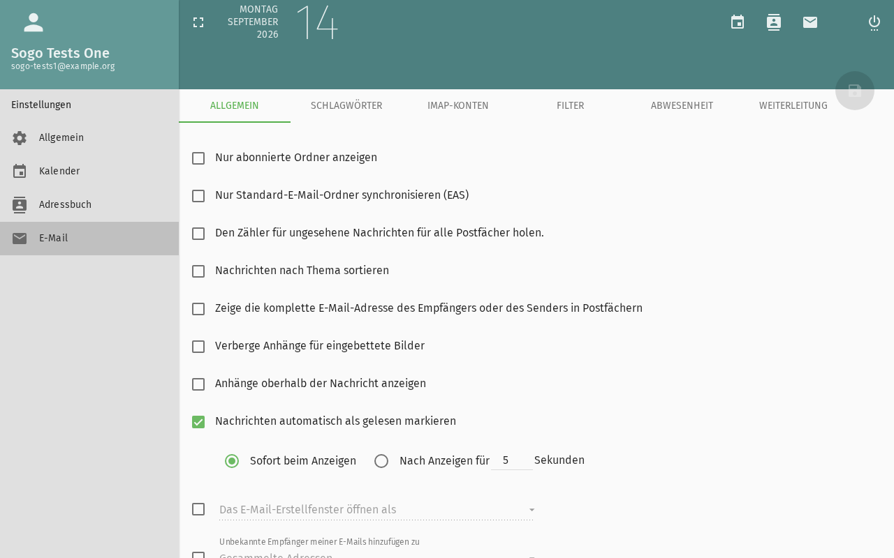

# E-Mail-Ordner und Filter

Erfahren Sie, wie Sie Ihren Posteingang mit Ordnern und
automatischen Nachrichtenfiltern (Sieve-Skripte) organisiert halten.

## Teil 1: Ordner verwalten

### Schritt 1: E-Mail-Modul öffnen

Klicken Sie oben in der Navigationsleiste auf **E-Mail**. Ihre Ordner werden links aufgelistet:

- **Posteingang** — Empfangene Nachrichten
- **Gesendet** — Von Ihnen gesendete Nachrichten
- **Entwürfe** — Ungespeicherte Nachrichten
- **Papierkorb** — Gelöschte Nachrichten
- **Spam** — Junk-E-Mail (falls aktiviert)

### Schritt 2: Neuen Ordner erstellen

1. Klicken Sie auf das Dreipunkt-Menü (⋯) neben einen beliebigen Ordner (z. B. Posteingang)
2. Wählen Sie **Neuer Ordner** oder **Ordner hinzufügen**
3. Geben Sie einen Namen ein (z. B. "Projekte", "Kunden", "Archiv")
4. Klicken Sie auf **OK**

Alternativ klicken Sie auf das **+**-Symbol neben der Ordnerlisten-Überschrift.

### Schritt 3: Verschachtelte Unterordner erstellen

Für eine bessere Strukturierung erstellen Sie Unterordner:

1. Klicken Sie auf das Dreipunkt-Menü (⋯) neben einen von Ihnen erstellten Ordner
2. Wählen Sie **Neuer Unterordner**
3. Benennen Sie ihn (z. B. "Projekte/Aktiv", "Projekte/Abgeschlossen")

**Ergebnis:**
```
📁 Posteingang
📁 Gesendet
📁 Projekte
  📁 Aktiv
  📁 Abgeschlossen
📁 Kunden
```

### Schritt 4: Nachrichten in Ordner verschieben

**Drag & Drop:** Klicken Sie auf eine Nachricht und ziehen Sie sie auf einen Ordner
**Dreipunkt-Menü (⋯):** Dreipunkt-Menü (⋯) bei einer Nachricht → **In Ordner verschieben** → Ziel auswählen
**Tastatur:** Nachrichten auswählen, `V` drücken, dann Ordner wählen

### Schritt 5: Ordner umbenennen oder löschen

- **Umbenennen:** Dreipunkt-Menü (⋯) neben Ordner → **Umbenennen**
- **Löschen:** Dreipunkt-Menü (⋯) neben Ordner → **Löschen** (leert den Ordner zuvor)

:::warning
Das Löschen eines Ordners löscht auch alle darin enthaltenen Nachrichten.
Verschieben Sie wichtige Nachrichten vorher an einen anderen Ort.
:::

## Teil 2: Automatische Filter (Sieve)

SOGo 5 verwendet **Sieve**-Skripte für die serverseitige E-Mail-Filterung.
Filter werden beim Eintreffen von E-Mails ausgeführt — bevor Sie sie in Ihrem Posteingang sehen.

### Schritt 1: Filtereinstellungen öffnen

1. Klicken Sie auf das **Dreipunkt-Menü** (⋯) (Einstellungen) in der oberen Symbolleiste
2. Wählen Sie **E-Mail** → **Filter**



### Schritt 2: Neuen Filter erstellen

Klicken Sie auf **Filter erstellen**.

### Schritt 3: Bedingungen festlegen

Legen Sie fest, wann der Filter angewendet werden soll:

| Bedingung | Beispiel |
|-----------|---------|
| **Von enthält** | `@example.com` → alle E-Mails von dieser Domain |
| **Betreff enthält** | `[Spam]` → potenziellen Spam markieren |
| **An enthält** | `team@firma.com` → Mailinglisten-Nachrichten |
| **Größer als** | `5M` → große Anhänge |

Sie können mehrere Bedingungen kombinieren:
- **Alle Bedingungen müssen zutreffen** (UND)
- **Jede Bedingung kann zutreffen** (ODER)

### Schritt 4: Aktionen festlegen

Wählen Sie, was passiert, wenn die Bedingungen erfüllt sind. Die genauen Bezeichnungen können je nach Version leicht variieren — typische Aktionen:

| Aktion | Anwendungsfall |
|--------|---------------|
| **In Ordner verschieben** | In den richtigen Ordner sortieren |
| **In Ordner kopieren** | Kopie im Posteingang behalten + in Ordner ablegen |
| **Weiterleiten an** | An eine andere Adresse senden |
| **Als gelesen markieren** | Newsletter automatisch archivieren |
| **Als markiert kennzeichnen** | Wichtige Absender hervorheben |
| **Verwerfen** | Spam löschen (mit Vorsicht verwenden) |
| **Mit Nachricht ablehnen** | Unerwünschte E-Mails mit eigener Nachricht zurückweisen |

**Wichtig:** Die Mails werden nur dann tatsächlich verschoben, wenn Sie als letzte Aktion **Beende die Filterverarbeitung** hinzufügen.

### Schritt 5: Filterpriorität festlegen

Filter werden von oben nach unten ausgeführt. Ziehen Sie Filter, um die Reihenfolge zu ändern.
Die Aktion des ersten zutreffenden Filters wird angewendet.

### Schritt 6: Filter speichern

Klicken Sie auf **Speichern** oder **Übernehmen**. Das Sieve-Skript wird kompiliert und
sofort auf dem Server aktiviert.

## Beispielfilter

### Beispiel 1: Arbeits-E-Mails sortieren

Ziel: Alle E-Mails von `@firma.com` in den Ordner „Arbeit" verschieben.

1. Legen Sie vorher den Ordner „Arbeit" an (Teil 1, Schritt 2)
2. Filtereinstellungen öffnen → **Filter erstellen**
3. Bedingung: **Von enthält** `@firma.com`
4. Aktion: **In Ordner verschieben** → Ordner „Arbeit" wählen
5. Letzte Aktion: **Beende die Filterverarbeitung**
6. Klicken Sie auf **Speichern**

### Beispiel 2: Dringende Nachrichten markieren

```
Bedingung: Betreff enthält "DRINGEND"
Aktion:    Als markiert kennzeichnen
```

### Beispiel 3: Newsletter archivieren

```
Bedingung: Von enthält "newsletter@"
Aktion:    In Ordner "Newsletter" verschieben
```

## Fehlerbehebung

### Filter funktionieren nicht

- Prüfen Sie, ob die letzte Aktion des Filters **Beende die Filterverarbeitung** ist (siehe Schritt 4)
- Testen Sie zuerst mit einem einfachen Filter (z. B. alle E-Mails von sich selbst verschieben)
- Ob Sieve aktiviert ist (`SOGoSieveScriptsEnabled = YES`), welche Sieve-Server-Adresse konfiguriert ist und ob die Server-Protokolle Sieve-Kompilierungsfehler zeigen, gehört zur Serverkonfiguration — das ist Aufgabe Ihrer IT-Administration. Fragen Sie im Zweifel Ihren Administrator.

### Ordner wird nicht angezeigt

- Melden Sie sich ab und wieder an
- Überprüfen Sie, ob der Ordner erstellt wurde (nicht versehentlich mit Schrägstrichen benannt)

## Fazit

Ordner und Filter helfen Ihnen, einen sauberen Posteingang ohne manuellen Aufwand zu erhalten.
Beginnen Sie mit 2–3 Filtern für Ihre häufigsten E-Mail-Muster.
## Barrierefreiheit

### Tastaturnavigation

Diese Anwendung unterstützt die Tastaturnavigation. Keine Maus erforderlich.

| Aktion | Tastenkombination | Hinweise |
|--------|-------------------|----------|
| Module navigieren | `Tab` / `Umschalt+Tab` | Wechselt zwischen Bereichen |
| Auswählen/Aktivieren | `Eingabetaste` oder `Leertaste` | Link oder Schaltfläche aktivieren |
| Abbrechen/Schließen | `Escape` | Aktuelle Aktion abbrechen |
| Listen navigieren | `Pfeiltasten` | Durch Einträge bewegen |

**Reihenfolge der Screenreader-Navigation:**
1. Modul-Navigation → `Tab` zum Betreten
2. Modulinhalte → `Pfeiltasten` zum Navigieren
3. Aktionsschaltflächen → `Leertaste` oder `Eingabetaste` zum Aktivieren
4. Formulare → `Tab` zwischen Feldern, Pfeiltasten für Dropdowns

### Screenreader-Workflow

**E-Mail-Ordner anlegen und automatische Filter einrichten**

**Teil 1: Ordner anlegen**

**Schritt 1: E-Mail-Modul öffnen**
1. `Tab` zur Modul-Navigation
2. Pfeiltasten zur Option **E-Mail**
3. `Eingabetaste`, um die E-Mail-Ansicht zu öffnen
4. Sie hören: „E-Mail, Baumansicht“ oder „Ordnerliste“

**Schritt 2: Neuen Ordner erstellen**
1. `Tab` zum **Dreipunkt-Menü** (⋯) neben einem Ordner (z. B. Posteingang)
2. Menü mit `Eingabetaste` öffnen, dann **Neuer Ordner** oder **Ordner hinzufügen** wählen
3. Ordnernamen eingeben (z. B. „Projekte“)
4. `Tab` zur Schaltfläche **OK**, `Eingabetaste` zum Anlegen
5. Alternativ: `Tab` zum **+**-Symbol neben der Ordnerlisten-Überschrift, `Eingabetaste`
6. Sie hören den neuen Ordner als Eintrag der Ordnerliste

**Schritt 3: Nachrichten verschieben (Tastatur statt Drag & Drop)**
1. Nachricht in der Liste mit den Pfeiltasten auswählen
2. `V` drücken — der Verschieben-Dialog öffnet sich
3. Mit den Pfeiltasten den Zielordner wählen, `Eingabetaste` zum Bestätigen
4. Sie hören: „Nachricht verschoben“ oder die Ansage des Zielordners

**Teil 2: Automatische Filter (Sieve) einrichten**

**Schritt 4: Filtereinstellungen öffnen**
1. `Tab` zum **Dreipunkt-Menü** (⋯) (Einstellungen) in der oberen Symbolleiste
2. Pfeiltasten zu **E-Mail** → **Filter**
3. `Eingabetaste`
4. Sie hören: „Filter, Überschrift“

**Schritt 5: Neuen Filter erstellen**
1. Fokus auf der Schaltfläche **Filter erstellen**, `Eingabetaste`
2. Filternamen eingeben

**Schritt 6: Bedingungen festlegen**
1. `Tab` zur Bedingungsauswahl (Kombinationsfeld)
2. Bedingung mit den Pfeiltasten wählen (z. B. „Von enthält“)
3. `Tab` zum Wertfeld, Wert eingeben (z. B. `@firma.com`)
4. Bei mehreren Bedingungen: mit den Pfeiltasten zwischen **Alle Bedingungen** (UND) und **Jede Bedingung** (ODER) wechseln

**Schritt 7: Aktionen festlegen und speichern**
1. `Tab` zu den Aktionen, Aktion festlegen (z. B. „In Ordner verschieben“)
2. Als letzte Aktion **Beende die Filterverarbeitung** hinzufügen — sonst verschiebt SOGo die Nachrichten nicht
3. `Tab` zur Schaltfläche **Speichern** oder **Übernehmen**, `Eingabetaste`
4. Sie hören: „Filter gespeichert“ — das Sieve-Skript ist auf dem Server aktiv

**Häufige Screenreader-Ansagen:**

| Ansage | Bedeutung | Aktion |
|--------|-----------|--------|
| „E-Mail, Baumansicht“ | E-Mail-Ordnerliste | Durch Ordner navigieren |
| „Neuer Ordner, Menüpunkt“ | Aktion zum Ordneranlegen | `Eingabetaste`, Namen eingeben |
| „Filter, Überschrift“ | Filterverwaltung geöffnet | Neuen Filter erstellen |
| „Bedingung, Kombinationsfeld“ | Dropdown für Filterbedingung | Mit Pfeiltasten auswählen |
| „Aktion, Listenraster“ | Verfügbare Filteraktionen | Aktion mit Pfeiltasten wählen |
| „Filter gespeichert“ | Erfolg | Filter ist nun aktiv |

### Beschreibungen der visuellen Inhalte

**mail-filters.png:** Der statische Screenshot zeigt die E-Mail-Filtereinstellungen in SOGo 5, in denen Sie Filter mit Bedingungen und Aktionen anlegen.

**Screenreader-Alternative:** Wenn Sie dieses Bild nicht anzeigen können, verwenden Sie den Abschnitt **Screenreader-Workflow** weiter oben. Er bietet dieselben Informationen in Textform, die für Screenreader geeignet ist.

### Hochkontrastmodus

SOGo unterstützt den Hochkontrast- und Dunkelmodus. Aktivierung über Benutzereinstellungen oder systemweite Barrierefreiheitseinstellungen:
- **Windows:** `Win+Strg+C` schaltet den Hochkontrast um
- **macOS:** Systemeinstellungen → Bedienungshilfen → Anzeige → Kontrast erhöhen
- **Browser-Erweiterungen:** Dark Reader, High Contrast (Chrome)

- **Orientierung:** verlieren Sie Ihren Platz, drücken Sie `Strg+Pos1`, um zum
  Seitenanfang zurückzukehren und von dort weiterzunavigieren.
