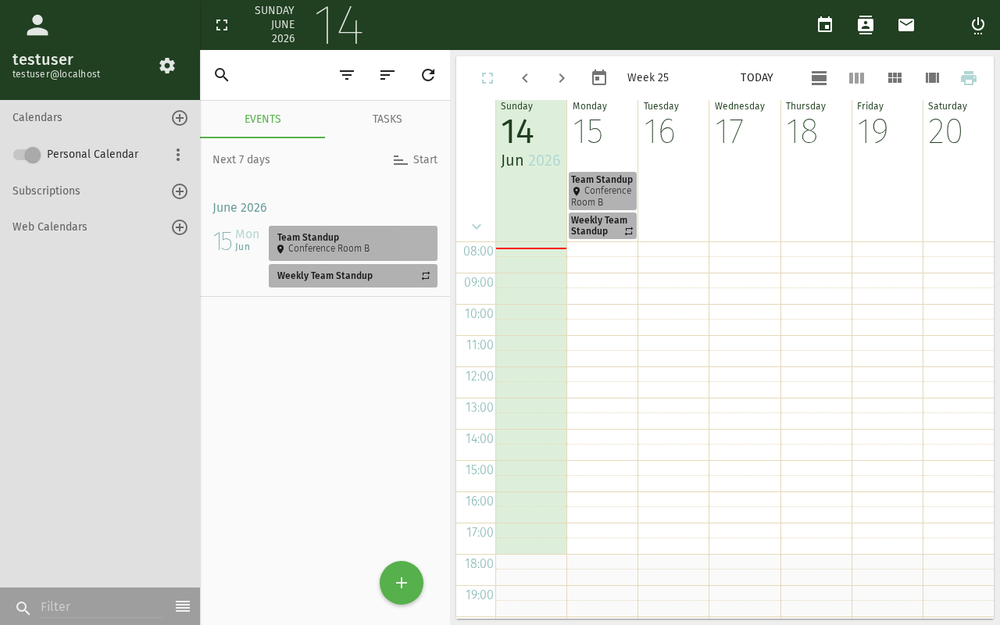

# Kalenderereignis erstellen

Dieses Tutorial führt Sie durch das Erstellen eines neuen Ereignisses im SOGo 6-Kalender,
einschließlich Datum und Uhrzeit, dem Hinzufügen von Teilnehmern und der Konfiguration von Erinnerungen.

## Voraussetzungen

- Ein SOGo 6-Konto mit gültigen Anmeldedaten
- Sie sind bei SOGo 6 angemeldet

## Schritt-für-Schritt-Anleitung

### Schritt 1: Kalendermodul öffnen

Klicken Sie oben in der Navigationsleiste auf **Kalender**,
um die Kalenderansicht zu öffnen.

Der Kalender öffnet standardmäßig in der **Wochenansicht**. Sie können zwischen
den Ansichten Tag, Woche, Monat und Jahr mit den Schaltflächen in der oberen Symbolleiste wechseln.

### Schritt 2: Neues Ereignis erstellen

Es gibt drei Möglichkeiten, ein Ereignis zu erstellen:

| Methode | Aktion |
|---------|--------|
| **Auf +-Schaltfläche klicken** | Klicken Sie auf die **+** (Plus)-Schaltfläche am unteren Rand der Kalenderansicht |
| **Doppelklicken** | Doppelklicken Sie auf einen beliebigen Zeitbereich im Kalendergitter |
| **Datumsauswahl verwenden** | Klicken Sie auf ein Datum im Minikalender links, dann auf **+** |

Wählen Sie die gewünschte Methode. Ein Dialog für ein neues Ereignis wird angezeigt.

### Schritt 3: Ereignisdetails eingeben

Füllen Sie die Ereignisdetails aus:

| Eingabefeld | Beschreibung | Beispiel |
|------|-------------|----------|
| **Ereignistitel** | Ein kurzer Name für Ihr Ereignis | "Team-Besprechung" |
| **Kalender** | In welchem Kalender gespeichert werden soll — Auswahl aus Ihrer Kalenderliste | Ihr persönlicher Kalender |
| **Ganztägig** | Schalter für Ganztägiges Ereignis (z. B. Geburtstage, Feiertage); die Zeitfelder sind dann deaktiviert | — |
| **Startzeit / Endzeit** | Datum und Uhrzeit von Beginn und Ende | Heute, 10:00–11:00 |
| **Zeitzone (Ereignis)** | Zeitzone für Beginn und Ende — nützlich bei Ereignissen über Zeitzonen hinweg | GMT+01:00 Europe/Berlin |
| **Ort** | Wo das Ereignis stattfindet | "Konferenzraum B" |
| **Beschreibung** | Notizen, Tagesordnung oder Vorbereitungshinweise | — |
| **URL** | Optionaler Link (z. B. zum Besprechungsdokument) | — |

Der Dialog bietet darüber hinaus Felder, die beeinflussen, wie das
Ereignis für andere erscheint:

| Feld | Optionen | Wirkung |
|--------|---------|--------|
| **Visibility** | Public · Private · Confidential | Einstufung pro Ereignis — siehe [Frei/Gebucht: Was andere sehen](./sogo-calendar-freebusy#was-andere-sehen) |
| **Show as** | Busy · Free · Out of office · Tentative | Wie das Ereignis erscheint, wenn jemand Ihre Verfügbarkeit prüft |
| **Status** | Confirmed · Tentative · Cancelled | Der Status des Ereignisses selbst |
| **Labels** | — | Optionale Labels für das Ereignis |
| **Participants** | — | Eingeladene Personen — siehe nächster Schritt |

### Schritt 4: Teilnehmer hinzufügen (Optional)

Wenn Sie andere Personen einladen möchten:

1. Klicken Sie auf den Bereich **Teilnehmer**, um ihn zu erweitern
2. Beginnen Sie mit der Eingabe des Namens oder der E-Mail-Adresse eines Kollegen
3. Wählen Sie die Person aus den automatischen Vervollständigungsvorschlägen aus
4. Wählen Sie deren **Teilnahmerolle**:
   - **Erforderlich** — Muss teilnehmen
   - **Optional** — Willkommen, aber nicht erforderlich
5. Wiederholen Sie dies für jeden weiteren Teilnehmer

SOGo 6 sendet jedem Teilnehmer eine E-Mail-Einladung, wenn Sie das Ereignis speichern.

### Schritt 5: Erinnerung festlegen (Optional)

Um eine Erinnerung vor dem Ereignis zu erhalten:

1. Klicken Sie auf **Add reminder** (Erinnerung hinzufügen)
2. Legen Sie fest, wie weit im Voraus Sie erinnert werden möchten

Sie können mehrere Erinnerungen pro Ereignis hinzufügen.

### Schritt 6: Beschreibung hinzufügen (Optional)

Nutzen Sie das Feld **Beschreibung**, um Notizen, eine Tagesordnung oder Vorbereitungshinweise
für das Ereignis hinzuzufügen. Dieses Feld unterstützt Klartext.

### Schritt 7: Wiederholung festlegen (Optional)

Für sich wiederholende Ereignisse klicken Sie auf den Bereich **Wiederholen** und wählen ein Muster:

| Zeitlicher Abstand | Beispiel |
|--------|----------|
| **Day(s)** — täglich | Tägliches Standup-Meeting |
| **Week(s)** — wöchentlich | Team-Meeting jeden Dienstag |
| **Month(s)** — monatlich | Abteilungsmeeting am ersten Montag jedes Monats |
| **Year(s)** — jährlich | Geburtstag oder Jahrestag |

Sie können auch ein **Enddatum** für die Wiederholung festlegen (z. B. Wiederholung bis
zum Semesterende).

### Schritt 8: Ereignis speichern

Klicken Sie auf **Create Event** (Ereignis erstellen), um das Ereignis zu erstellen — oder auf **Cancel** (Abbrechen), um es zu verwerfen.

Das Ereignis wird in Ihrem Kalender angezeigt. Wenn Sie Teilnehmer hinzugefügt haben, erhalten diese
eine E-Mail-Einladung, die sie annehmen oder ablehnen können.

## Fazit

Sie haben erfolgreich ein Kalenderereignis erstellt. Sie können nun:
- [Ihren Kalender mit anderen teilen](./sogo-calendar-share)
- Das Ereignis durch Klicken bearbeiten
- Es per Drag & Drop verschieben
- Die Dauer durch Ziehen an den Rändern ändern
## Barrierefreiheit

### Tastaturnavigation

Diese Anwendung unterstützt die Tastaturnavigation. Keine Maus erforderlich.

| Aktion | Tastenkombination | Hinweise |
|--------|-------------------|----------|
| Module navigieren | `Tab` / `Umschalt+Tab` | Wechselt zwischen Bereichen |
| Auswählen/Aktivieren | `Eingabetaste` oder `Leertaste` | Link oder Schaltfläche aktivieren |
| Abbrechen/Schließen | `Escape` | Aktuelle Aktion abbrechen |
| Listen navigieren | `Pfeiltasten` | Durch Einträge bewegen |

**Reihenfolge der Screenreader-Navigation:**
1. Modul-Navigation → `Tab` zum Betreten
2. Modulinhalte → `Pfeiltasten` zum Navigieren
3. Aktionsschaltflächen → `Leertaste` oder `Eingabetaste` zum Aktivieren
4. Formulare → `Tab` zwischen Feldern, Pfeiltasten für Dropdowns

### Hochkontrastmodus

SOGo unterstützt den Hochkontrast- und Dunkelmodus. Aktivierung über Benutzereinstellungen oder systemweite Barrierefreiheitseinstellungen:
- **Windows:** `Win+Strg+C` schaltet den Hochkontrast um
- **macOS:** Systemeinstellungen → Bedienungshilfen → Anzeige → Kontrast erhöhen
- **Browser-Erweiterungen:** Dark Reader, High Contrast (Chrome)
