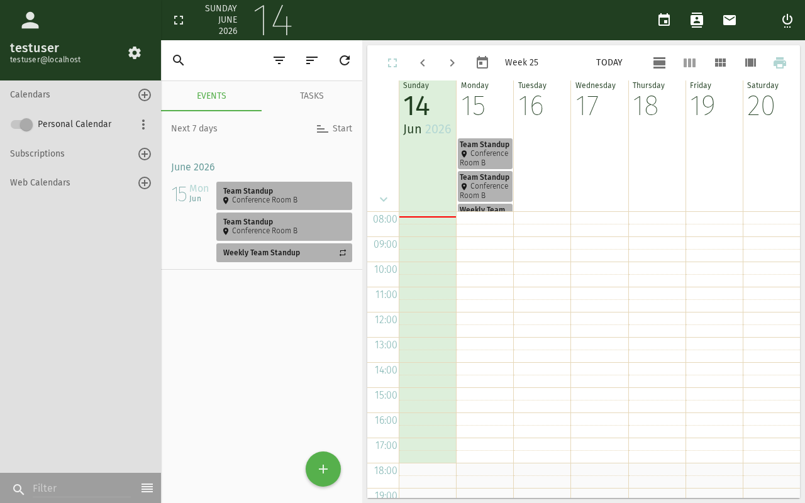
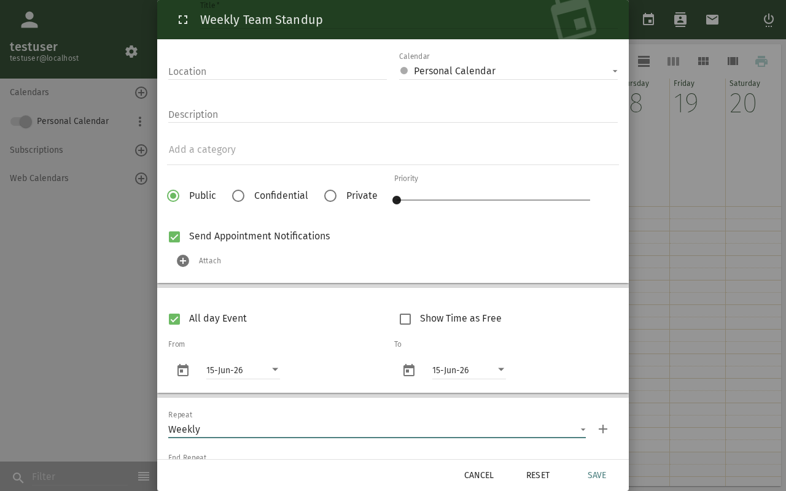
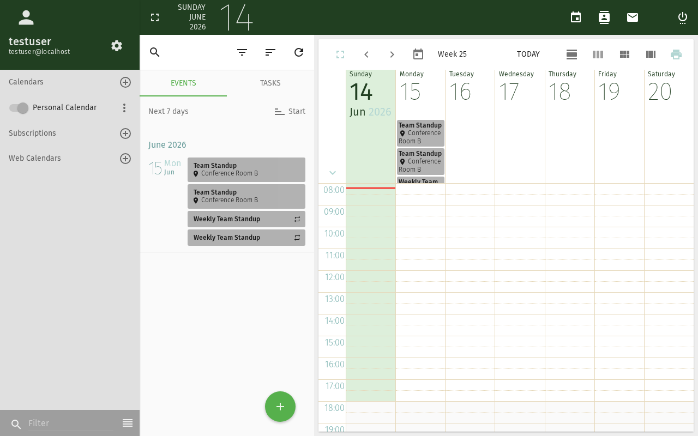

import VideoFallback from '@site/src/components/VideoFallback';

import Tabs from '@theme/Tabs';
import TabItem from '@theme/TabItem';

# Wiederkehrende Ereignisse und Erinnerungen

Dieses Tutorial behandelt das Erstellen von Ereignissen, die sich nach einem Zeitplan wiederholen,
und das Konfigurieren von Erinnerungen, damit Sie sie nie verpassen.

## Voraussetzungen

- Ein SOGo 6-Konto mit gültigen Anmeldedaten
- Sie sind bei SOGo 6 angemeldet

## Teil 1: Ein wiederkehrendes Ereignis erstellen

### Schritt 1: Ein neues Ereignis beginnen

1. Öffnen Sie das Modul **Kalender**
2. Klicken Sie auf die **+** (Plus)-Schaltfläche oder doppelklicken Sie auf einen Zeitbereich

3. Der Dialog für das neue Ereignis wird angezeigt

### Schritt 2: Grundlegende Details festlegen

Füllen Sie aus:
- **Titel:** z. B. "Wöchentliches Team-Standup"
- **Beginn / Ende:** Datum und Uhrzeit des ersten Vorkommens
- **Kalender:** Wählen Sie, in welchem Kalender gespeichert werden soll

### Schritt 3: Wiederholung konfigurieren

Aktivieren Sie den Schalter **Repeat** (Wiederholen):

<VideoFallback
  srcMp4="/docmakerai/clips/calendar-recurring.mp4"
  poster="/docmakerai/clips/calendar-recurring.png"
  alt="Kurzclip: Wiederholen aktivieren und die Häufigkeitsoptionen öffnen im SOGo-6-Ereignisdialog"
  width="640"
  height="400"
/>

| Option | Beschreibung | Beispiel |
|--------|-------------|----------|
| **Day(s)** — täglich | Wiederholt sich alle N Tage | Morgen-Check-in |
| **Week(s)** — wöchentlich | Wiederholt sich an ausgewählten Wochentagen | Standup jeden Mo/Mi/Fr |
| **Month(s)** — monatlich | Wiederholt sich an einem Tag im Monat | Abteilungsmeeting am 1. |
| **Year(s)** — jährlich | Wiederholt sich an einem Datum jedes Jahr | Geburtstag, Jahrestag |

:::tip
Bei **wöchentlicher** Wiederholung können Sie mehrere Tage auswählen
(z. B. Montag, Mittwoch, Freitag), indem Sie die Kontrollkästchen aktivieren.
:::

### Schritt 4: Enddatum festlegen (Empfohlen)

Legen Sie stets ein Enddatum für wiederkehrende Ereignisse fest, um eine unendliche
Wiederholung zu vermeiden:

- **Ende am:** Ein bestimmtes Datum wählen (z. B. Semesterende)
- **Ende nach N Vorkommen:** Anzahl der Wiederholungen begrenzen
- **Kein Enddatum:** Sparsam verwenden — nur für dauerhafte Ereignisse

### Schritt 5: Wiederkehrendes Ereignis erstellen

Klicken Sie auf **Create Event** (Ereignis erstellen). Das Ereignis wird erstellt und
als wiederkehrend gekennzeichnet.

## Teil 2: Alarme (Erinnerungen) hinzufügen

Um eine Erinnerung vor dem Ereignis zu erhalten:

1. Klicken Sie im Ereignisdialog auf **Add reminder** (Erinnerung hinzufügen)
2. Legen Sie fest, wie weit im Voraus Sie erinnert werden möchten

Sie können mehrere Erinnerungen pro Ereignis hinzufügen.

## Teil 3: Wiederholung bearbeiten oder beenden

### Ein einzelnes Vorkommen bearbeiten

1. Klicken Sie auf die bestimmte Ereignisinstanz im Kalender
2. Wählen Sie **Nur dieses Vorkommen bearbeiten**
3. Nehmen Sie Änderungen vor — sie gelten nur für dieses Datum

### Die gesamte Serie bearbeiten

1. Klicken Sie auf ein beliebiges Vorkommen
2. Wählen Sie **Die Serie bearbeiten**
3. Änderungen gelten für alle Ereignisse der Wiederholung

### Wiederholung beenden

1. Öffnen Sie den Ereignisdialog
2. Deaktivieren Sie den Schalter **Repeat**
3. Speichern — SOGo 6 fragt, ob künftige Vorkommen dieser Serie geändert werden sollen
4. Wählen Sie **Alle zukünftigen Ereignisse löschen** oder **Als einzelne Ereignisse behalten**

## Fehlerbehebung

### Wiederholungsoptionen werden nicht angezeigt

- Stellen Sie sicher, dass Sie ein neues oder vorhandenes Ereignis im Modul **Kalender**
  bearbeiten, nicht eine per E-Mail erhaltene Einladung
- Einige SOGo 6-Designs verbergen den Wiederholungsbereich hinter einer Schaltfläche "Weitere Optionen"

### Alarm wird nicht ausgelöst

- **Anzeige-Alarme** erfordern, dass der Browser-Tab geöffnet ist
- Überprüfen Sie die Browser-Benachrichtigungsberechtigungen

## Fazit

Sie haben gelernt, wie Sie wiederkehrende Ereignisse erstellen und Alarme in SOGo 6 einrichten.
Diese Funktionen sind unerlässlich für regelmäßige Besprechungen, Fristen und
wichtige Termine.
## Barrierefreiheit

### Tastaturnavigation

Diese Anwendung unterstützt die Tastaturnavigation. Keine Maus erforderlich.

| Aktion | Tastenkombination | Hinweise |
|--------|-------------------|----------|
| Module navigieren | `Tab` / `Umschalt+Tab` | Wechselt zwischen Bereichen |
| Auswählen/Aktivieren | `Eingabetaste` oder `Leertaste` | Link oder Schaltfläche aktivieren |
| Abbrechen/Schließen | `Escape` | Aktuelle Aktion abbrechen |
| Listen navigieren | `Pfeiltasten` | Durch Einträge bewegen |

**Reihenfolge der Screenreader-Navigation:**
1. Modul-Navigation → `Tab` zum Betreten
2. Modulinhalte → `Pfeiltasten` zum Navigieren
3. Aktionsschaltflächen → `Leertaste` oder `Eingabetaste` zum Aktivieren
4. Formulare → `Tab` zwischen Feldern, Pfeiltasten für Dropdowns

### Screenreader-Workflow

**Wiederkehrendes Ereignis anlegen**

**Schritt 1: Neues Ereignis anlegen**
1. `Tab` (ggf. mehrfach) zur Seitenleiste
2. `Pfeiltasten` zu **Kalender**
3. `N` oder `+` für ein neues Ereignis drücken

**Schritt 2: Wiederholungseinstellungen öffnen**
1. Der Ereignis-Dialog öffnet sich
2. Mit `Tab` zum Wiederholungsfeld navigieren
3. `Leertaste` drücken, um den Wiederholungsbereich aufzuklappen

**Schritt 3: Wiederholungshäufigkeit festlegen**
1. Fokus auf die Auswahlliste für die Häufigkeit setzen
2. Mit `Pfeiltasten` auswählen (Täglich/Wöchentlich/Monatlich/Jährlich)
3. `Eingabetaste` drücken

**Schritt 4: Wiederholungsdetails festlegen**
1. Mit `Tab` zum Intervallfeld navigieren (z. B. „Alle 2 Tage“)
2. Intervallzahl eingeben, Einheit mit `Pfeiltasten` auswählen
3. Mit `Tab` zu Enddatum bzw. Anzahl der Wiederholungen navigieren
4. Festlegen, wann die Wiederholung endet

**Schritt 5: Wiederkehrendes Ereignis anlegen**
1. Mit `Tab` zur Schaltfläche **Ereignis erstellen** navigieren
2. `Eingabetaste` drücken
3. Sie hören eine Bestätigung, dass die Serie angelegt wurde

**Häufige Screenreader-Ansagen:**

| Ansage | Bedeutung | Aktion |
|------------------------------------------|---------------------------------|------------------------------------------|
| „Wiederholung, Kontrollkästchen“ | Wiederholung verfügbar | `Leertaste` zum Aktivieren |
| „Häufigkeit, Optionsfeld“ | Wie oft wiederholt wird | Mit `Pfeiltasten` den Typ auswählen |
| „Alle, Bearbeiten“ | Wiederholungsintervall | Zahl eingeben, Einheit auswählen |
| „Bis, Datumsauswahl“ | Ende der Wiederholung | Mit `Tab` navigieren, Enddatum wählen |
| „Wiederholungen, Bearbeiten“ | Wie oft wiederholt wird | Zahl eingeben oder leer lassen |
| „Wiederkehrendes Ereignis erstellt“ | Erfolg | Die Ereignisserie ist gespeichert |

### Beschreibungen der visuellen Inhalte

**calendar-recurring.png:** Statischer Screenshot des Ereignis-Dialogs mit geöffneter Auswahlliste für die Wiederholungshäufigkeit.

### Hochkontrastmodus

SOGo unterstützt den Hochkontrast- und Dunkelmodus. Aktivierung über Benutzereinstellungen oder systemweite Barrierefreiheitseinstellungen:
- **Windows:** `Win+Strg+C` schaltet den Hochkontrast um
- **macOS:** Systemeinstellungen → Bedienungshilfen → Anzeige → Kontrast erhöhen
- **Browser-Erweiterungen:** Dark Reader, High Contrast (Chrome)

- **Orientierung:** verlieren Sie Ihren Platz, drücken Sie `Strg+Pos1`, um zum
  Seitenanfang zurückzukehren und von dort weiterzunavigieren.
