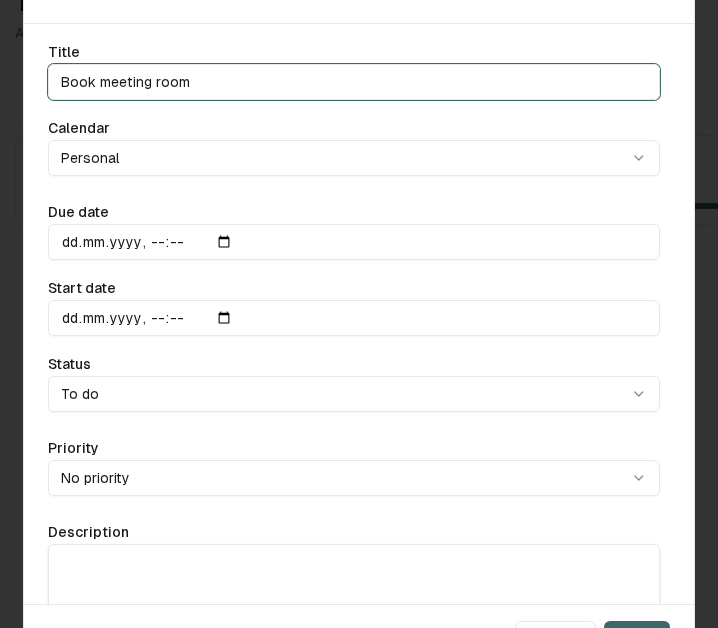

import VideoFallback from '@site/src/components/VideoFallback';

# Aufgaben / To-Do-Modul

Organisieren Sie Aufgaben, setzen Sie Prioritäten und Fälligkeitsdaten im SOGo-6-Aufgabenmodul.

## Voraussetzungen

- Ein SOGo 6-Konto mit gültigen Anmeldedaten
- Sie sind bei SOGo 6 angemeldet

## Das Modul im Überblick

Klicken Sie in der Navigationsseitenleiste auf **Tasks** (Aufgaben), um das Modul zu öffnen.

Aufgaben sind oben im Modul in Ansichten gruppiert:

| Ansicht | Zeigt |
|---------|-------|
| **All tasks** — alle Aufgaben | Jede Aufgabe |
| **Today** — heute | Aufgaben, die heute fällig sind |
| **Upcoming** — anstehend | Aufgaben, die später fällig sind |
| **Overdue** — überfällig | Aufgaben nach dem Fälligkeitsdatum |
| **Completed** — abgeschlossen | Erledigte Aufgaben |

Aufgaben werden in einem Kalender gespeichert — standardmäßig in Ihrem persönlichen Kalender.

## Aufgabe erstellen

1. Klicken Sie auf **New task** (Neue Aufgabe)
2. Füllen Sie den Dialog aus:

| Feld | Beschreibung |
|------|-------------|
| **Title** — Titel | Kurzer Aufgabenname |
| **Calendar** — Kalender | In welchem Kalender die Aufgabe gespeichert wird |
| **Due date** — Fällig am | Bis wann die Aufgabe erledigt sein muss |
| **Start date** — Beginnt am | Wann die Aufgabe beginnt |
| **Status** — Status | Aufgabenstatus — Standard: *To do* (Zu erledigen) |
| **Priority** — Priorität | Aufgabenpriorität — Standard: *No priority* (Keine Priorität) |
| **Description** — Beschreibung | Ausführliche Notizen |

3. Klicken Sie auf **Save** (Speichern)

<VideoFallback
  srcMp4="/docmakerai/clips/tasks-add.mp4"
  poster="/docmakerai/clips/tasks-add.png"
  alt="Kurzclip: den Dialog „New task“ öffnen und den Titel ausfüllen in SOGo 6"
  width="640"
  height="400"
/>

## Mit Aufgaben arbeiten

- Öffnen Sie eine Aufgabe, um ihre Felder zu bearbeiten
- Die Ansicht **Completed** sammelt erledigte Aufgaben
- Die Ansicht **Overdue** zeigt Aufgaben nach dem Fälligkeitsdatum

## Barrierefreiheit

### Tastaturnavigation

| Aktion | Wie | Hinweis |
|--------|-----|---------|
| Aufgabenmodul öffnen | `Tab` zu Tasks, dann `Enter` | Aus jedem Modul |
| Aufgabe erstellen | `Tab` zu **New task**, dann `Enter` | Öffnet den Aufabendialog |
| Durch die Dialogfelder bewegen | `Tab` / `Shift+Tab` | Pfeiltasten funktionieren in Dropdowns |
| Aufgabe speichern | `Tab` zu **Save**, dann `Enter` | Bestätigen-Schaltfläche des Dialogs |

### Screenreader

- `Strg+Pos1` bringt Sie an den Seitenanfang — ein verlässlicher
  Ausgangspunkt, um die Seite mit `h` (Überschriften) zu erschließen.
- Nach dem Öffnen des Aufgabendialogs erreichen Sie mit `Tab` die Felder
  in ihrer sichtbaren Reihenfolge: Title, Calendar, Due date, Start
  date, Status, Priority, Description.
- Sie hören die Feldbezeichnungen, während Sie durch die Felder gehen.
