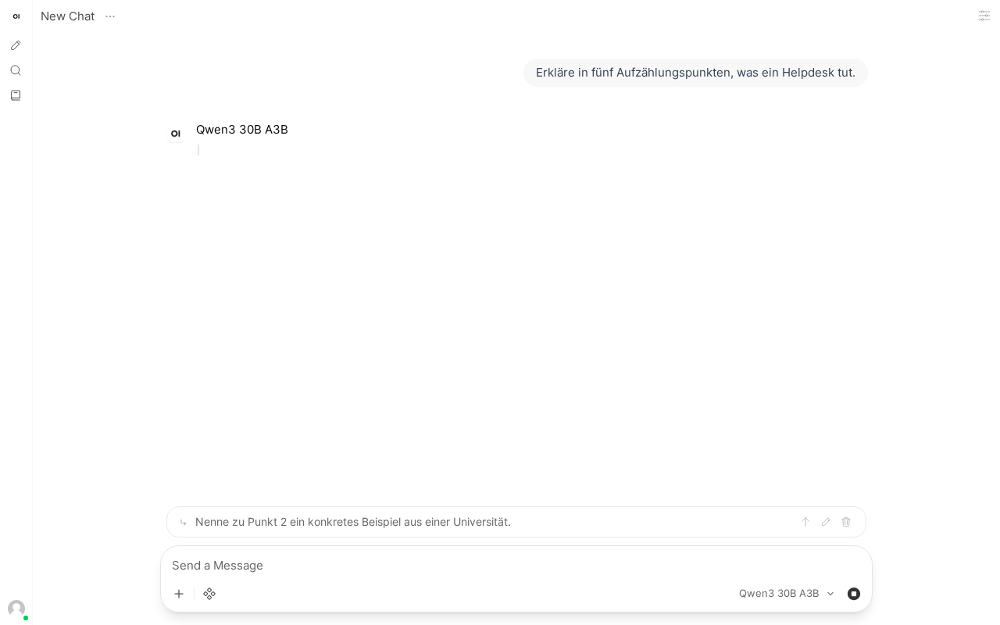

import VideoFallback from '@site/src/components/VideoFallback';

# AI Chat (Open WebUI)

The AI chat ([Open WebUI](https://ai.openedusuite.org)) lets you work
with a large language model: ask questions, have texts written or
summarized, or get help structuring your work. From the [portal](/suite/portal), sign in with your
openEduSuite account.

<VideoFallback
  srcMp4="/docmakerai/clips/ai-chat.mp4"
  poster="/docmakerai/clips/ai-chat.png"
  alt="Short clip: asking the AI chat a question and receiving an answer"
  width="640"
  height="400"
/>

## Asking a Question

1. Open the AI chat and sign in if asked
2. At the bottom, write your question into the message field —
   suggestion cards can serve as a starting point
3. Send it with `Enter` — the answer streams in as it is written
4. Ask follow-up questions — the chat keeps the context of the
   conversation, as the clip above shows

Above the message field you see which model answers — pick another one
there if your university offers several.

## Working Well With the AI

- Give context: what the text is for, for whom, in which language
- For long texts: paste them in and say what should happen (summarize,
  shorten, check)
- Check important statements — the AI can be confidently wrong
- Do not paste confidential or personal data you would not share
  openly; ask at the [helpdesk](/suite/helpdesk-create-ticket) if you
  are unsure what is allowed

## Accessibility

| Action | Key |
|--------|-----|
| Start a new chat | `Ctrl+Shift+O` |
| Search your chats | `Ctrl+K` |
| Move to the message field | `Tab` |
| Send the message | `Enter` |

- The chat is a normal web page: `Tab` brings you to the message
  field, `Enter` sends the focused message.
- If you lose your orientation, press `Ctrl+Home` (German keyboards:
  `Strg+Pos1`) to return to the top of the page.

- **High contrast and dark mode:** contrast and dark themes come from the
  operating system or browser — Windows `Win+Ctrl+C`, macOS *Increase contrast*,
  or a browser extension such as Dark Reader. If the app offers its own dark
  theme, switch it in its settings; the navigation described above still applies.
