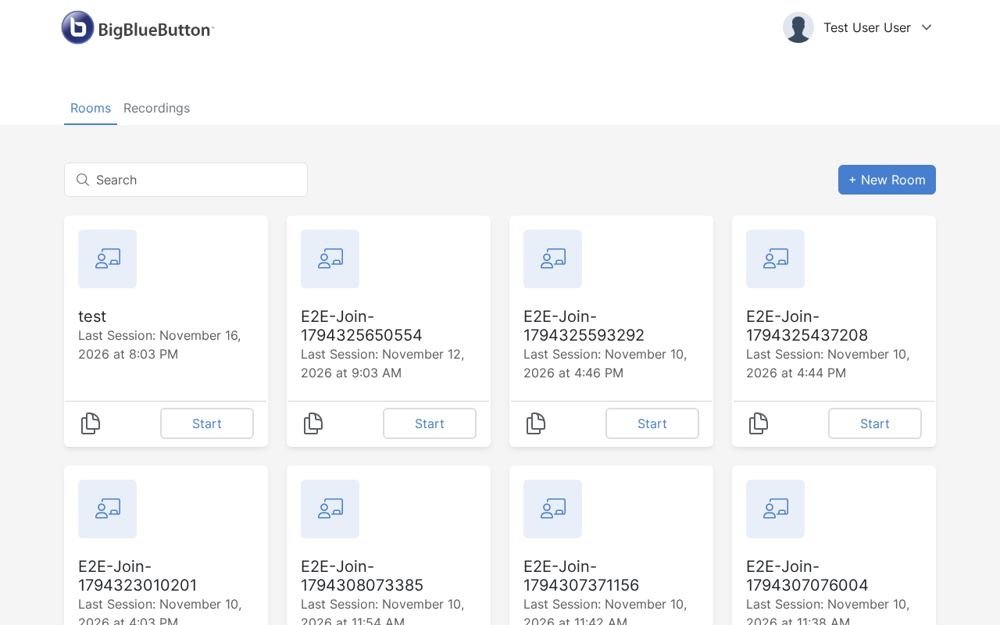

# Video Conferences (BigBlueButton)

The openEduSuite's [conferencing](https://bbb.openedusuite.org) runs on
[BigBlueButton](https://bigbluebutton.org) with Greenlight as its
front door: your personal conference rooms, ready to start, for
lectures, seminars, and working meetings — in the browser, no
installation.

## Signing In

BigBlueButton greets you in German ("Willkommen in BigBlueButton").
Open the BigBlueButton tile in the [portal](/suite/portal), choose
**Anmelden** (sign in) in the top right — the openEduSuite sign-in
follows, and you land in your rooms.

## Your Rooms

The **Rooms** page is your home base: each room is a standing
conference space with its own link. **+ New Room** adds another — one
for the lecture, one for office hours, one for the project.

- **Start** opens the live session: microphone and camera are asked
  for when you join, and the conference window offers screen sharing,
  chat, and a collaborative whiteboard
- **Recordings** keeps the sessions you recorded, ready to share with
  those who missed them

Share a room's link and people can join without an account — handy
for guests outside the university.

If the service stays closed to you, the
[helpdesk](/suite/helpdesk-create-ticket) reaches its operators.

## Accessibility

| Action | Key |
|--------|-----|
| Move through the room list and buttons | `Tab` |
| Open the focused action | `Enter` |

- Greenlight's pages are ordinary web elements: `Tab` moves you
  through rooms and actions, `Enter` opens the focused one.
- Inside a running conference, keyboard reachability is limited;
  if you lose your orientation there, `Escape` leaves full-screen
  views, and the browser's `Ctrl+Home` (German keyboards:
  `Strg+Pos1`) returns you to the top of the page outside it.

- **High contrast and dark mode:** contrast and dark themes come from the
  operating system or browser — Windows `Win+Ctrl+C`, macOS *Increase contrast*,
  or a browser extension such as Dark Reader. If the app offers its own dark
  theme, switch it in its settings; the navigation described above still applies.
