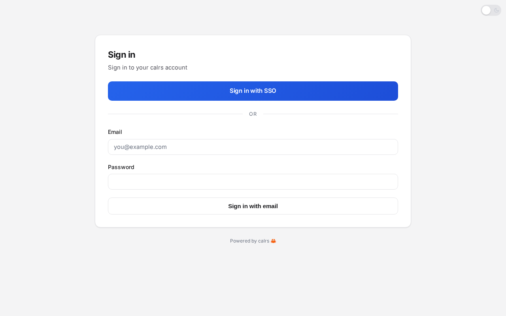

# Calendar Service (calrs)

At [calendar.openedusuite.org](https://calendar.openedusuite.org)
runs **calrs** — "Powered by calrs 🦀", as the page footer says —
the open-source booking service from
[cal.rs](https://cal.rs): appointment booking in the Cal.com style,
with the booked slots managed on a calendar backend. It is separate
from the [SOGo calendars](/sogo6/sogo-calendar-views), though
calendars can be connected: bookings appear in SOGo as a subscribed
calendar. Note that it currently has **no tile on the portal**: you
reach it only through a link, and access is managed by
administrators.

## Signing In

The sign-in page offers two paths:

- **Sign in with SSO** — through the openEduSuite account
- **Sign in with email** — with a calrs-specific account

### The Current SSO Hurdle

Signing in via SSO can end in an account error:

> Account error: An account with this email already exists. The
> identity provider has not verified that you own this address, so
> we cannot link them automatically. Contact an administrator.

If you see this, nothing went wrong on your side — the service
already knows your email address, but cannot yet connect it to your
openEduSuite account on its own. **Contact an administrator** (see
the [helpdesk](/suite/helpdesk-create-ticket)) to link the two, or
to receive email credentials.

Self-registration is disabled ("Registration is disabled") — new
accounts are likewise created by administrators. The public booking
pages (`/booking`) exist in the router, but until an event type is
published they answer "Event type not found".

## Until Access Is Set Up

Your working calendar remains [SOGo](/sogo6/sogo-calendar-views):
mail, calendars, and tasks in one place, with
[invitations](/sogo6/sogo-calendar-create-event) and
[delegation](/sogo6/sogo-delegation).

## Accessibility

| Action | Key |
|--------|-----|
| Move through form fields and buttons | `Tab` |
| Confirm the focused control | `Enter` |

- The sign-in page is a small, ordinary form: `Tab` moves you
  between the SSO button, email, password, and sign-in;
  `Enter` confirms.
- If you lose your orientation, `Ctrl+Home` (German keyboards:
  `Strg+Pos1`) returns you to the top of the page.
