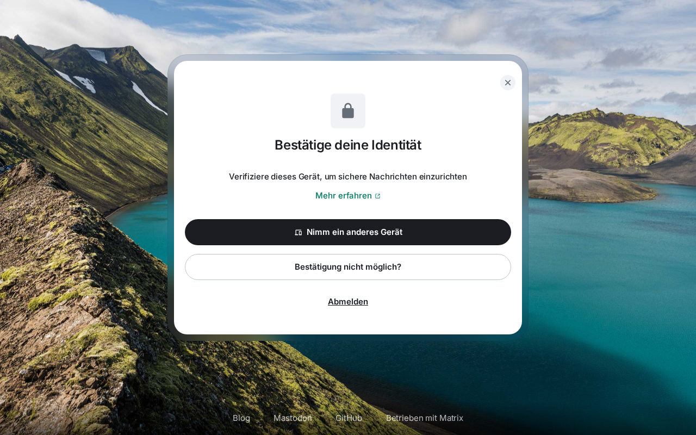

# Chat (Element)

The openEduSuite [chat](https://chat.openedusuite.org) runs on
[Element](https://element.io) — a chat built on the open Matrix
network. From the [portal](/suite/portal) tile, sign in with your openEduSuite account and you land directly
in the messenger: rooms for courses, working groups, or one-to-one
conversations, on any device.

## First Login: Verify Your Identity

The first time you sign in on a new device, Element asks you to
**verify your identity** — the university's Element greets you in
German ("Bestätige deine Identität"; in an English browser: "Confirm
your identity"). This step sets up the encryption that protects your
messages:

- **Nimm ein anderes Gerät** (use another device) — the recommended
  path if you already use Element elsewhere: the other device confirms
  the new one, and your message history stays intact.
- **Bestätigung nicht möglich?** (cannot verify?) — skips the
  verification, but with a price the app spells out before you
  continue: your account data, contacts, settings, and chat lists are
  kept, **but message history stored only on the server is lost**, and
  all devices and contacts must be verified again. Confirm with
  **Fortfahren** (continue) only if you have nothing to lose — on a
  fresh account, for example.

After skipping, the wizard asks two quick confirmations: a
**single sign-on** step ("use Single Sign-On to confirm your
identity") and the encryption setup (**Bestätigen** — confirm). Each
is one click; then **Fertig** (done) closes the dialog and the
messenger is yours.

If you use the chat seriously, verify properly on your second device
the first chance you get — one honest minute beats a lost history.

## The Messenger

Once inside, Element works like any modern messenger: rooms in the
left column, the conversation on the right, and the composer at the
bottom. Start rooms for your work, join the ones your courses and
colleagues share, and keep an eye on your notifications.

Element encrypts by design: what you write stays between you and your
rooms — including from the server operators, once devices are
verified.

## Accessibility

| Action | Key |
|--------|-----|
| Move through rooms and messages | `Tab` |
| Send the focused message | `Enter` |

- The messenger is keyboard-reachable: `Tab` moves you through rooms
  and the conversation, `Enter` sends what you have written.
- If you lose your orientation, `Ctrl+Home` (German keyboards:
  `Strg+Pos1`) returns you to the top of the page.
