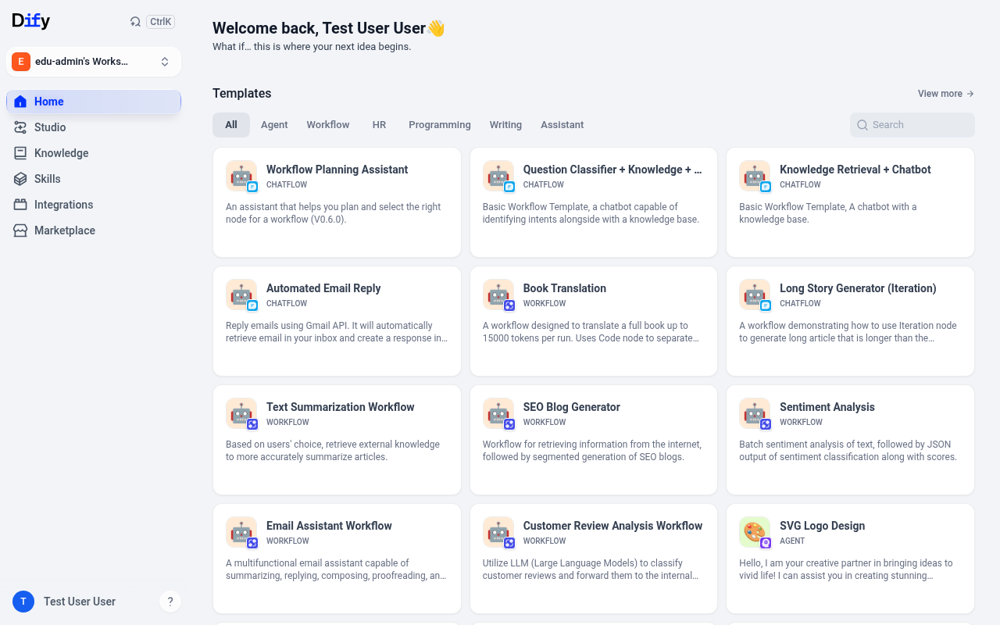

import PageSEO from '@site/src/components/PageSEO';

<PageSEO
  title="Build Your Own AI Assistants (Dify)"
  description="Assemble your own AI assistants and mini-apps — with templates, knowledge, and no programming"
  keywords={["Build", "Your", "Own", "Assistants", "Dify", "openEduSuite"]}
  suffix="openEduSuite"
  defaultKeywords={["higher education", "open source"]}
/>

# Build Your Own AI Assistants (Dify)

[Dify](https://dify.openedusuite.org) is the low-code builder for AI
applications: assemble your own assistants, chatbots, and small
workflows around the university's language models — without
programming. Where the [AI chat](/suite/ai-chat) is a ready-made
conversation, Dify lets you shape your own.

## The Overview

After signing in from the [portal](/suite/portal) with your openEduSuite account you see **Home** with
a greeting and **Templates** — ready-made starting points for agents,
workflows, and assistants, sorted by purpose (for example *Agent*,
*Workflow*, *Writing*, *Assistant*).

The navigation leads to the building blocks:

- **Studio** — your apps; every assistant you build lives here
- **Knowledge** — document collections your assistants can draw on
- **Skills** — reusable abilities your apps can call
- **Integrations** — connections to other services
- **Marketplace** — extensions and content from the community

## Building a First Assistant

Start from a template that matches your goal: open it from **Home**,
follow its setup, and adapt the prompt — the instructions that tell
the assistant its role and rules. Add documents under **Knowledge**
when the assistant should answer from your material, and test the
result in the preview before you share it.

Working in the shared workspace? Then everyone in it sees the apps —
coordinate before publishing, and ask at the
[helpdesk](/suite/helpdesk-create-ticket) when in doubt about what
belongs there.

## Accessibility

| Action | Key |
|--------|-----|
| Move through the navigation and templates | `Tab` |
| Open the focused element | `Enter` |

- The pages are ordinary web elements: `Tab` moves you through the
  navigation, templates, and lists, `Enter` opens the focused element.
- If you lose your orientation, press `Ctrl+Home` (German keyboards:
  `Strg+Pos1`) to return to the top of the page.

- **High contrast and dark mode:** contrast and dark themes come from the
  operating system or browser — Windows `Win+Ctrl+C`, macOS *Increase contrast*,
  or a browser extension such as Dark Reader. If the app offers its own dark
  theme, switch it in its settings; the navigation described above still applies.
