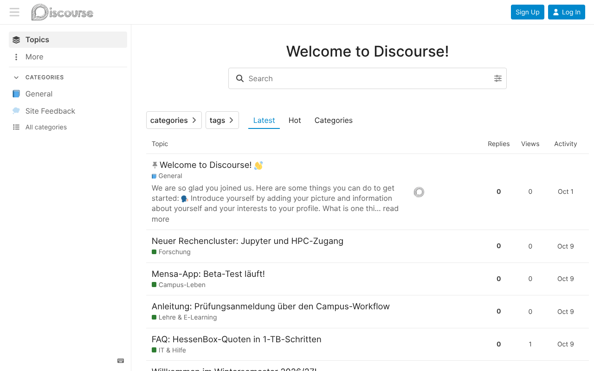

# Forum (Discourse)

[Discourse](https://discourse.openedusuite.org) is the
openEduSuite's forum — questions, announcements, and discussions
in threads. Reading is public: the tile opens straight onto the
categories (such as **General** and **Site Feedback**), no account
needed.

- **Categories** group the threads by topic; each category shows
  the latest activity.
- **Topics** are the threads themselves — latest post first, with
  replies nested below.

## Posting

To write, choose **Log In** on the forum and there
**Sign in with OpenID Connect** — that is the openEduSuite account
via SSO. After the redirect you are logged in and can open a topic
or reply with the **Reply** button.

## Accessibility

| Action | Key |
|--------|-----|
| Move through categories, topics, and buttons | `Tab` |
| Open the focused topic or button | `Enter` |

- The forum is a regular website in reading order: category list,
  topic list, then the buttons — `Tab` walks it, `Enter` opens.
- `Ctrl+Home` (German keyboards: `Strg+Pos1`) returns you to the
  top of the page.
