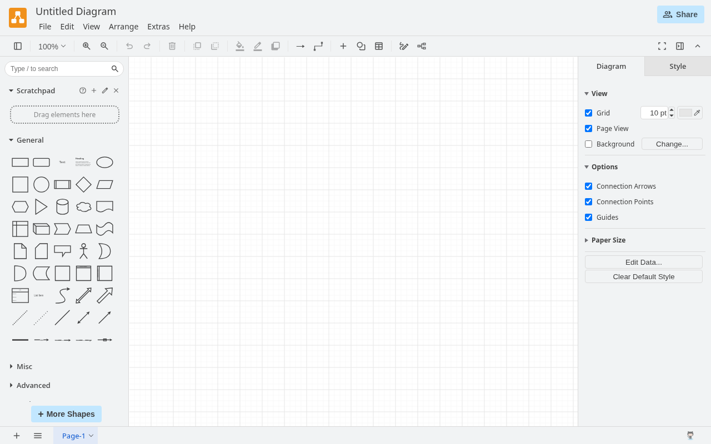

# Diagrams (draw.io)

[draw.io](https://drawio.openedusuite.org) is the diagram tool of
the openEduSuite — flowcharts, network plans, org charts, UML.
The portal tile **Diagrams (draw.io)** and the suite account open
the editor directly: no setup, the canvas is there.

- **File | Edit | View | Arrange** — the classic menu bar; every
  shape lives in the shape panel on the left, the drawing on the
  canvas.
- Diagrams are stored in the browser by default; use
  **File → Save as** to keep your work as a `.drawio` or `.xml`
  file — for example in your [OpenCloud](/suite/files) folder.
- **Extras** bundles the tool settings; **Help** opens the
  documentation of the editor.

## draw.io, Excalidraw, or Grist

- **[Excalidraw](/suite/excalidraw)** — quick sketches with a
  hand-drawn look; draw.io for precise, formal diagrams.
- **[Grist](/suite/grist)** — when the "diagram" is really data:
  relationships belong in tables.

## Accessibility

| Action | Key |
|--------|-----|
| Move through menus and panels | `Tab` |
| Open the focused menu element | `Enter` |

- The editor is a canvas application; the menu bar and panels are
  reachable by `Tab`, the canvas itself is worked with the mouse.
- `Ctrl+Home` (German keyboards: `Strg+Pos1`) returns you to the
  top of the page.
