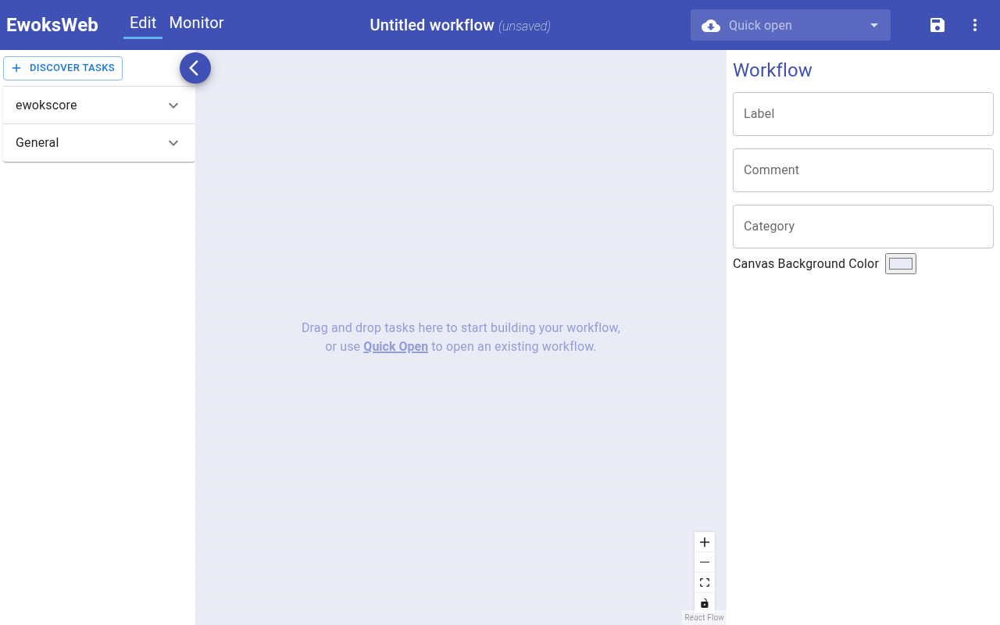

# Workflows (EWOKS)

[EWOKS](https://ewoks.openedusuite.org) is the openEduSuite's
workflow editor, based on the
[ewoks](https://ewoks.readthedocs.io) workflow system from the
ESRF. Sign in via the portal tile **Workflows (EWOKS)** and SSO —
the editor opens straight away.

The page offers two views, switchable at the top:

- **Edit** — assemble a workflow as a graph: tasks are nodes,
  connections carry data from one task to the next. The
  **DISCOVER TASKS** area lists available task packages (such as
  `ewokscore`); drag tasks into the canvas and connect them.
- **Monitor** — follow a running workflow: which node is being
  executed, which are done, and where execution stopped.

## When EWOKS, and When Not

- **Yes** — recurring, multi-step data processing: "whenever new
  data arrives, run these steps in this order" — reproducible and
  observable instead of a pile of scripts.
- **No** — one-off ad-hoc analysis (a notebook in
  [OpenScience](/suite/openscience) fits better) or simple automations
  that glue suite services together — that is [n8n](/suite/n8n)
  territory.

EWOKS workloads often run inside the workspaces of
[OpenScience](/suite/openscience); both tiles share the same SSO
account.

## Accessibility

| Action | Key |
|--------|-----|
| Move through editor elements and links | `Tab` |
| Open the focused element | `Enter` |

- The editor is a canvas application; keyboard paths through the
  graph are limited — the Edit/Monitor switch and the task list
  are reachable by `Tab`.
- `Ctrl+Home` (German keyboards: `Strg+Pos1`) jumps back to the
  top of the page.
