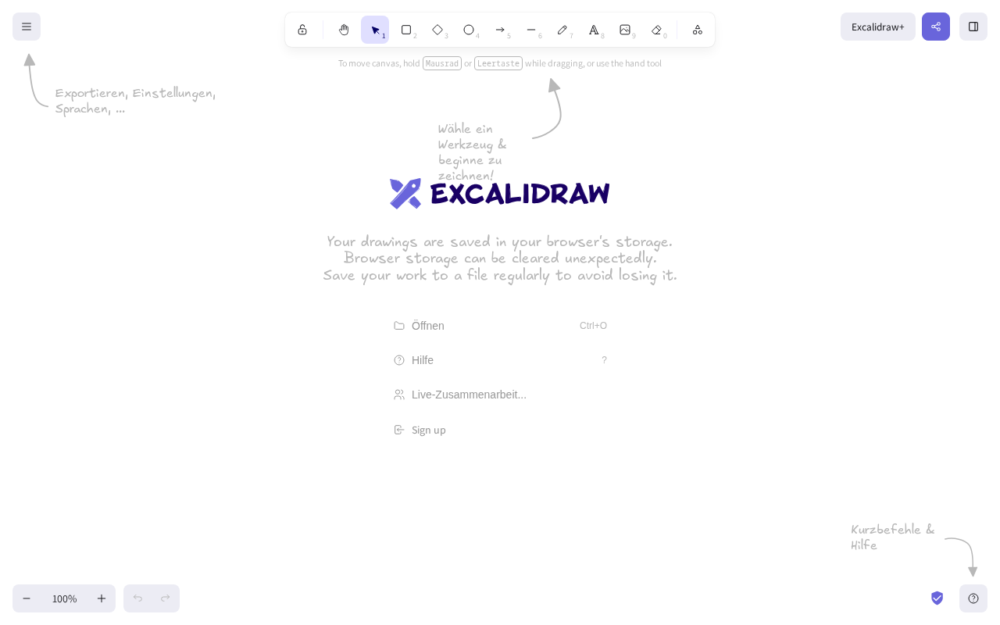

# Whiteboard (Excalidraw)

[Excalidraw](https://excalidraw.openedusuite.org) is the
whiteboard of the openEduSuite — sketch ideas, structures, and
processes with the hand-drawn look that invites iteration rather
than polish. The portal tile **Whiteboard (Excalidraw)** and the
suite account open the board directly.

- **Open** (`Ctrl+O`) loads a previous drawing; the toolbar holds
  rectangles, arrows, text, and the pen.
- The board saves in your **browser's storage** — the app says it
  plainly: browser storage can be cleared unexpectedly. Save your
  work to a file regularly and keep it in
  [OpenCloud](/suite/files) or [Nextcloud](/suite/nextcloud).
- **Help** opens the Excalidraw documentation with the full
  shortcut list.

## Excalidraw or draw.io

- **[draw.io](/suite/drawio)** — formal diagrams: UML, network
  plans, org charts.
- **Excalidraw** — thinking out loud: workshops, drafts, quick
  explanations.

## Accessibility

| Action | Key |
|--------|-----|
| Move through toolbar and dialogs | `Tab` |
| Open the focused element | `Enter` |

- The canvas itself is drawn with the mouse; toolbar, dialogs, and
  the help are reachable by `Tab`.
- `Ctrl+Home` (German keyboards: `Strg+Pos1`) returns you to the
  top of the page.
