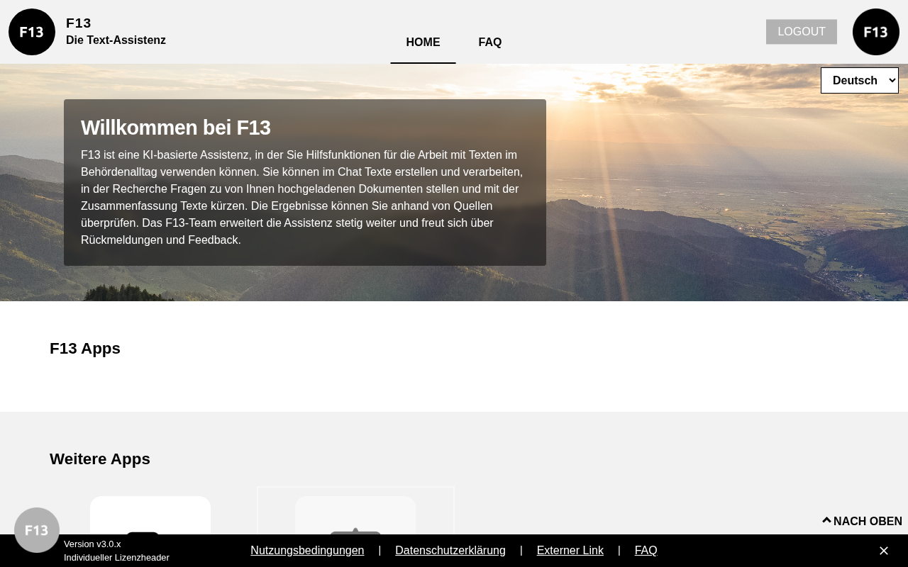

# Text Assistance (F13)

[F13](https://f13.openedusuite.org), "die Text-Assistenz", is AI
help for everyday text work: drafting letters, asking questions
about your own documents, and shortening long texts — with sources
you can check. It runs inside the openEduSuite, under its terms.

## Signing In — and the Consent Gate

Sign in with your openEduSuite account. On first entry F13 asks for
your agreement to its terms: read the **Nutzungsbedingungen** (terms
of use) and **Datenschutzerklärung** (privacy policy), then choose
**Einverstanden** (I agree). **Ablehnen und Seite verlassen**
(decline and leave) takes you out again — the choice is yours and
stays yours: the gate reappears until you agree.

## What F13 Does

The welcome screen names the core apps, and the team keeps adding:

- **Chat** — create and rework texts: drafts, replies, rewrites
- **Recherche** — upload documents and ask questions about them
- **Zusammenfassung** — shorten long texts to their core

Results come with sources so you can verify what the assistance
tells you — the honest way to use AI in official work. **FAQ**
answers common questions; the language switch
(**Deutsch / English**) sits at the top.

## F13 and Open WebUI

Both chat with AI. F13 is the tuned specialist for administrative
text work with its own apps and source checks; Open WebUI is the
general workshop where you pick any model for any task.

## Accessibility

| Action | Key |
|--------|-----|
| Move through navigation and buttons | `Tab` |
| Open the focused app or link | `Enter` |

- F13's pages are ordinary web elements: `Tab` moves you through
  navigation, the apps, and the consent buttons; `Enter` activates
  the focused one.
- **NACH OBEN** (to top) is a screen-wide shortcut back to the
  start of the page; `Escape` closes overlays.
