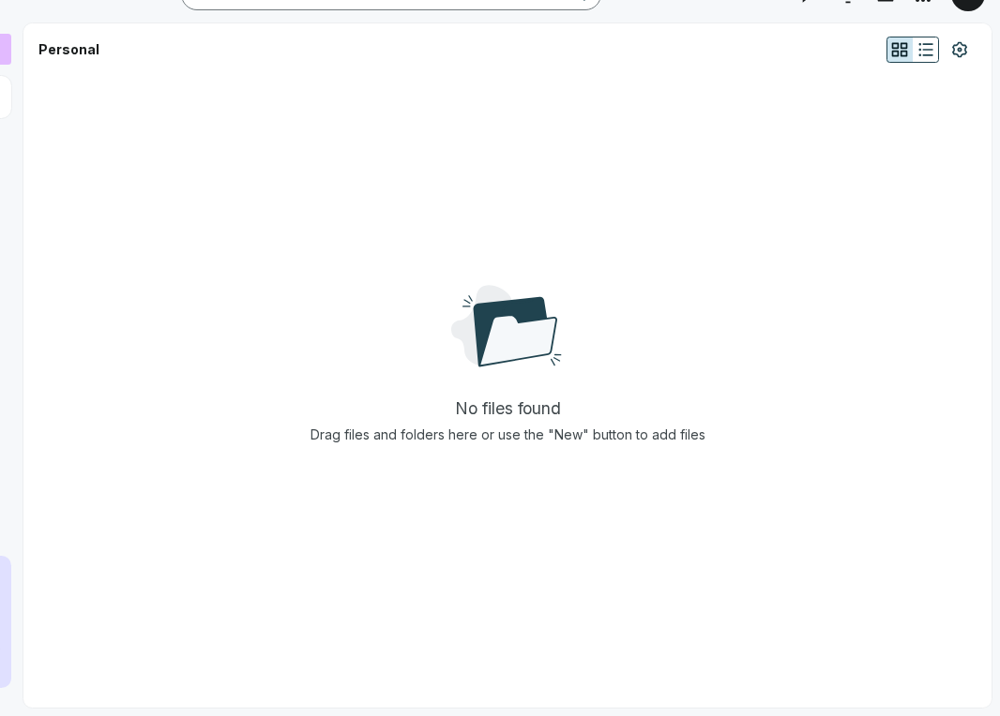
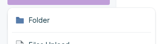
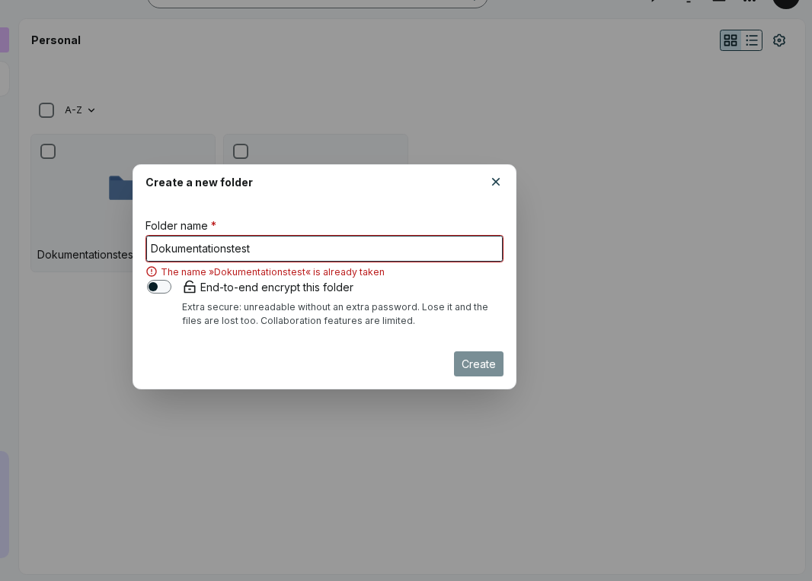
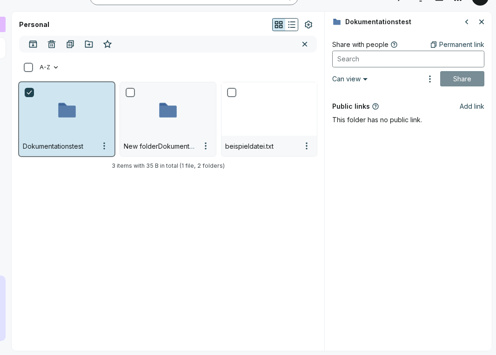
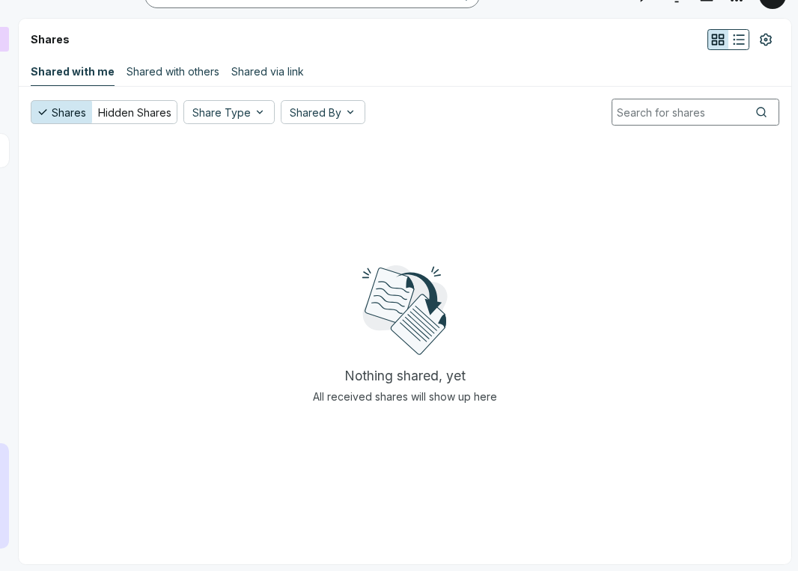

import VideoFallback from '@site/src/components/VideoFallback';

# Files with OpenCloud

[OpenCloud](https://cloud.openedusuite.org) is your file storage in the
openEduSuite: keep documents, images and folders in your personal
space, share them with others, and reach them from anywhere. Open it
from the [portal](/suite/portal) tile **OpenCloud** or go there
directly — signing in works with your openEduSuite account.

## Your Personal Space

After signing in you land in your personal space: **All files** shows
your files and folders.

The navigation offers:

- **Personal** — your own files, with **All files**, **Favorites**, and
  **Deleted files**
- **Shares** — files shared with you and by you
- **Spaces** — shared areas for teams and projects

## Adding Files

Choose **New** to create or upload:

- **Folder** — a new folder: the dialog asks for the **Folder name**,
  and with **Create** the folder lands in **All files**
- **Files Upload** — upload one or more files from your computer
- **Folder Upload** — upload an entire folder
- **Note**, **Markdown file**, **Shortcut** — create these directly in
  the cloud

**Files Upload** opens your computer's file picker: choose one or more
files, and they land in **All files**.

<VideoFallback
  srcMp4="/docmakerai/clips/cloud-create-folder.mp4"
  poster="/docmakerai/clips/cloud-create-folder.png"
  alt="Short clip: creating a new folder — New menu, folder name, create"
  width="640"
  height="400"
/>

## Working With Files

Select a file or folder — right-click it, or open the **⋯** menu at the
end of its row — and the actions appear above the table: **Download**,
**Delete**, **Copy to**, **Move to**, **Add to favorites**. The row
menu itself offers **Open**, **Share**, **Copy permanent link**, and
more.

### Sharing

Choose **Share** and the share panel opens next to the file:

- **Share with people** — invite people directly; with **Can view**
  they can look, and richer roles can be picked as your university
  enables them
- **Permanent link** — copy a stable link to this exact file
- **Public links** — add a link anyone with it can use (**Add link**);
  without one, the panel says so plainly ("This folder has no public
  link.")

## Shares

Under **Shares** you find everything that is shared:

- **Shared with me** — files and folders colleagues shared with you
- **Shared with others** — what you have shared
- **Shared via link** — your public share links

Deleted files first go to **Deleted files** — from there you can
restore them or remove them permanently.

If the service stays closed to you, the
[helpdesk](/suite/helpdesk-create-ticket) reaches its operators.

## Accessibility

| Action | Key |
|--------|-----|
| Move through the file list and buttons | `Tab` |
| Open the focused file or menu entry | `Enter` |
| Open the New menu | `Enter` on the New button |

- The files view is a standard web list: `Tab` moves you through files
  and buttons, `Enter` opens the focused element.
- If you lose your orientation, press `Ctrl+Home` (German keyboards:
  `Strg+Pos1`) to return to the top of the page.

- **High contrast and dark mode:** contrast and dark themes come from the
  operating system or browser — Windows `Win+Ctrl+C`, macOS *Increase contrast*,
  or a browser extension such as Dark Reader. If the app offers its own dark
  theme, switch it in its settings; the navigation described above still applies.
