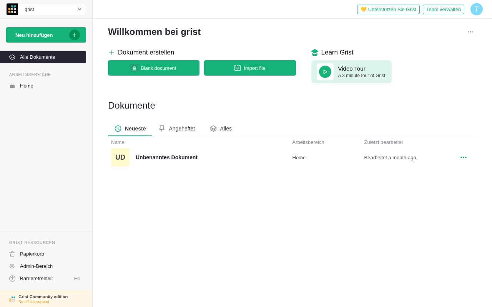

import PageSEO from '@site/src/components/PageSEO';

<PageSEO
  title="Forms and Tables (Grist)"
  description="Sovereign data capture — forms, tables, and documents you keep under control"
  keywords={["Forms", "and", "Tables", "Grist", "openEduSuite"]}
  suffix="openEduSuite"
  defaultKeywords={["higher education", "open source"]}
/>

# Forms and Tables (Grist)

The openEduSuite's [data capture](https://grist.openedusuite.org)
runs on [Grist](https://getgrist.com) — spreadsheets that grow up
into databases, without a line of code. Forms feed tables, tables
become documents, and everything stays in your hands: "sovereign
capture", as the welcome screen says.

## Signing In

The [portal](/suite/portal) tile signs you into Grist with your openEduSuite account. Your home lists
**Alle Dokumente** (all documents) organized in workspaces —
**Home** to start — with **Papierkorb** (trash) for what you removed
and an **Admin-Bereich** for team administration.

## Starting a Document

**Neu hinzufügen** (add new) creates the next thing: a document,
blank or from a template. Inside a document, Grist works like a
spreadsheet at first — columns, cells, formulas — but each page can
become a card view, a form for data entry, or a chart. When you need
the same data as a form for others to fill, that is a document
setting, not a separate tool.

Grist links to its own resources from the sidebar, including a
dedicated **Barrierefreiheit** (accessibility) page.

## When Grist, and When Not

- **Lists, registrations, small inventories** — Grist, start to
  finish: form in, table out
- **Structured work with due dates and assignees** —
  [OpenProject](/suite/openproject)
- **One-off collaborative writing** — [Typst](/suite/typst) or the
  [wiki](/suite/xwiki)

If the service stays closed to you, the
[helpdesk](/suite/helpdesk-create-ticket) reaches its operators.

## Accessibility

| Action | Key |
|--------|-----|
| Move through the workspace tree and documents | `Tab` |
| Open the focused document | `Enter` |

- The home page is an ordinary sidebar-and-list layout: `Tab` moves
  you through workspaces and documents, `Enter` opens the focused
  one.
- Grist ships its own accessibility statement — find it under
  **Barrierefreiheit** in the sidebar. In tables, `Escape` leaves an
  active cell; `Ctrl+Home` (German keyboards: `Strg+Pos1`) returns
  you to the top of the page.

- **High contrast and dark mode:** contrast and dark themes come from the
  operating system or browser — Windows `Win+Ctrl+C`, macOS *Increase contrast*,
  or a browser extension such as Dark Reader. If the app offers its own dark
  theme, switch it in its settings; the navigation described above still applies.
