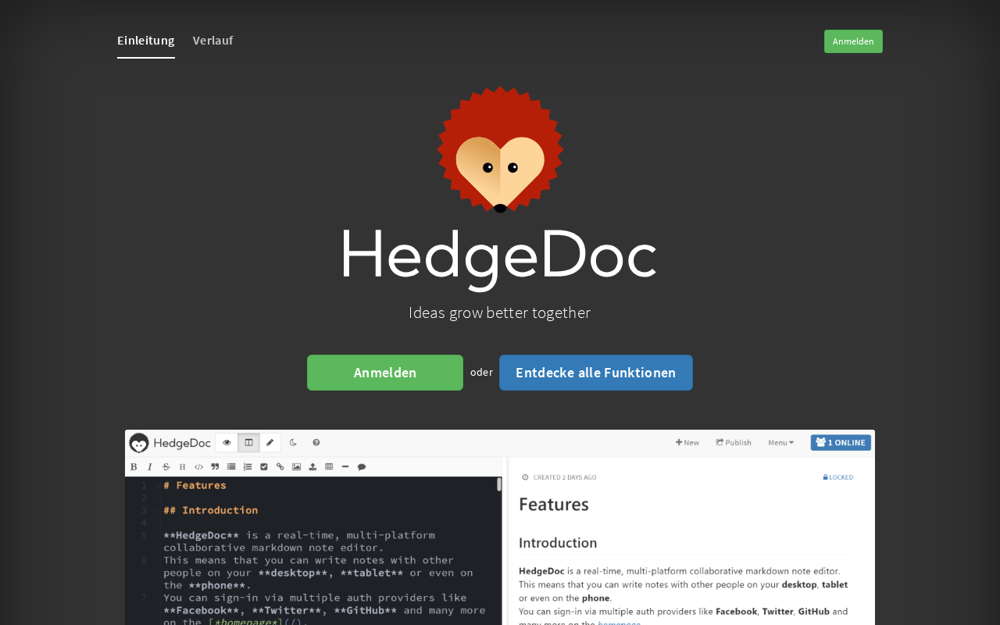

# Notes (HedgeDoc)

[HedgeDoc](https://hedgedoc.openedusuite.org) is the openEduSuite's
service for shared Markdown notes — several people writing in one
document at the same time, live. Open the [portal](/suite/portal) tile **HedgeDoc**
and pass the suite sign-in: the landing page greets you with
"Ideas grow better together".

## The Landing Page

The navigation bar holds three entries — German by default:
**Einleitung** (introduction), **Verlauf** (history) and
**Anmelden** (sign in). Under the heading sit two buttons,
**Anmelden** and **Entdecke alle Funktionen** (explore all
features), and three cards name what the editor does:

- **Kollaboration in Echtzeit** — real-time collaboration
- **Unterstützt Diagramme und MathJax** — diagrams and formulas
- **Unterstützt Präsentationsmodus** — a note as slides

Every card links into the built-in **Features** note, which
documents the editor in detail. The language menu in the footer
offers some 45 languages, English and German among them, and the
footer names the software — "Betrieben mit HedgeDoc" — with the
links **Versionen** (release notes) and **Quelltext** (source
code, pointing at HedgeDoc 1.10.4).

## Reading Notes

- **Verlauf** opens the panel **Lokaler Browserverlauf**: a table
  with the columns **Titel** and **Uhrzeit** listing the notes
  this browser has opened. A fresh browser shows the empty state
  **Kein Verlauf**; the link **Vom Browser importieren** pulls
  older visits out of the browser's own history.
- **Einleitung** points at the instance's introduction note. It
  is closed to anonymous visitors — the page answers "You are
  not allowed to access this page. Maybe try logging in?"
- Notes live at their own addresses, and access differs per
  note: the **Features** note opens without signing in and serves
  as the built-in manual, while the introduction note does not.
  The button **Entdecke alle Funktionen** leads to that manual.

## Signing In to HedgeDoc

The suite sign-in opens the door to the service, but it does not
sign you in to HedgeDoc itself — the navigation keeps showing
**Anmelden** until you take one more step:

1. Choose **Anmelden**. A dialog **Methode wählen** (choose
   method) opens.
2. Pick a way in: **Einloggen über Keycloak** or
   **Einloggen über E-Mail** — each label sits in the dialog on
   one line. The tabs **Anmelden** and **Registrieren** switch
   between signing in and registering a HedgeDoc account.

As of November 2026 the Keycloak option runs into an error: the
redirect answers "Internal Server Error" and you land back on the
start page, still signed out. **Einloggen über E-Mail** asks for
an email address and password; the **Registrieren** tab holds the
sign-up form.

## Inside a Note

The toolbar above a note offers:

- **Neu** — start a new note
- **Veröffentlichen** — publish. "If you want to share a
  read-only note, simply press the publish button and copy the
  URL", as the Features note puts it
- **Menü** — a menu with **Extra**, **Version** (the note's
  revisions), **Präsentationsmodus** (slide mode),
  **Importieren** (from a Gist or the clipboard) and
  **Download** (as Markdown, HTML or raw HTML)

A counter shows how many people are currently in the note —
"1 ONLINE" when you are alone — and the status line names the
note's age, such as "ERSTELLT VOR EINEM TAG" (created a day ago),
next to badges like **LOCKED**. On desktop and tablet the editor
offers three layouts — View (result only), Both (editor and
result side by side) and Edit (editor only); on mobile just View
and Edit. A night mode darkens the screen.

Markdown is the format: headings, lists, code — and with MathJax
support and the presentation mode, formulas and slides too.

## HedgeDoc and Its Neighbors

- [Grist](/suite/grist) — structured tables and forms instead of
  free text.
- [XWiki](/suite/xwiki) — long-lived knowledge, not living
  documents.
- [Typst](/suite/typst) — papers with professional typesetting.

If the service stays closed to you, the
[helpdesk](/suite/helpdesk-create-ticket) reaches its operators.

## Accessibility

| Action | Key |
|--------|-----|
| Move through links and menus | `Tab` |
| Follow the focused link | `Enter` |

- The landing page is a regular page in reading order: navigation,
  heading, buttons, cards, footer — `Tab` walks it, `Enter` opens.
- `Ctrl+Home` (German keyboards: `Strg+Pos1`) returns you to the
  top of the page.

- **High contrast and dark mode:** contrast and dark themes come from the
  operating system or browser — Windows `Win+Ctrl+C`, macOS *Increase contrast*,
  or a browser extension such as Dark Reader. If the app offers its own dark
  theme, switch it in its settings; the navigation described above still applies.
