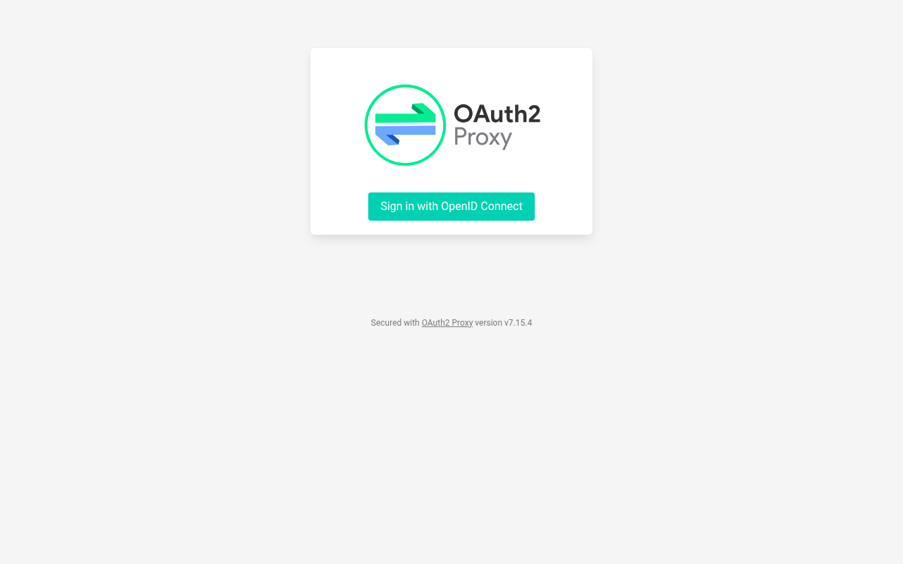
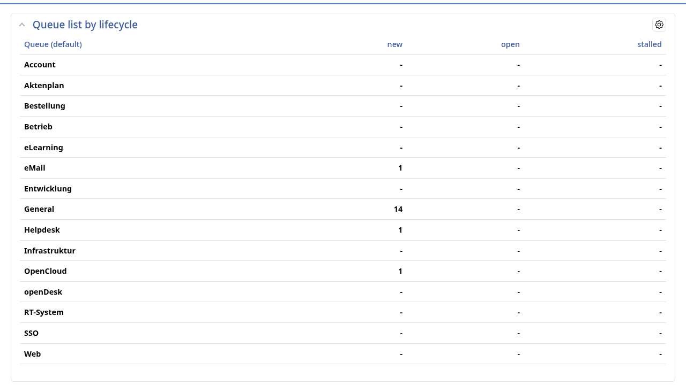
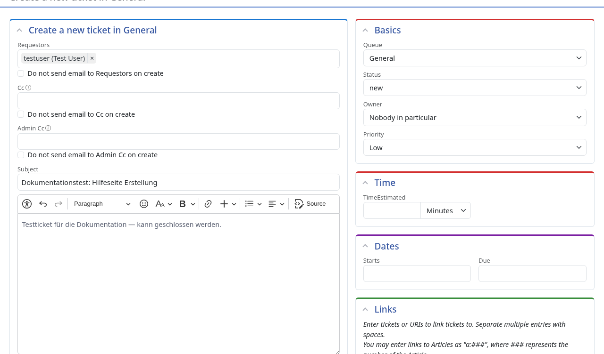

import PageSEO from '@site/src/components/PageSEO';

<PageSEO
  title="Helpdesk: Create a Ticket"
  description="How to reach the helpdesk and submit a support ticket in Request Tracker (RT)"
  keywords={["Helpdesk:", "Create", "Ticket", "openEduSuite"]}
  suffix="openEduSuite"
  defaultKeywords={["higher education", "open source"]}
/>

import VideoFallback from '@site/src/components/VideoFallback';

# Helpdesk: Create a Ticket

The helpdesk is where you ask for help: broken access, questions about a
service, requests for your workgroup. It runs on
[Request Tracker (RT)](https://rt.openedusuite.org) — open it and sign in
with your openEduSuite account if asked — start from the [portal](/suite/portal) tile.

## Signing In to the Helpdesk

The helpdesk is part of the openEduSuite single sign-on: if you are
already signed in elsewhere, you usually go straight through. If a
**Sign In** page appears, choose
**Sign in with OpenID Connect** — after logging in once you are back in
the helpdesk. See [Signing In](/suite/sso-login) for how the login works.

## The Dashboard

After signing in you see your dashboard: a quick way to create tickets
and a list of your open tickets.

## Creating a Ticket

Open **Create Ticket** and fill in:

- **Queue** — what the ticket is about; pick the one that fits best
  (for example *General* or *Helpdesk*)
- **Requestors** — who the ticket is for; usually yourself — start
  typing your name or email address and pick the suggestion
- **Subject** — a short summary of your problem
- The large text field — describe your request: what you did, what you
  expected, and what happened instead
- Optionally: **Cc** for people who should follow along, and further
  details like priority or a due date

Choose **Create** to submit the ticket. The helpdesk team takes it from
there — you receive replies by email and can follow the ticket status in
the helpdesk.

<VideoFallback
  srcMp4="/docmakerai/clips/rt-create.mp4"
  poster="/docmakerai/clips/rt-create.png"
  alt="Short clip: filling in the Create Ticket form in the helpdesk"
  width="640"
  height="400"
/>

## Tips for Good Tickets

- One topic per ticket — two problems are two tickets
- Write what you already tried
- For error messages: copy the exact text into the ticket

## Accessibility

| Action | Key |
|--------|-----|
| Move through form fields | `Tab` |
| Commit an entry in the requestor field | `Enter` |
| Send the form | `Enter` on the Create button |

- The ticket form is a standard form: `Tab` moves through the fields in
  order, and `Enter` activates the focused button. In the requestor
  field, `Enter` accepts the suggested entry.
- The message field is a rich text editor; `Tab` moves you into and out
  of it. If you lose your orientation, press `Ctrl+Home` (German
  keyboards: `Strg+Pos1`) to return to the top of the page.

- **High contrast and dark mode:** contrast and dark themes come from the
  operating system or browser — Windows `Win+Ctrl+C`, macOS *Increase contrast*,
  or a browser extension such as Dark Reader. If the app offers its own dark
  theme, switch it in its settings; the navigation described above still applies.
