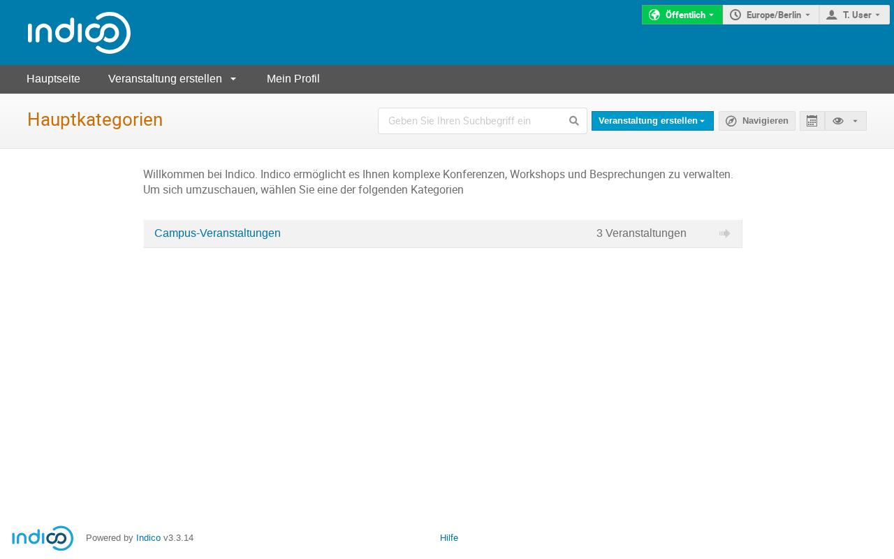

import PageSEO from '@site/src/components/PageSEO';

<PageSEO
  title="Events (Indico)"
  description="Lectures, conferences, and campus events — announced, booked, and archived"
  keywords={["Events", "Indico", "openEduSuite"]}
  suffix="openEduSuite"
  defaultKeywords={["higher education", "open source"]}
/>

# Events (Indico)

The openEduSuite [event calendar](https://indico.openedusuite.org)
runs on [Indico](https://getindico.io) — the event platform born at
CERN. It is where campus life is announced: lectures, conferences,
and meetings with dates, rooms, and materials in one place.

## Signing In

Open the Indico tile in the [portal](/suite/portal); Indico greets you in your language (German by default:
**Einloggen**). Its login dialog offers two paths: a local Indico
account, or — the one for you — **openEduSuite SSO** under "oder
verbinden mit": one click through the university sign-in and you are
in, with your name in the top bar.

## Home and Categories

The home page lists the **categories** — today a single public one,
**Campus-Veranstaltungen** (campus events), holding its events.
Open a category to browse what is coming; open an event for its
times, place, and attached materials. The toolbar's calendar view
switches between list and timetable.

## Creating an Event

**Veranstaltung erstellen** (create event) starts the wizard: pick
the category, set title and time, add a room — and the event is
announced to everyone watching the category. Registration, if the
event asks for it, is a click for attendees.

Search (**Durchsuche Indico**) reaches across everything public.

If the service stays closed to you, the
[helpdesk](/suite/helpdesk-create-ticket) reaches its operators.

## Accessibility

| Action | Key |
|--------|-----|
| Move through categories, events, and dialogs | `Tab` |
| Open the focused category or event | `Enter` |
| Close dialogs and dropdowns | `Escape` |

- Indico's pages are ordinary web elements: `Tab` moves you through
  the category list and event pages, `Enter` opens the focused one,
  `Escape` closes dialogs.
- If you lose your orientation, `Ctrl+Home` (German keyboards:
  `Strg+Pos1`) returns you to the top of the page.

- **High contrast and dark mode:** contrast and dark themes come from the
  operating system or browser — Windows `Win+Ctrl+C`, macOS *Increase contrast*,
  or a browser extension such as Dark Reader. If the app offers its own dark
  theme, switch it in its settings; the navigation described above still applies.
