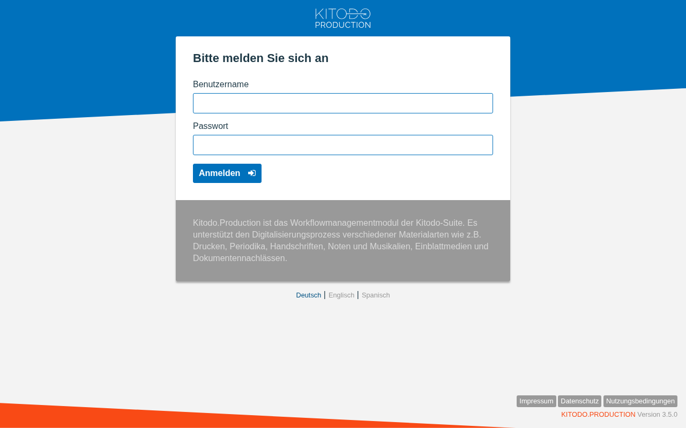

# Library (Kitodo)

Kitodo.Production is the openEduSuite's tile for digitized
collections — presenting scans and metadata of library and archive
material, and managing the digitization workflow behind it. The
[portal](/suite/portal) tile opens `https://kitodo.openedusuite.org/kitodo/` —
with your suite account you pass the sign-in gate directly.

- The suite sign-in (SSO) opens the door to the service.
- **Kitodo asks for its own sign-in** on top: *Bitte melden Sie
  sich an* — user name and password of your Kitodo account, issued
  by the administrators. The suite account alone is not a Kitodo
  account.

The login page presents itself in German by default; the language
switch above the form offers **Deutsch**, **Englisch**, **Spanisch**.
The sign-in form carries the fields **Benutzername** (user name) and
**Passwort** (password), and the button **Anmelden** (sign in). In
the English UI the same form reads **Username**, **Password**, and
**Sign in**.

## For Readers, For Staff

- **Readers** reach digitized material once collections are
  published; the catalog view is part of the Kitodo suite
  (`Kitodo.Presentation`).
- **Digitization staff** work in the workflow module shown here:
  processes, tasks, and scans from template to finished digital
  copy.

If you need access or a collection stays dark, the
[helpdesk](/suite/helpdesk-create-ticket) connects you with the
library team.

## Accessibility

| Action | Key |
|--------|-----|
| Move through form fields and links | `Tab` |
| Submit the focused form | `Enter` |

- The sign-in page is an ordinary form: user name and password
  fields, then the sign-in button — `Tab` walks it in order.
- `Ctrl+Home` (German keyboards: `Strg+Pos1`) returns you to the
  top of the page.
