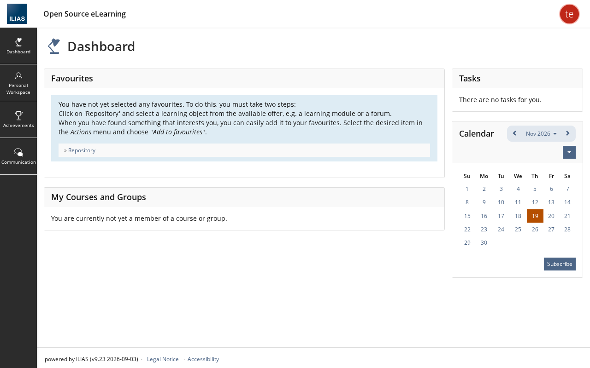

# Learning platform (ILIAS)

The openEduSuite runs its own learning platform:
[ILIAS](https://lms.openedusuite.org). Courses, learning
materials, and tests of the suite live here. The portal tile
**Learning platform (ILIAS)** and the suite account open the
**Dashboard** directly.

- **Dashboard** greets you after sign-in: your courses and the
  personal desktop.
- **Personal Workspace** holds your own files and bookmarks;
  **Achievements** shows certificates and completed courses.
- **Communication** bundles mail and forum functions of your
  courses.

Note: the tile **ILIAS** under *UNIVERSITÄT* points to the
university-wide ILIAS of the Philipps-Universität (external) —
the suite instance here is the openEduSuite's own, with your
suite account.

## Accessibility

| Action | Key |
|--------|-----|
| Move through menus and content | `Tab` |
| Open the focused element | `Enter` |

- ILIAS is a classic web application in reading order: main
  menu, content area — `Tab` walks it.
- `Ctrl+Home` (German keyboards: `Strg+Pos1`) returns you to the
  top of the page.
